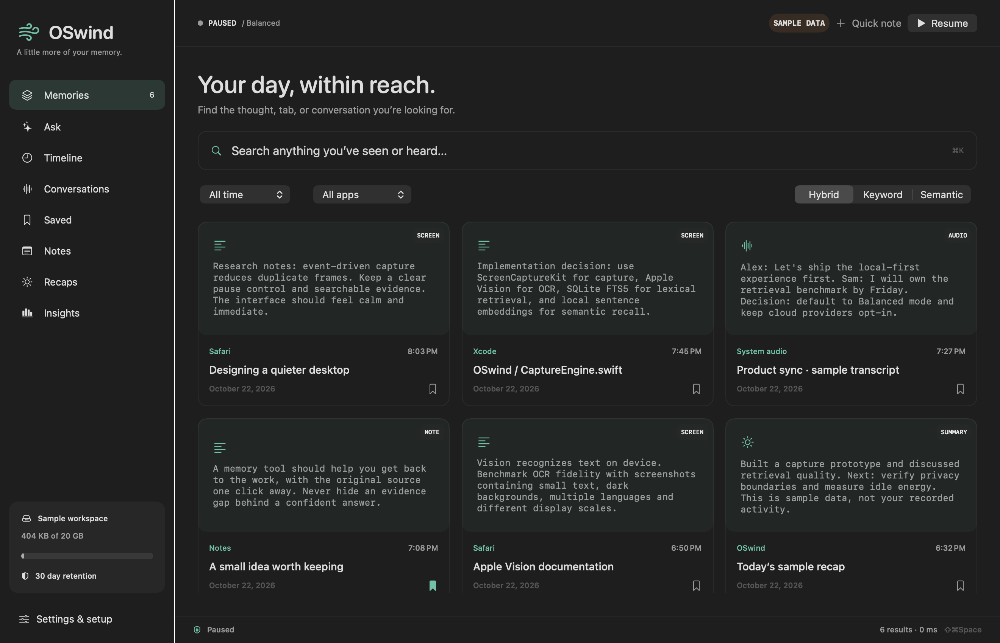

# OSwind

A native, local-first memory for your Mac. Capture the windows you choose, search what you saw and heard, and ask questions with the original evidence alongside the answer.

**v0 is in active development.** Broad competitive parity and a top-three ranking are goals; they are not verified claims. See [delivery ledger](docs/PROGRESS.md), [competitive research](docs/landscape.html), and [benchmarks](benchmarks/README.md).



*Native sample workspace rendered for layout review; these are synthetic memories.*

## Build & run

macOS 14+, Apple Silicon recommended, Xcode 16+ for core features. Building the Apple Intelligence integration requires an SDK with FoundationModels (Xcode 26+); it runs only on macOS 26+ with Apple Intelligence enabled. No third-party Swift dependencies.

```bash
swift test
scripts/build-app.sh release
open dist/OSwind.app
```

For an isolated sample workspace: `open dist/OSwind.app --args --demo`. Demo records are labeled sample data and stored separately.

To install locally, copy `dist/OSwind.app` to `/Applications`. The build is ad-hoc signed, not Developer ID notarized. Permission grants attach to the app's identity and location; rebuilds may require granting access again.

## What v0 contains

- ScreenCaptureKit focused-window capture and optional multi-display snapshots; Vision OCR and bounded Accessibility text extraction.
- Light / Balanced / Detailed capture profiles, perceptual duplicate suppression, idle/sleep/lock suspension and thermal/low-power backoff.
- SQLite WAL + FTS5 keyword search, Apple sentence embeddings or optional local GPU Qwen3 embeddings, model-versioned indexes and hybrid ranking.
- Native timeline, app/date filters, saved memories, notes/tags, OCR region inspection, source URLs, capture health and storage insights.
- Durable local Ask conversations, follow-up subject context, per-turn evidence cards/scope, cancellation, chat deletion and Markdown export. Deleting or revising a source removes chat answers that cited it.
- Evidence-only answers without downloads; on-device Apple Intelligence; local Ollama; optional OpenAI-compatible and Anthropic BYOK. Keys live in Keychain. Cloud context is opt-in.
- Optional microphone and system-audio capture, 30-second bounded chunks, local whisper.cpp transcription, separate source labels, silence gate, raw-chunk deletion.
- App/domain/window exclusions, common-secret pattern redaction with raw-image suppression, retention and storage pruning, deletion, JSON export/import.
- Menu bar controls, global search shortcut ⇧⌘Space, pause ⇧⌘P, login item support, setup and permissions UI.
- Read-only, token-authenticated localhost API; MCP stdio server for trusted local assistants.

These are implementation claims. The progress ledger separates automated tests, live verification and outstanding validation. [View the native chat sample](assets/chat-sample.png).

## Local models

```bash
scripts/setup-models.sh
```

Installs Ollama and whisper.cpp through Homebrew if missing, starts a loopback Ollama server if necessary, pulls `qwen3:4b` and `qwen3-embedding:0.6b`, and checksum-verifies Whisper `base.en` from its publisher's Hugging Face repository. Model weights remain outside this Git repository. Whisper defaults to `~/Library/Caches/OSwind/models/ggml-base.en.bin`. Settings → Models offers independent answer/search models, installed-model discovery, download progress/cancel, runtime GPU residency and resumable search indexing. The app can start an installed Ollama server with cloud inference disabled; it never replaces an existing server. Large downloads are optional for capture and keyword search.

Apple's default sentence embeddings are English. For multilingual text, select Ollama embeddings in Models and build the additional index. Hybrid search warns when falling back to keywords or when vectors cover only part of the range. Semantic-only reports model failure explicitly. Vision OCR auto-detects supported languages. Choose a multilingual Whisper model and language for non-English speech. No unmeasured GPU speedups are promised: the runtime's `ollama ps` and whisper.cpp backend logs establish actual model execution.

## Command line

The executable is `oswindctl` (a distinct name avoids case-insensitive filesystem collisions with `OSwind.app`).

```bash
swift run oswindctl doctor
swift run oswindctl note "Maya owns Friday's release checklist"
swift run oswindctl search --mode hybrid "release checklist"
swift run oswindctl ask --provider apple "Who owns the checklist?"
swift run oswindctl chat new
swift run oswindctl chat ask CONVERSATION_ID "Who owns the checklist?"
swift run oswindctl chat export CONVERSATION_ID conversation.md
swift run oswindctl models list
swift run oswindctl reindex --model qwen3-embedding:0.6b --use-model
swift run oswindctl eval-retrieval --model qwen3-embedding:0.6b
swift run oswindctl benchmark --count 1000
swift run oswindctl benchmark-vectors --count 100000
swift run oswindctl help
```

Pass `--data /absolute/directory` or `OSWIND_DATA_DIR` for an isolated store. Normal data lives in `~/Library/Application Support/OSwind`. Never commit a real activity database, screenshots, exported memories, or credentials.

For an unlocked Mac with capture permission, `python3 scripts/live-capture-smoke.py` checks real targeted capture/OCR, exclusions, secret redaction, image suppression and deletion using disposable synthetic apps and a temporary store.

## Integrations

See [API & MCP](docs/INTEGRATIONS.md). Enabling MCP gives its client access to your local memory. That client may send results to its own provider. OSwind does not control another assistant's data policy.

## Privacy boundaries

Capture begins when you resume it. Audio sources start independently; Pause stops both screen and audio. Explicit Stop audio finishes a short final segment; privacy pauses discard pending chunks. Default capture is the focused window. Browser capture fails closed when domain rules need a URL and Accessibility cannot provide one. Full-display mode masks all browser apps because background-tab URLs cannot be verified. Window-title detection of private browsing is best effort and varies by browser and language.

Secret redaction is pattern-based, not a guarantee of complete PII removal. Detected secrets suppress screenshot retention as well as redacting text. Audio privacy is separate: a one-second foreground privacy check stops audio on an exclusion, and chunks are checked again before queueing; raw chunks exist briefly during local processing. Changes within a polling interval remain a limitation. Transcripts contain microphone/system labels, not speaker identities.

Chat follow-ups use up to three earlier user questions to resolve the subject and retrieve fresh evidence within the current scope. Earlier generated prose is not reused as evidence. Chat source text is hydrated from the live store, rather than copied into a second source archive. Deleting/revising a source removes citing turns and resets their session titles; retention also ages out chat turns. Explicitly saved notes, copied text and exported files are independent copies. Apple generated claims use guided source-number output; valid citation numbers do not prove factual support.

SQLite and images are local with restrictive directory permissions; v0 does **not** yet provide an encrypted application vault or biometric unlock. Use FileVault. Ordinary deletion cannot guarantee forensic erasure from APFS snapshots, backups or exports. No analytics, advertising, account, vendor telemetry or automatic cloud fallback is included.

## Development

Original implementation, MIT licensed. Competitor repositories informed research; no competitor source has been vendored. Contributions should add meaningful tests, update the feature ledger, preserve privacy boundaries and avoid unsupported parity/performance claims. See [architecture](docs/ARCHITECTURE.md).
