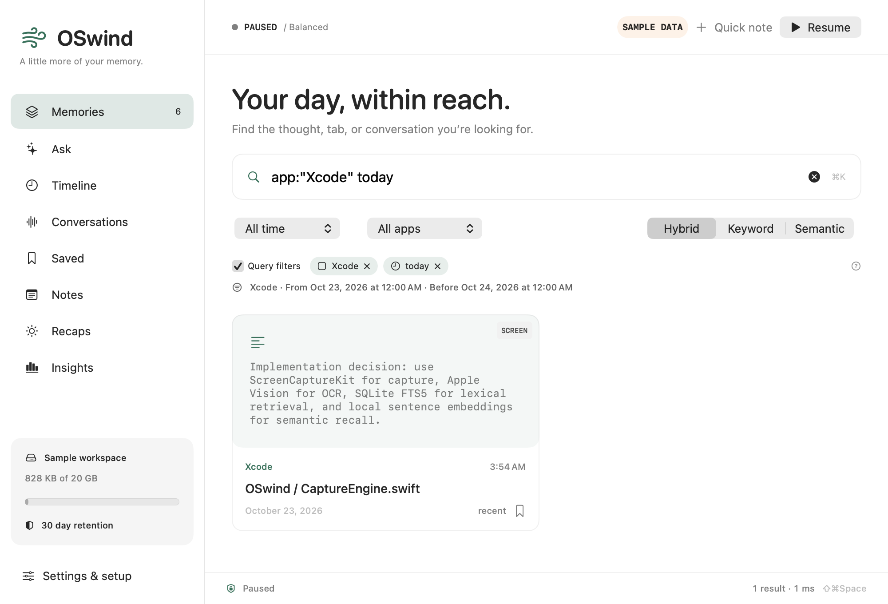
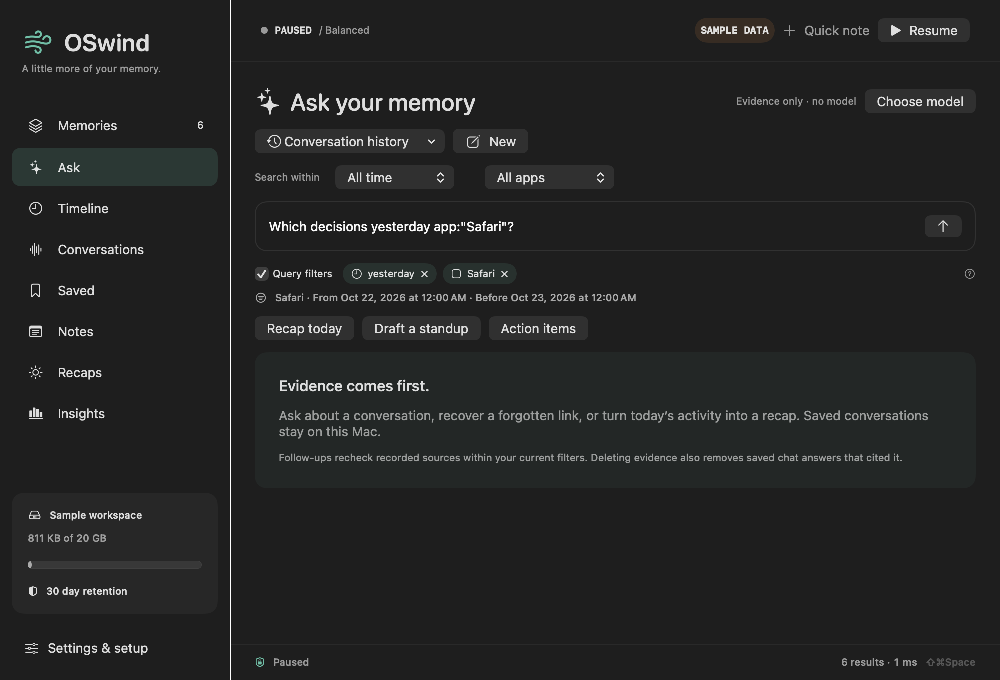

# OSwind

A native, local-first memory for your Mac. Capture the windows you choose, search what you saw and heard, and ask questions with the original evidence alongside the answer.

**v0 is in active development.** The [feature ledger](docs/features.json) tracks 78 requirements across [20 researched offerings](docs/landscape.html). Broad parity and a top-three ranking remain goals. Sustained desktop power, complete migrations/sync, notarized distribution and matched whole-product competitor measurements are still open.

The latest qualification adds [collector vault lock-phase evidence](docs/VAULT-COLLECTOR-TRACE.md). Native controls now identify a known held reader at either lock, recover normally and preserve imported history. The [613-input run](benchmarks/vault-collector-trace-v1.json) passes 1,304 full tests / two explicit skips, all 127 selected sanitizer cases and all 127 optimized cases. All 15 traced images are absent afterward. This changes test diagnostics; the historical sporadic detach cause and production release acceptance remain open.

The preceding milestone publishes a [stock Screenpipe keyword HTTP comparison](docs/SCREENPIPE-COMPARISON.md) at 1,000 and 10,000 identical authored records. Both products preserve exact original text and hit all positive first results; Screenpipe has 70/70 exact result sets versus OSwind 65/70, and lower warm HTTP p95 at both sizes. [All measurements and retained failures](benchmarks/screenpipe-keyword-http-v1.json) include 21 passing contract cases, independent physical Parquet checks and frozen signed binaries. This is a restricted component workload. Earlier benchmark startup added task-only Spotlight exclusions; final restoration remains unverified, and a separate native vault CI detach failure remains unresolved.

The preceding milestone adds [owned native helper phases and safe missing-member diagnostics](docs/VAULT-HELPER-PHASE.md). Create/attach cancellation no longer depends on process-list polling. The [605-input qualification](benchmarks/vault-helper-phase-v1.json) passes all 19 stages: 1,299 full-suite passes / three explicit skips; sanitizer and optimized each pass 359 / one skip; signed process, million-record and package checks pass. Both exact-source CI jobs pass. Historical missing-member and detach failures remain unresolved.

The preceding milestone fixes [native input activity accounting](docs/NATIVE-INPUT-ACTIVITY.md): automatic snapshot/text capture and replay now read any-input age instead of null-event age. The old query reports about 16 days idle despite recent input. The 267-case focused run passes 266 with one opt-in skip, including all five new regressions. A short owned native controller probe verifies repeated sampled spans, stable answer evidence and continued capture without injected text, clocks or idle values. The [preceding receipt](benchmarks/native-input-activity-v1.json) retains 1,291 full-suite passes / two skips / one failed native-cancellation case, 266 TSan and 266 optimized passes / one skip each, all 18 other ordered stages, and four unchanged native-cancellation follow-up passes. Both exact-source CI jobs pass. The original broad run remains partial.

The preceding milestone adds [sampled text observation spans](docs/TEXT-OBSERVATION-SPANS.md): repeated automatic text stays findable in a later time scope, with first/last samples and gaps explicitly shown. Inspection and answers pin the extent they use; later observations start a new source. Frozen product qualification and the explicit harness-only follow-up are recorded below.

The preceding milestone adds [standalone Accessibility text capture](docs/ACCESSIBILITY-TEXT-CAPTURE.md): an explicit desktop mode that reads permitted focused-window text without screen pixels or OCR. Setup explains the required Accessibility access, and saved crop/display scopes remain blocked until explicitly resolved. Native app coverage and physical power remain open. [Replay context duty](docs/REPLAY-CONTEXT-DUTY.md) separately reduces full-tree polling while retaining per-frame privacy checks.

[Preceding qualification](benchmarks/text-observation-spans-v1.json): 1,286 full passes / three explicit skips, 261 selected sanitizer passes / one skip and all 262 optimized cases. The original 16/19 stage passes retain three harness failures; an explicit fixture-only follow-up passes the affected contracts. Owned manual native text capture, audio isolation and playback follow-ups pass separately. Native automatic spans, application coverage and sustained power remain acceptance work.

The preceding native automatic-capture pilot exposed a false-idle bug: snapshot/replay query null-event age rather than any-input age, so recent activity can still be treated as idle. The [retained counterexample](docs/TEXT-OBSERVATION-SPANS.md#native-idle-counterexample-found-after-qualification) is retained as a before-fix result; the shared correction above has focused/native passing observations and has the separately published partial broad-run receipt and passing exact-source CI.

[Experimental local PII import masking](docs/LEARNED-IMPORT-PRIVACY.md) and [per-memory check records](docs/PII-SCAN-RECORDS.md) are available for explicit text imports. The model stays off by default and has known misses. A recorded check does not establish that personal information is absent; learned capture/media/egress protection remains open.

Builds are staged and ad-hoc signed. [Benchmark receipts](benchmarks/README.md) retain successes, failures and their scope. Physical desktop, native vault detach and release acceptance remain open. [October 29 research notes](docs/landscape-source-checks-2026-10-29.json) record the four newly integrated profiles and retain pricing/access caveats.


*Native sample workspace rendered for layout review; these are synthetic memories.*


## Build & run

macOS 14+, Apple Silicon recommended, Swift 6.2+ / Xcode 26+ to build. Building the Apple Intelligence integration requires an SDK with FoundationModels (Xcode 26+); it runs only on macOS 26+ with Apple Intelligence enabled. SwiftPM resolves pinned USearch/NumKong search, FluidAudio speech and Hugging Face tokenizer dependencies; third-party notices are bundled.

```bash
swift test
scripts/build-app.sh release
open dist/OSwind.app
```

For an isolated sample workspace: `open dist/OSwind.app --args --demo`. Demo records are labeled sample data; the default demo library is separate. `OSWIND_DATA_DIR` takes priority, so use a fresh explicit directory when testing with that variable.

To install locally, copy `dist/OSwind.app` to `/Applications`. The build is ad-hoc signed, not Developer ID notarized. Permission grants attach to the app's identity and location; rebuilds may require granting access again.

## What v0 contains

- [Limitless API text import](docs/LIMITLESS-IMPORT.md): saved response files become searchable notes with original time ranges, Markdown, nested speaker text and stable retry IDs. Account-export ZIPs, Rewind databases/video, chats and audio migration remain future work.

- [Review and insert drafts](docs/CONTEXTUAL-DRAFTS.md): edit an evidence-backed answer, then explicitly insert into a shortcut-selected native text field or Copy. Protected/changed fields and uncertain writes are guarded; browser/terminal/IDE insertion and live signed-app acceptance remain open.

- [People & projects](docs/ENTITY-MEMORY.md): on-device suggestions and explicit project aliases, source-linked curation/merges, scoped search/Ask and read-only integrations. Full backup preserves this layer; source JSON/Markdown currently do not.

- [Text-only Accessibility mode](docs/ACCESSIBILITY-TEXT-CAPTURE.md) reads permitted focused-window text without Screen Recording, pixels or OCR; explicit saved scope, privacy checks and repeated-text suppression apply. Some applications expose incomplete or no accessible text.
- ScreenCaptureKit focused-window snapshots or opt-in hardware HEVC replay with timed OCR/Accessibility text; native frame seeking and OCR boxes. Multi-display capture uses masked snapshots; see [replay scope and checks](docs/REPLAY.md).
- [Display selection and crop regions](docs/CAPTURE-REGIONS.md) preserve chosen display identities, crop window/display snapshots before OCR, and refuse wider replay fallbacks. Native crop alignment and hardware acceptance remain open.
- [Bounded accessibility reads](docs/ACCESSIBILITY-CAPTURE.md) keep snapshot/replay/audio tree traversal off the UI thread; cancellation and fail-closed work budgets preserve capture boundaries. Shared-read cancellation and audio epoch/session guards are tested; physical availability/energy measurements remain open.
- [Source-linked saved recaps](docs/RECAPS.md), with original evidence anchors, revision checks, transitive erasure and privacy-aware JSON/Markdown portability.
- [Frozen natural-speech evaluation](docs/HELDOUT-EVALUATION.md): public plans, independent DER/WER scorers and model-free CI contracts. Both frozen test runs are complete with retained failures and regressions; this is not a competitor ranking.
- [Local visual memory search](docs/VISUAL-SEARCH.md): screenshots and all declared replay frames, protected matched previews/time seek, scoped queries, resumable background indexing, complete-frame backup/restore and CLI/HTTP/MCP. Optional pinned SigLIP2 models, one-click local preparation and manual bundle selection; no image cloud fallback.
- [Native PII setup](docs/NATIVE-PII-SETUP.md) in Models settings or CLI, with progress/cancel, pinned local assets and CPU/Core ML checks. [Explicit inspection](docs/NATIVE-PII-RUNTIME.md) uses whole-grapheme masks and a drainable owner. Experimental; production capture/egress and privacy-quality acceptance remain open.
- [Encrypted libraries](docs/VAULT.md): managed AES-256 APFS images, passphrase/optional user-presence Keychain, native setup and lock screens, verified source-preserving copy, closed-handle refusal and volume-detach truthfulness. Real authentication and native acceptance remain open.
- [Full-library erasure and recovery](docs/WIPE.md), including orphan media, coordinated file writers, background progress, durable retry and explicit compaction outcomes.
- [Selective history erasure](docs/HISTORY-ERASURE.md) by time, app, bundle ID and website, with preview guards and retryable retained-media cleanup. [Individual deletion and retention](docs/DELETION.md) also preserve shared files and report partial cleanup.
- Light / Balanced / Detailed capture profiles, perceptual duplicate suppression, idle/sleep/lock suspension and thermal/low-power backoff.
- SQLite WAL + FTS5 keyword search, Apple sentence embeddings or optional local GPU Qwen3 embeddings, model-versioned indexes, optional HNSW retrieval with live source validation and hybrid ranking.
- [Activity calendar](docs/ACTIVITY-CALENDAR.md), with complete daily/hourly counts, exact repeated-hour search scopes and cancellable background refresh.
- Native timeline, app/date filters, saved memories, notes/tags, query-matched excerpts/highlights, OCR region inspection, source URLs, capture health and storage insights.
- [Required phrases and Boolean content search](docs/SEARCH-EXPRESSIONS.md) across keyword, semantic, hybrid and Ask, with literal escape and scope-safe follow-ups.
- Durable local Ask conversations, follow-up subject context, per-turn evidence cards/scope, cancellation, chat deletion and Markdown export. Deleting or revising a source removes chat answers that cited it.
- Evidence-only answers without downloads; on-device Apple Intelligence; local Ollama; optional OpenAI-compatible and Anthropic BYOK. Keys live in Keychain. Cloud context is opt-in.
- Optional microphone and system-audio capture with [bounded per-source PCM ingress](docs/AUDIO-INGRESS.md), format/interruption refusal, dropped-duration warnings and 30-second chunks, Whisper.cpp or resident Parakeet v3 Core ML transcription, ANE/GPU/CPU policies, timed transcripts, separate source labels and a silence gate. Raw clip retention is opt-in.
- App/domain/window exclusions, common-secret pattern redaction with raw-image suppression, retention and storage pruning, deletion, JSON export/import.
- [Whole-library Markdown / Obsidian export](docs/EXPORT.md): complete timed sources, source-linked conversations, optional retained media, current privacy rules, progress and cancellation.
- Menu bar controls, global search shortcut ⇧⌘Space, pause ⇧⌘P, login item support, setup and permissions UI.
- Read-only, token-authenticated localhost API; MCP stdio server for trusted local assistants.

These are implementation claims. The progress ledger separates automated tests, live verification and outstanding validation. [View the native chat sample](assets/chat-sample.png) or [highlighted search sample](assets/search-excerpt-sample.png).

## Local models

```bash
scripts/setup-models.sh
```

Installs Ollama and whisper.cpp through Homebrew if missing, starts a loopback Ollama server if necessary, pulls `qwen3:4b-instruct-2507-q4_K_M` and `qwen3-embedding:0.6b`, and checksum-verifies Whisper `base.en` from its publisher's Hugging Face repository. Model weights remain outside this Git repository. For native Parakeet, choose it in Settings → Audio and use **Download and use**. The app downloads/verifies models with progress and cancellation; no source checkout or Python is needed. `oswindctl native-model install parakeet` is the CLI alternative. The pinned 483 MB download checks every SHA-256 and never replaces an existing install. Optional imported speaker labels have their own **Download and use** control (22 MB); macOS 15+ is required for this stage. See [native speech setup and limits](docs/AUDIO.md). Whisper defaults to `~/Library/Caches/OSwind/models/ggml-base.en.bin`. Settings → Models offers independent answer/search models, installed-model discovery, download progress/cancel, runtime GPU residency and resumable search indexing. The app can start an installed Ollama server with cloud inference disabled; it never replaces an existing server. Large downloads are optional for capture and keyword search.

The chat preset uses the explicitly versioned [non-thinking Qwen3 Instruct model](https://huggingface.co/Qwen/Qwen3-4B-Instruct-2507); the short `qwen3:4b` alias resolved to a thinking-only model during validation. Existing selected model names are preserved. Generation that reaches a provider's output limit fails without saving a partial chat answer.

Apple's default sentence embeddings are English. For multilingual text, select Ollama embeddings in Models and build the additional index. Search strategy defaults to Automatic: unfiltered archives with at least 20,000 selected-model vectors use a background-built HNSW cache, while smaller and filtered searches stay exact. Exact remains available for exhaustive results. Indexed explicitly opts into approximate candidate selection with float32 reranking; it can miss neighbors. Cancel pauses graph preparation until explicitly resumed; completed embedding batches remain durable. Cancelled partial graph construction currently restarts.

Hybrid search warns when falling back to keywords or when vectors cover only part of the range. Semantic-only reports model failure explicitly. Vision OCR auto-detects supported languages. Choose a multilingual Whisper model and language for non-English speech. No unmeasured GPU speedups are promised: the runtime's `ollama ps` and whisper.cpp backend logs establish actual model execution.

## Command line

The executable is `oswindctl` (a distinct name avoids case-insensitive filesystem collisions with `OSwind.app`).

```bash
swift run oswindctl doctor
swift run oswindctl note "Maya owns Friday's release checklist"
swift run oswindctl search --mode hybrid "release checklist"
swift run oswindctl ask --provider apple "Who owns the checklist?"
swift run oswindctl chat new
swift run oswindctl chat ask CONVERSATION_ID "Who owns the checklist?"
swift run oswindctl chat export CONVERSATION_ID conversation.md
swift run oswindctl models list
swift run oswindctl reindex --model qwen3-embedding:0.6b --use-model
swift run oswindctl index-search --model qwen3-embedding:0.6b --use-index
swift run oswindctl eval-retrieval --model qwen3-embedding:0.6b
swift run oswindctl benchmark --count 1000
swift run oswindctl benchmark-vectors --count 100000 --indexed --quality-queries 16
swift run oswindctl activity --month 2024-11 --day 2024-11-03 --time-zone America/New_York
swift run oswindctl help
```

Pass `--data /absolute/directory` or `OSWIND_DATA_DIR` for an isolated store. Normal data lives in `~/Library/Application Support/OSwind`. Never commit a real activity database, screenshots, exported memories, or credentials.

For an unlocked Mac with capture permission, `python3 scripts/live-capture-smoke.py` checks real targeted capture/OCR, exclusions, secret redaction, image suppression and deletion using disposable synthetic apps and a temporary store.

## Backup and restore

Settings → Data creates a full `.oswindbackup` package and restores a separate verified library. Retained media, chats, metadata and vectors travel together; credentials, API tokens, models and disposable caches are excluded. Restored services and automatic cleanup start off. Packages are plaintext. See [backup usage and limits](docs/BACKUP.md).

## Integrations

See [API & MCP](docs/INTEGRATIONS.md). Enabling MCP gives its client access to your local memory. That client may send results to its own provider. OSwind does not control another assistant's data policy.

## Privacy boundaries

Capture begins when you resume it. Audio sources start independently; Pause stops both screen and audio. Explicit Stop audio finishes a short final segment; privacy pauses discard pending chunks. Default capture is the focused window. Browser capture fails closed when domain rules need a URL and Accessibility cannot provide one. Full-display mode masks all browser apps because background-tab URLs cannot be verified. Window-title detection of private browsing is best effort and varies by browser and language.

Secret redaction is pattern-based, not a guarantee of complete PII removal. Optional native PII models can be prepared in Settings for explicit local inspection; learned results are not applied to automatic recording or export. [Native hybrid checks on 72 authored sources](docs/NATIVE-PII-QUALITY.md) and [918 inspections on 153 external synthetic documents](docs/PII-DOMAIN-VALIDATION.md) retain separate scopes. On the broader set, combined 0.7 coverage is 118/250 values with 4/45 policy-negatives flagged on CPU, and 115/250 with 3/45 on Core ML. No production privacy operating point is accepted. [Earlier learned evaluation](docs/PII-EVALUATION.md) retains model-only results and integration blockers. Detected production-pattern secrets suppress screenshot retention as well as redacting text. Audio privacy is separate: a one-second foreground privacy check stops audio on an exclusion, and context is renewed before WAV creation and after transcription before admission; raw chunks exist during local processing, with optional retained playback clips. Detected secrets suppress retained audio. Changes within a polling interval remain a limitation. Live capture uses microphone/system track labels. Imported recordings optionally receive recording-local speaker labels and manual names, with indexed name search, `speaker:"Maya"` scopes and speaker-tagged answer evidence. Labels do not identify people across recordings. See [audio imports and playback](docs/AUDIO.md).

Chat follow-ups use recent user questions to resolve the subject and retrieve fresh evidence within the current scope. Generation receives the current question and the freshly read source excerpts. Earlier questions are kept out of the answer prompt to reduce repeated-question errors. Earlier generated conversation prose is not automatically reused as evidence. Explicitly saved recaps are searchable, labelled AI-generated, linked to their originals and accompanied by a save-date warning. Long sources use query-anchored lexical excerpts (or opening/ending passages for recaps), with omission markers and access to the complete source. Long source bodies also have overlapping semantic passages with validated source anchors; lexical excerpts remain the fallback. Chat source text is hydrated from the live store, rather than copied into a second source archive. Deleting/revising a source removes citing turns and resets their session titles; retention also ages out chat turns. New saved recaps retain source dependencies: revising or deleting an original removes their live derived chain. Legacy recaps without links, explicit independent notes, copied text and exported files remain independent copies. Apple generated claims use guided source-number output; valid citation numbers do not prove factual support.

SQLite and images are local with restrictive directory permissions. Source includes an optional [encrypted-library package](docs/VAULT.md) with passphrase and user-presence Keychain support; ordinary libraries remain plaintext. The currently installed schema17 build does not include this feature. Real authentication and release acceptance are still open. Use FileVault for the rest of the disk. Ordinary deletion cannot guarantee forensic erasure from APFS snapshots, backups or exports. No analytics, advertising, account, vendor telemetry or automatic cloud fallback is included.

## Development

Original implementation, MIT licensed. Competitor repositories informed research; no competitor source has been vendored. Contributions should add meaningful tests, update the feature ledger, preserve privacy boundaries and avoid unsupported parity/performance claims. See [architecture](docs/ARCHITECTURE.md).


### Search a specific moment

Query filters apply to when a memory was captured. The UI shows removable chips and the actual time bounds; selected controls apply together with query filters.

```bash
oswindctl search --details 'release decisions yesterday app:"Safari"'
oswindctl search --mode keyword 'tag:work is:favorite on:2026-10-22'
oswindctl search 'kind:audio since:2026-10-22T07:00:00Z until:2026-10-23T07:00:00Z'
oswindctl search --literal 'yesterday app:Safari'
```

Examples assume `oswindctl` is on PATH; repository builds use `.build/release/oswindctl`. Supported English ranges include today/yesterday, this/last week or month, this/last weekday, this morning/afternoon/evening, last night, and past/last numeric hours/days/weeks/months. Weeks start Monday; plain dates use the Mac's local time zone. `since:` includes its boundary and `until:` excludes it. Quote multiword values (`app:"Google Chrome"`); quote whole date/operator phrases or use literal mode to search them as content. Unknown ordinary colon words remain text; malformed recognized filters fail visibly. This is a bounded grammar, not general temporal reasoning about due dates or every language.

CLI `--details` includes the resolved filter; ordinary search preserves its result-array output and prints applied-scope diagnostics to stderr. HTTP/MCP accept `literal: true` to disable query interpretation while keeping explicit filter parameters. HTTP query parameters use form encoding: spaces may be `+` or `%20`, while literal plus signs must be `%2B`. Use a query encoder, for example:

```bash
curl --get 'http://127.0.0.1:47831/v1/search'   --data-urlencode 'query=C++ yesterday app:"Xcode"'   --data-urlencode 'mode=keyword'   -H "Authorization: Bearer $OSWIND_TOKEN"
```

Saved chat turns retain their actual absolute scope and time zone. Follow-up subjects can use earlier user questions; the current controls/question determine the current scope. Broader date grammar and native interaction verification remain in [the progress ledger](docs/PROGRESS.md).




