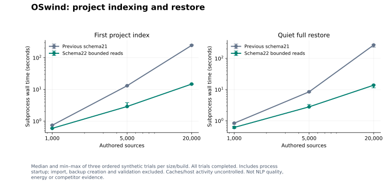

# Benchmark protocol and results

[Native any-input idle admission](native-input-activity-v1.json), source 07f5de5: corrects a reproduced null-event query that treated recent input as roughly 16 days idle. Five pre-fix tests retain seven failed assertions; all five and 35 inherited span cases pass in full/TSan/optimized builds. **The original 609-input run remains partial: 1,291 full passes / two skips / one failed native-cancellation case (two assertions, one unexpected), 18/19 ordered stages.** Selected TSan and optimized each pass 266 / one skip; every signed process/archive/package stage passes. Four unchanged native-cancellation follow-up cases pass and no matching image remains; the failed phase was not observed and remains unresolved. Both exact-source CI jobs pass. A short native AX controller probe with real clocks/text/idle values produces two two-sample spans, stable consumed evidence and continued capture, independently inspected with zero media. Context routing is limited to one owned window; three explicit calls do not establish unattended cadence, app coverage or energy. The preceding missing-backup-member/attached-fixture CI failure and earlier detach gates stay separate. [Contract and remaining gates](../docs/NATIVE-INPUT-ACTIVITY.md).

[Sampled text observation spans and stable evidence](text-observation-spans-v1.json), product 2d58589 / harnesses 44e0bb1: **1,286 full passes / three skips, 261 selected TSan passes / one skip, all 262 optimized cases**; all 35 new cases pass each build. Original frozen 19-stage run retains 16 passes and three harness failures. Strict schema/socket-only corrections pass four follow-up stages against the same signed CLI, including nine span process groups / 26 operations. All product/test/SDK/CI/model/asset bytes remain qualified. Paired signed million-source range probe checks 90 reads/six scopes, exact independent IDs and every original typed source field; current 100-result medians are about 2.8–3.2 ms versus about 2.9 ms preceding. Small warm component observations do not establish speed, power or whole-product ranking. Ten component renders and separate owned native manual AX, generated-tone process isolation and muted playback lifecycle follow-ups pass. Full batch skips, all development regressions and prior independent native detach gates remain retained. A later owned automatic-controller pilot exposes a false-idle admission bug (`.null` versus any input); both native failures and the direct API comparison are retained and block automatic-capture acceptance. Native automatic spans, representative coverage, sustained power/cadence, sync/distribution and competitor ranking remain open. [Contract](../docs/TEXT-OBSERVATION-SPANS.md).

[Standalone Accessibility text capture](accessibility-text-capture-v1.json), eadabc1: **1,252 full passes / two explicit skips; 163 selected TSan and 163 optimized passes/one session-admission skip each; all 17 ordered stages over 588 unchanged declared inputs**. New 22 core/two app-model cases cover explicit mode, no pixel/OCR fallback, source/privacy/lifecycle admission and quiet portability. Eight signed CLI groups / 29 operations and 12 owned light/dark component renders pass. Repeated 100 calls yield one source/101 full reads/one source-embedding request;ten changed calls yield ten sources/20 reads/ten requests, zero media. These are work counts, not native AX timing or power. Signed HEVC/portability/encrypted APFS/million-source SIGKILL-retry and 34-file package proofs pass; installed 15-file tree unchanged. One post-run CI-only schema expectation is separately replayed with exact assertions. Native signed-GUI/TCC capture, application coverage, coalesced active time, sustained power, distribution/sync and matched whole-product competitor ranking remain open. [Contract and remaining gates](../docs/ACCESSIBILITY-TEXT-CAPTURE.md).

[Replay context observation duty](replay-context-duty-v1.json), fbb7350: **1,228 full passes/two explicit skips, 131 selected TSan/one session-admission skip, 131 optimized/one session-admission skip, all17 ordered stages pass** over584 unchanged declared inputs. Metadata supervision keeps fresh full checks around every frame OCR; controlled301-node/120-tick work counts match across all three build modes. Generated hardwareHEVC stores and decodes all12 authored frame identities. Signed process/portability/erasure, actual encrypted APFS, one-million-source migration SIGKILL/retry, SDK16 and locked-session zero-source checks (native target resolution unexercised) pass. Strict signatures/same-build payloads/exact extracted ZIP match34 files; installed15-file tree remains unchanged. These are controlled work/component/process proofs, not live transition, IPC latency, physical energy, broad parity or competitor ranking acceptance. [Contract and remaining gates](../docs/REPLAY-CONTEXT-DUTY.md).

[Schema23 process-fixture follow-up](schema23-process-fixtures-v1.json), e243f84: six corrected strict harnesses pass against signed product0839818, including actual encrypted APFS and a one-million-source pre-tag installation SIGKILL/retry with exact payload hashes and full SQL/JSON tag oracle. Only latest-version constants/descriptions change; original schemas19/20/21 and data assertions remain. The reproduced old region-harness assertion is retained. This supplements the original frozen reports; it does not rewrite their results or imply desktop/power/competitive acceptance.

[Content-bound import-check records](pii-scan-records-v1.json), product0839818 / fixture-only d2ee1b1: corrected full suite **1,214 passes/two explicit skips/zero failures**, with581 frozen inputs. Initial579-input qualification retains three stale schema22 assertions and1211 passes/two skips; only the three expectations changed, with product/tools/assets identical. The original202 selected TSan,202 optimized,16 Python SDK checks and eleven signed process groups pass. Native learned-import30-operation/eight-case and record23-operation/two-case contracts are separate from privacy quality. Strict signatures/same-build payloads/exact ZIP tree cover34 files; installed15-file tree remains unchanged. Fourteen SwiftUI card and12 Settings component renders do not establish foreground/TCC acceptance. The known email miss produces recorded metadata with redacted=false and privacyAcceptance=false on both CPU/Core ML. No privacy operating point, physical power, parity or competitive rank is accepted. [Contract and limits](../docs/PII-SCAN-RECORDS.md).

[Experimental learned text-import privacy](learned-import-privacy-v1.json), source c54ac84: 1,193 defined (1,191 passes/two explicit skips),152 selected TSan,152 optimized and all14 ordered operations pass over573 frozen inputs. Nine signed process groups include30 PII-import operations and eight native cases: six authored phone positives and two retained email misses. Strict signatures, normalized same-build payloads and the extracted ZIP match all34 files; installed bytes remain unchanged. F047 becomes partial. Initial email acceptance fails ten assertions, with no privacy operating point, capture/media/egress, framing quality, physical power or ranking acceptance. Retained failures and prior independent native detach CI gate remain explicit.

[Bounded import input and joined lifetime](import-input-lifetime-v1.json), source94f60b0: 1,164 defined (1,162 passes/two physical/admission skips),119 selected TSan,119 optimized and all12 ordered operations pass. Signed sparse100000001-byte input has median process maximumRSS118.16 to18.32MB over three samples/build including startup; host/cache uncontrolled, no accepted-import/desktop/power claim. Pending collector/wipe before/after removes1/2 notes and leaves1/0; the old remaining note is verified as the pending collector source. Both refuse FIFOs. Strict signatures/same-build payloads/extracted-tree proof covers34 files. Plain-switch/shared-lease regressions and stopped pre-fix qualification remain retained. [Contract and limits](../docs/IMPORT-INPUT-LIFETIME.md).

[Normal import preparation](import-preparation-v1.json), source d3f0181: 1,145 defined (1,143 passes/two physical/admission skips), 88 selected TSan, 88 optimized and all 11 ordered operations pass. Same/other-connection progress, source/settings/cache fences, eight packaged settings-race checks and seven process groups pass. The unchanged-import passage-key regression and initial 0644 fixture refusal remain retained, along with the publication parser correction for interleaved trace output. Strict signatures/same-build payloads/extracted-tree checks cover the 34-file app/ZIP. This is a concurrency/publication contract, not an isolated throughput, energy or competitor benchmark. [Contract and limits](../docs/IMPORT-PREPARATION.md).

[Original-source production privacy masks](privacy-original-mask-union-v1.json), source7621eb8:1,092 defined cases (1,090 passes/two skips),154 TSan,113 optimized and14/15 ordered operations pass. Thirteen current signed process contracts fix retained old overlap/Unicode/route failures; the existing72-example baseline remains14/48 value coverage and0/24 negatives flagged. The final held-reader terminal Ctrl-C trial fails at attachment inventory with reported status2; normal recovery preserves history but does not erase it. Native termination reason is missing, so exit-versus-signal provenance is next. Package/visual proofs pass; broader privacy/release/competitive acceptance remains open. [Contract](../docs/PRIVACY-MASK-UNION.md).

[Complete native PII documents](pii-document-windows-v1.json), source3890d6d:1,079 defined (1,077 passes/two skips),95 TSan,88 optimized and15 ordered operations pass. Signed CLI30 real-model/19 offline/11 setup/two managed-cache checks, package/visual/vault regressions pass. One known authored phone value at three positions is covered by both backends; no representative quality, speed or energy claim. A separate production sequential-pattern admission leak is reproduced and retained despite the passing suite; PR #77 repairs original-source pattern union while retaining a later terminal inventory failure. [Contract and limitations](../docs/NATIVE-PII-DOCUMENTS.md).

[Native vault closing and diagnostics](vault-native-diagnostics-v1.json), product 4594e94 / fixture follow-up 193287c: 1,052 defined cases (1,050 passes/two skips), 128 TSan and 48 optimized passes; all 15 ordered operations pass. Signed CLI ordinary/cancellation/held-reader checks, four additional optimized rapid trials, visual compatibility and 34-file package proofs pass. Five trace-export/native cases also pass in each normal/TSan/optimized follow-up, with escaped/kernel path failures retained. Historical CI/terminal causes, broad desktop/release acceptance and competitor ranking remain open. [Contract](../docs/VAULT-NATIVE-DIAGNOSTICS.md).

[Native PII setup](native-pii-setup-v1.json), source fef24c7: 1,020 defined cases (1,018 passes/two skips), 168 TSan and 64 optimized PII/setup passes; all 12 ordered operations pass. Final signed CLI freshly prepares pinned native assets without Python, with 19 setup checks, 11 offline refusals and 25 prior explicit-inspection checks. Ten light/dark state renders are visually checked; current visual quality and 34-file signed package proofs pass. Inherited PR #73 rapid-vault CI failure remains open; no whole-product privacy, energy, ranking or release claim. [Contract](../docs/NATIVE-PII-SETUP.md).

[Native PII runtime qualification](native-pii-runtime-v1.json): source `2e95c49`, notice packaging `e13db2c`;1004 defined/1002 passes/two skips,152 TSan and48 optimized passes. Both actual backends match432 validation comparisons per build configuration; final signed CLI25 real/18 offline checks and visual compatibility pass. The failed cross-rebuild byte assertion is retained; no production privacy, energy or competitor claim. [Contract](../docs/NATIVE-PII-RUNTIME.md).

[Native PII decoding](native-pii-decoding-v1.json), source f2d0a74: 984 defined cases (982 pass/two explicit skips),132 selected TSan passes,28 optimized PII passes and all six ordered package/process operations pass. Both exact-source CI jobs pass. Native decoder/masks match276 CPU and216 CoreML threshold comparisons; confidence differences0 /2.0862e-6. Fixed128 token input with dynamic word output completes144 CoreML-EP calls on72 validation sources;20 CoreML partitions plus82 CPU node names are profiled, with all framework warnings retained. No physical device placement, production learned redactor, long-source/representative privacy, power or competitive ranking claim. [Protocol](../docs/NATIVE-PII-DECODING.md).

[Native PII input compatibility](native-pii-tokenizer-v1.json), source 2d8d65d: 966 defined cases (964 pass/two explicit skips), 114 focused TSan passes and all six ordered operations pass. Exact native tensors/UTF-16 words match 181 GLiNER/Rust inputs; the existing 439 visual references also pass. A shared ByteLevel prefix defect has a retained two-assertion counterexample. The 33-file signed app/ZIP and unchanged installed/staged-byte proof pass. Signed CLI visual quality preserves 459/501 top 1 and 498/501 top 5 with current model/corpus, indexing/scopes/reopen. No production PII redactor, complete privacy admission, paired performance, energy or competitive ranking is claimed. [Contract and remaining gates](../docs/NATIVE-PII.md).

[Learned PII validation](pii-model-evaluation-v1.json): 72 authored validation examples, 144 reserved test predictions unopened. Actual shipping regex fully covers14/48 values with0/24 negatives flagged; candidate threshold0.5 covers42/48 with8/24 negatives flagged. CPU/MPS quality agrees at all three thresholds. Native CPU fixed-input parity passes30 calls; Core ML construction fails in both attempts. Twenty offline contract/asset checks pass. This is a developer experiment with no production redactor, representative privacy acceptance, energy or competitive ranking claim. [Protocol and remaining gates](../docs/PII-EVALUATION.md).

A separate shape-metadata-only diagnostic completes30 CoreML-EP calls on one distinct validation input, with20 CoreML partitions plus82 CPU node names and retained framework warnings. It stays within the frozen logit tolerance; duplicate fixture slots do not count as distinct cases. This does not resolve the original dynamic-shape failures or establish physical GPU placement/full-pipeline acceptance.

[Quiet workspace lifecycle](quiet-workspace-wake-v1.json), product 9d6f33e / test-only qualification 4a13727 / schema 22: current 956 defined cases (954 passes/two skips), 151 selected TSan cases (150 passes/one skip), all 11 follow-up operations and seven final render operations pass. Both product-source CI jobs pass; both fixture-follow-up CI jobs pass (run 40798125648); later documentation CI is separate. Original 149-pass/one-skip/one-failed TSan run remains:342s maintenance sleep overlaps the 355.7 s opening case; an unchanged awake retry passes, followed by the awake-budget/cleanup fixture follow-up. Complete current command-path/image inventories, 33-file app/ZIP and installed-byte proofs pass. No physical wake, desktop energy, causal speed or competitor claim follows. PR #68's earlier truncated-comm process-absence observation is withdrawn; current proofs use full command paths.


[Nonblocking lifecycle status](nonblocking-library-state-v1.json), source b2c520c/schema22: 938 defined cases (937 pass, one physical-audio skip), 177 selected TSan passes and all 11 ordered operations pass. Two causal held-writer status probes fail before the fix; SQL reads/close remain serialized afterward. Signed app/ZIP and installed/staged-byte proofs pass. Both frozen-source CI jobs pass (run 40779889309); later documentation CI is separate. Initial audit assertion values were not retained. Its later truncated-comm process filter is also invalid, so that process-absence claim is withdrawn. Current PR #69 proof uses full command paths; artifact hashes and image inventories are independent. The first assertion cause remains unproven. The unpaired 26.36-second authored import and prior 25.82/97.34-second observations are not causal speed or competitor evidence; exact input/vector matches are recorded. Physical desktop, power, inherited busy-terminal and broader release gates remain open.


[Automatic maintenance lifecycle](maintenance-startup-v1.json): 930 functional passes/one physical-audio skip, 126 focused TSan passes, 16 successful operations and both source CI jobs. Three retained before-fix old-note failures are fixed. Identical CLI/input/vector bytes still show unpaired 1,000-note timing variation 25.82→97.34 s; no code-regression or speed claim. Active/quiet light/dark layouts checked; long-duration scheduling and physical power remain open.

[Desktop shortcut registration](shortcut-registration-v1.json): 118 related normal / 118 TSan passes, nine operations and both source CI jobs. [Native observation](shortcut-native-v1.json) confirms registration, actual 30-byte Copy/paste and native paste Undo; key delivery/direct insertion remain unverified, with GUI permissions unavailable. The earlier native cleanup/process-absence correction is explicit in the retained draft receipt.

[Limitless API text migration](limitless-import-v1.json): source 0e949f3, 912 functional passes/one physical skip, 183 focused TSan passes, signed app/ZIP and actual encrypted/process checks. A 1,000-note first frozen import takes 25.82 s / 86.9 MB peak RSS with startup/Apple embeddings/SQLite included. Original invocation and owned cleanup-fault receipts remain retained; harness follow-up corrects unconfirmed-create cleanup. Partial migration and release acceptance remain explicit.

## Bounded visual source validation

[Sourcec440650 partial qualification](visual-source-digest-v1.json) passes69 related normal and69 TSan cases. Three exact-bundle pairs on the existing100-photo/501-query fixture observe query median13.36→12.00ms, p9516.67→14.91ms, with identical459/498 top1/top5 counts, scope and reopen. The [frozen protocol](visual-source-digest-plan-v1.json) pins executables, model, corpus, input hashes and fixed order. Six legacy three-image compatibility trials also pass. Peak RSS stays about1.58GB; no broad memory/energy/competitor claim.

A later held-reader terminal check retains a different native inspection error: exit1 remains visible, but the expected busy message is not reached. Normal recovery detaches and preserves history; no successful retry replaces the failure. The sequence is partial, with full evidence and limitations in the report.


## Matched-bundle text-encoder diagnostic

[Six fixed-order probes](visual-query-components-v1.json) compare source5aa58b9 and152c846 against the exact same c538c66 bundle: all501 token arrays and text vectors match exactly. Medians excluding each process's first text remain about1.7–1.8ms. Preparation/first text is4.65→2.04s, consistent with the separate loader measurements. Total process CPU/resources include a second tokenization and JSON output, so they do not isolate inference. Three pairs with uncontrolled caches do not establish a small latency win. A separate low-coverage owned-process stack sample shows source validation/traversal/hashing; it does not establish their CPU percentage or explain the historical end-to-end timing difference. No vendor hashing change was made on speculation.

## Current natural-photo visual recheck

[The current signed CLI](visual-tokenizer-natural-v1.json) preserves459/501 top1 and498/501 top5 on the previously opened100-photo/501-query fixture. Indexing, filtering and reopen pass. The frozen harness retains a **failed same-model-ID check**: four compiled metadata members differ from the old manual bundle, while graph/weights/tokenizer member hashes match. Current query median/p9528.49/35.66ms and peak RSS1.582GB are visible; older14.27ms is not a paired or matched-model baseline. No cause, speedup, fresh holdout, desktop or competitor claim is inferred.

## Reviewed contextual drafts

[Source d48fcbd / schema22 qualification](contextual-drafts-v1.json) passes891 functional cases with one physical-audio skip,105 focused app/privacy TSan cases and all14 ordered package/CLI operations. The new17 draft cases cover evidence revision/deletion/privacy, bounds, selection/expiry/protected input, uncertain acknowledgements, cancellation and binding ownership. A reproduced stale cleanup counterexample remains retained. Light/dark synthetic views are visually checked. No live editor delivery, undo, global keyboard/VoiceOver, universal sensitive-field protection, sustained power or competitor ranking is inferred.

No overall ranking against other products has been established. Competitor features are documented in the research report. Pinned rem database-method timings are measured separately below; full competitor app runtime performance remains unmeasured.

## Byte-exact visual tokenizer/loading: frozen sourcea5627ab

[Signed qualification](visual-tokenizer-loader-v1.json) passes874 functional cases with one physical-audio skip,57 focused visual TSan cases, all12 operations and both CI jobs. Exact full vocabulary/merge hashes and439 independent token inputs pass. Retained regressions cover canonical key loss, BOM stripping, combining-mark boundaries, a fabricated Unicode BPE merge and literal-space normalization. A pinned Apache2 local target preserves original source/license and two minimal patches.

Six alternating signed trials on three fixed color PNGs/three queries agree on model, corpus, recall@1=1, scope and reopened index. Median indexing/model preparation is **4.532→1.949s**, whole-process awake elapsed **4.654→2.071s**, child CPU **4.584→2.013s**. Median process maxRSS is effectively unchanged,1,538,654,208→1,538,785,280bytes (about1.43GiB); query medians are3.592/3.541ms. Caches/background activity uncontrolled, shared-daemon/per-operation GPU costs unmeasured. These are tiny-workload component observations, not cold-cache, release-memory reduction, desktop quality, physical energy or competitor ranking. Physical audio/live capture are deferred at locked-session preflight. [Method and reproduction](../docs/VISUAL-TOKENIZER.md).

## CLI error preservation: frozen source5aa58b9

[Signed qualification](cli-error-preservation-v1.json) passes all13 selected operations. The same real held-reader/Ctrl-C harness fails on signed269d4c9 (masked cancellation130) and passes on the fixed candidate (busy error1 with actionable instructions). Both preserve authored history through normal recovery after the reader closes. Ordinary terminal create/unlock/lock cancellation and five repeated SIGINT trials still detach/recover; backup/export SIGINT/SIGKILL, native/legacy access, encrypted SDK, APIs, erasure and wipe pass. Strict signed33-file app/ZIP payload/tree checks pass; installed app unchanged. Core/app/model/test/SDK inputs inherit the recorded863 functional/452 TSan component observations and were not rerun. Both exact-source CI jobs pass. The earlier unheld terminal failure's exact native cause remains uncaptured; this is error preservation, not forced detach or complete release acceptance.

## Text collectors and Python SDK: frozen source269d4c9

[Partial signed qualification](collector-sdk-v1.json) passes863 functional cases with one physical-audio skip,452 broad TSan cases with no race report, and16 offline Python contracts. The actual immutable CLI/SDK verifies stable retries and source updates, favorite/tag preservation, current privacy/redaction/browser-context rules, atomic refusal, six read tools, partial-pipe SIGINT and an encrypted admission/lock/refusal/remount round trip. Strict signed bundle/ZIP payload/tree checks pass. In-app plugin installation, scheduling, sandbox and a connector catalog remain unfinished.

The ordered run retains a terminal lock cancellation counterexample: exit130 while independent inventory still lists the owned image. Normal product lock recovers it. A controlled held-reader trial reproduces masked busy failure and preserves history after normal recovery. The CLI error-propagation fix follows separately; exact underlying cause of the earlier terminal failure was not captured. Explicit continuation runs only remaining contracts;12 of13 listed operations pass. Physical normal/TSan audio and targeted capture are deferred at locked-session preflight. These checks establish neither sustained collector performance nor complete release acceptance; all-known-contract acceptance remains false.

## Native proof and descriptor ownership: frozen source f7d941f

[Signed qualification](vault-native-ownership-v1.json) passes **852 functional cases,441 distinct TSan cases,14 operations and both CI jobs**. Cancellation waits through complete native attach proof and exact-proof normal cleanup. Failed reservation construction transfers descriptor ownership only after validation, fixing a reproduced double-close: the preceding concurrent stable-manifest read fails with Bad file descriptor in0.608s; the fixed instrumented workload completes8,000 reads and4,000 rejected reservations. A language probe confirms destructor behavior; original CI descriptor identity is not captured, so its precise event is not claimed.

Strict signed app/ZIP payload/tree proof, repeated actual SIGINT and terminal Ctrl-C, encrypted entity/project and legacy flows, ordinary/indexed APIs, normal/instrumented physical tones and targeted live OCR/privacy/erasure pass. Native owned-note Stop/reopen/Data Lock and detached screens are observed, while later OS lock and v1 sampler limitations prevent complete causal isolation. Installed app/launch binding remain unchanged. Earlier CI/local failures remain retained; complete product parity, authentication, sustained physical power and competitor ranking are outside this qualification.

## Complete vault closing transition: retained CI unlock failure

[Source2cc11a9 partial qualification](vault-close-transition-v1.json) retains seven preceding-code failures in a three-cycle held-media-lease cancellation regression. The fix protects the entire closing transition and rejects already-cancelled requests before reservation. All846 functional and435 distinct instrumented cases have passing observations across runs. The full functional run passes845 with one separately exercised physical skip. Broad TSan retains430 passes, one skip, three failed cases/four failures overlapping host sleep; all four cases pass in each of three unchanged clock-observed awake trials. No race report is observed. These observations do not convert the failed broad run into a passing suite.

Strict signed bundle/ZIP proof, five signed CLI SIGINT repetitions, terminal Ctrl-C create/unlock/lock, encrypted entity/project flows, ordinary/indexed integrations and normal/instrumented physical-tone plus targeted live capture checks pass. Source2cc CI passes, but later unchanged-product head a377 CI exposes a **cancelled-unlock attached-image/retry failure**. That separate counterexample remains a blocker. Native attach through complete proof acquisition is the next fix; release acceptance and all-known-contract acceptance remain false. Installed app unchanged.

## Whole Unicode entity admission: retained lock counterexample

[Partial source 681676f qualification](entity-unicode-v1.json) fixes admission of malformed surrogate/composed-character spans and verifies 262 exact tokenizer references. All 844 defined cases have passing observations across runs, but the initial full run retains a session failure spanning 763 seconds of sleep. Four unchanged awake retries pass. The broader TSan selection has 431 passes and one **awake cancelled-lock failure**: independent inventory still lists the owned image after cancellation returns. Later status/history and final absence checks pass; the failing observation remains a release blocker. No data race is reported.

The signed 33-file package/ZIP and completed process/normal-tone checks pass. Instrumented physical audio and live capture are not run after the failure. The optional learned recognizer remains separate. Source labels and case coverage are not equivalent to every known lifecycle contract passing.

## Independent entity quality

[Pre-inference protocol](../docs/ENTITY-EVALUATION.md), [fixed selection/hash plan](entity-membership-plan-v1.json) and [actual baseline](entity-membership-baseline-v1.json) separate recognition quality from lifecycle tests. Actual signed fbe6fac CLI on M5 Max/macOS26.6.2 admits/indexes all 256 validation / 1,024 test Wikipedia sources unchanged under default privacy. No model/threshold tuning precedes the baseline; no raw corpus text is committed.

Test typed-membership precision/recall/F1: **61.47/54.48/57.76%**. Exact anchored F1: **57.52%**, with zero invalid source spans. Per-kind F1 is person 68.90%, organization42.33%, place 57.91%. The counts include negatives, repeated names once per source, partial-name false positives and missed full-name false negatives. This measured quality gap is preserved; suggestions are not verified identities. English corpus projection, artificial token spacing, annotation differences and unknown pretraining limit interpretation. No desktop, multilingual, PII, energy or competitor result follows. The test is now opened and must not be described as unseen in future tuning. Twelve generated-data scorer/admission/process tests pass and run offline in CI.

## Cooperative encrypted-library cancellation

[Signed qualification](vault-cancellation-v1.json) binds runtime fbe6fac/schema22 to **818 distinct functional passes and 407 distinct TSan passes**, five repeated actual CLI interruption trials and terminal-generated Ctrl-C for create/unlock/lock. Immediate recovery preserves an authored source and independent OS inventory confirms detachment. Native Stop during an owned helper hold, with intervening OS lock, is followed by an observed detached screen; native recovery shows the original note with recording paused. OS lock prevents final Settings Lock screen confirmation, while product/OS state verifies final detachment. The 33-file signed bundle and complete ZIP agree; installed schema17 stays unchanged.

The identical native baseline has two failed cases/one pass and19 reported failures. The preceding signed CLI fails immediate recovery four of five times. Both remain retained, alongside a short-helper observation miss and CI's subsecond Python-startup fixture failure. The timeout probe is corrected and its five policy tests rerun normally/TSan; product files remain unchanged. CI run40151212798 passes both jobs. This qualifies cooperative cancellation on owned fixtures, not SIGKILL, Force Quit, native OS hangs, power loss, real authentication, broad feature parity, energy or competitive placement.

```bash
python3 scripts/vault-terminal-smoke.py /absolute/path/oswindctl \
  --root /new/owned/vault-terminal-check
```

## Bounded project indexing and restore

[Paired signed evidence](project-index-scaling-v1.json) compares frozen schema21 `ea90902` and schema22 `f7e52a6` on one M5 Max/macOS26.6.2 host. All **18 trials** complete: three ordered baseline/candidate pairs at each of three sizes. Exact authored project membership, UTF-16 anchors and source revisions agree across builds and after restore; restored completion resets and automatic indexing stays off.

| Sources | Median first index, before → after | Median quiet restore, before → after |
| ---: | ---: | ---: |
| 1,000 | 0.743 → 0.594 s | 0.840 → 0.613 s |
| 5,000 | 13.079 → 2.900 s | 8.500 → 2.806 s |
| 20,000 | 245.055 → 14.756 s | 267.532 → 13.825 s |



Wall times include process startup, SQLite and native NLP for indexing. Import, initial project creation, backup creation and validation are excluded; restore is timed separately. Raw per-trial child user/system CPU deltas, ranges and no-op resume are retained. Resume at 20,000 sources has median 0.095/0.092s, not the same large improvement. Caches/host activity are uncontrolled; text is short and repeated. No natural NLP quality, million-source scale, full capture, physical energy or competitor ranking is inferred. The separate [schema22 qualification](project-corrections-v1.json) exercises all 810 defined cases, 399 distinct TSan cases and 22 final operations, including native correction/rename/rebuild/manual override and scoped search. The preceding CI SIGINT counterexample remains retained; the later cancellation qualification above repairs its cooperative native-action boundary. Final project-correction CI passes both jobs. Passing defined cases does not establish every known contract, full product parity or top-three placement.

## Project metadata without unnecessary extraction

**Counterexample unresolved in this schema21 runtime:** outside the 791 defined tests, rejecting an automatic project link then renaming the same project and rescanning restores that link. Both old/new signed CLIs reproduce expected zero versus observed one. This passing metadata qualification does not establish that every known contract passes; the later schema22 implementation above repairs it with stable-ID exclusions. Historical schema21 evidence remains unchanged.

[Metadata-preservation evidence](entity-metadata-v1.json) binds runtime ea90902/schema21 and a separately staged signed package to **791 defined cases all exercised**: 760 normal passes/31 opt-in skips, 313 native/model/Metal passes adding 25, five real cached-model/runtime checks and one physical-audio case. All 42 focused plus one distinct physical TSan cases pass; all fourteen final qualification operations pass. This is one-host test coverage, not feature completeness, energy or a ranking. Package, normalized executable payloads and complete ZIP agree; installed schema17 is unchanged.

Three paired signed-CLI trials begin with 1,000 indexed synthetic sources, one manual link and a rejected match. A notes edit previously invalidated 1,000 sources; it now invalidates **zero**, preserving exact automatic anchors. Median **sum of edit and index/resume subprocess times** is 1.224 → 0.117 seconds, including startup/SQLite and extraction/no-op resume. Setup, intervening validation/progress reads and backup/control work are excluded; caches/host activity are uncontrolled. This is not note-save-only or overall application acceleration. Genuine alias changes and restored uncurated-to-curated activation still invalidate, both edit/create paths rescan correctly, and quiet backup preserves definitions, anchors and corrections.

Actual signed GUI input confirms notes-only save retains 6/6 completion and two original sources, whereas a new alias resets completion and removes only the automatic link; resume restores it. Cached model setup, repeated ASR/speaker fixtures, real idle expiry/reload and isolated managed runtime pass. Two Apple MPSGraph cache-load diagnostics remain retained; placement/physical memory/power are unmeasured. Latest signed targeted live capture/OCR/privacy/deletion and normal/TSan two-tone PCM checks pass without permission or volume changes. Full controller/microphone-to-ASR, Documents-root startup, representative entity quality, million-source entity work and matched competitor apps remain open. Earlier failed regression/curation variants are retained.

```bash
python3 scripts/entity-metadata-smoke.py /absolute/path/new/oswindctl \
  --root /new/owned/metadata-check \
  --baseline-cli /absolute/path/pre-fix-schema21/oswindctl
```

The optional baseline must be the pre-fix schema21 CLI; its expected invalidation behavior is asserted. Without that option the harness still validates the candidate, explicit alias/curation changes and quiet backup.

## Native search shortcut navigation

[Search-navigation evidence](search-navigation-v1.json) binds runtime a91f25b/schema21 to 752 normal passes/31 opt-in skips, 305 native/model/Metal passes and **777 distinct functional passes/six remaining opt-in cases**. All 23 focused TSan cases and eight final qualification operations pass. Three of four new regressions fail before the fix; all four pass after it. Signed native input repeats a two-source project → People & projects → ⌘K and shows all six global sources, restores six after the zero-result Conversations view, deliberately retains Ask's project scope, and accepts typed quoted-phrase filtering. All data are synthetic; capture/audio remain off. Package/ZIP identity, signed entity/API/MCP and indexed integrations pass. The signed CLI matches the preceding entity report byte for byte; its broader race/physical-audio evidence stays separately attributed.

The 20k-vector/32-dimension expression test matches the exact top ten across three alternating required-phrase queries and a changed-source check. Sequential Metal observations are 36.6/29.2/25.6 ms after preparation, with uncontrolled caches and host activity. These omit embedding inference, capture, power and competitor workloads. Full accessibility, Documents-root startup, latest uninterrupted desktop capture and general microphone/controller acceptance remain open.

## Source-linked people/project memory and encrypted lifecycle

[Entity qualification](entity-memory-v1.json) binds runtime0a5cad1/schema21 to **748 normal passes/31 opt-in skips**, **281 native/model passes**, **773 distinct functional passes/six remaining opt-in cases**, and **318 distinct TSan passes with no races reported**. Twenty-two final operations pass, including fifteen unique signed process groups and actual encrypted entity lock/remount/quiet-backup/rescan. The signed 33-file package, raw/signed normalized executables and extracted ZIP are bound separately. Minimum-size light/dark list renders are app-owned synthetic NSHosting outputs. The unlocked continuation adds targeted signed capture/OCR/privacy, normal/TSan production PCM known-tone isolation and observed native project editing/linking/catch-up/scoped Ask/citation opening. Native ⌘K retains stale scoped results after scope clearing; this defect remains attributed to this package. Documents-root fixture file opens stalled; temporary synthetic fixtures passed without permission changes. Neither suspected protected-folder cause nor general GUI/controller/microphone/ASR acceptance is established.

The signed 1,000-source fixture exactly matches **667 authored project members** and validates **1,335 UTF-16 source spans**, with first-index/resume wall time **0.714/0.062 seconds**. This is one uncontrolled-cache sequential trial over three repeated short sentences, including CLI startup, SQLite and native NLP. Its exact project-alias precision/recall is 1.0 on this authored oracle. Apple NLP output is only observed: **Chen** is suggested without **Maya**, and **Apollo** is classified as an organization. There is no representative entity accuracy, true identity, million-source, power or competitor score. Read-only CLI/HTTP/MCP membership, corrections, source revisions, old20 refusal, quiet portability and erasure pass.

[Independent APFS observations](entity-native-detach-observations-v1.json) retain the initial three native-group failures and three diagnostic failures on the older eight-observation budget. One sampled image-listed/volume-missing interval spans at least **9.897 seconds** before absent replies. Extra IPC may affect timing; exact verifier observations and the OS cause were not captured. The candidate retains the first 50 ms retry and all identity/error/cancellation guards, then backs off within sixteen observations and 11.55 seconds of configured pauses. Two consecutive fresh absence replies remain mandatory. No additional/forced detach was introduced. Twenty-four focused native/deterministic cases and the complete final normal/native/race/process selections pass; native helper deadlines remain separate from pause bounds.

## Independent 24-hour synthetic component soak

[The pinned schema11 component run](reliability-soak-24h-v1.json) reached 86,400 seconds with **4,291 concurrent-writer/read cycles, 4,291 writes, 4,091 deletions and 144 local Qwen answers**. Every sampled writer was live while the persistent MCP served reads. MCP shutdown was normal, without a forced exit. The final fixture contains 202 sources.

Its classification is **completed with gaps**, not uninterrupted pass: four oversized wall intervals were retained at 82.1, 91.9, 113.5 and 248.3 seconds. The last aligns with separately observed OS sleep; the others are not assigned a cause. Median/p95 cycle wall time is 0.127/0.276 seconds, with a retained 113.5-second maximum. Median/p95 local answer wall time is 1.275/19.425 seconds, with a retained 113.4-second maximum. Sampled persistent-MCP RSS peaks at 24,363,008 bytes; writer/model daemons and power are excluded. The authored owner-string/citation contract is not an independent answer-quality benchmark.

This old, pinned executable exercises synthetic storage, concurrent read/write, source reads, erasure and local answers. It does **not** qualify schema21, uninterrupted desktop capture, device/UI behavior, storage growth under real media, power or competitor placement. The current end-to-end 24-hour capture gate remains open.

## Native detach verification and signed live capture

[Detach-settlement evidence](vault-detach-settling-v1.json) binds runtime d224bff and a signed 33-file package to 714 normal passes/31 opt-in skips, 247 native/model passes and one physical case: 739 distinct passes/six remaining opt-in cases. All 283 focused TSan cases plus physical audio pass, giving 284 distinct race checks. All nineteen final operations pass, including twelve unique signed process groups, three complete vault processes and native audio. The broader race selection adds vault/session/migration cases for the changed driver; test counts are coverage, not speed comparisons.

An actual owned encrypted image preserves six sources across six rapid write/lock cycles, with independent hdiutil checks after each close and a final source read. Deterministic observation sequences prove two consecutive absent replies are required, reappearance/incompleteness resets the counter and cancellation/unknown or changed identity cannot confirm detach. Real replacement directories/manifests preserve marker bytes, including a precreated vault object whose exact image inode/manifest move into another package. Eight observations with 50 ms pauses are configured limits; native helper calls have separate timeouts. No forced or additional detach is introduced by the verifier.

The exact signed CLI passes live targeted fixture capture/OCR/privacy/deletion, returning five OCR regions and normal/secret statuses of 942/577 ms. These are one-shot observations under uncontrolled host activity, not a benchmark distribution. The instrumented source-bound tone fixture also passes. Captured PCM is not saved; generated source WAVs and aggregate metrics are retained. This is not full GUI/controller/microphone/ASR, arbitrary app privacy, energy or competitor acceptance.

An intermediate full run preserves one failed snapshot test/two assertions aligned with real OS sleep and a four-minute wall gap. Its synthetic snapshot controller observed the real workspace. Private lifecycle injection and an explicit injected-sleep cancellation case correct that fixture boundary; public capture retains macOS workspace observation. Final full/native/race runs pass. The earlier vault refusal's exact failing inventory remains unproven; this verifier handles a specific missing-volume observation after successful normal detach, while ambiguous/initial/other native failures remain refusals. [Design and remaining gates](../docs/VAULT-DETACH.md).

## Real owned system-audio buffers

[Native system-audio evidence](native-system-audio-v1.json) binds runtime07cb8de and a separately signed 33-file package to 702 normal passes/30 opt-in skips, 234 native/model passes, one distinct physical case and 726 distinct passes/six remaining opt-in cases. All 236 focused TSan cases plus the physical case pass, giving 237 distinct race checks. All seventeen final qualification operations pass, including eleven signed process groups.

Two independently registered generated-tone apps are explicitly hidden, playing concurrently while one source is requested per stream. Four final selections (normal/TSan, A/B) each produce 48,640 samples in 152 callbacks, exact 16 kHz mono Float32, flags41, maximum 320 samples per callback and no format rejection/interruption. Intended-to-other-known-tone amplitude ratios range from 332,519 to 2,269,098. The onscreen-only inventory omits both sources; the production background-inclusive inventory finds them. This establishes short controlled format/known-tone checks on one M5 Max/macOS26.6.2 host. SwiftPM normal/instrumented code performs capture, not the signed GUI. It is not speech quality, broad application privacy, whole-controller acceptance, latency, power or a competitor benchmark.

Earlier direct-shell fixture attempts failed discovery and then mixed both tones. LaunchServices registration changed that result. The failed measurements remain retained; process responsibility is a possible explanation, not a captured diagnosis. Raw captured audio stays in memory, no permission or system-volume changes occur, and owned sources are terminated after each probe. [Protocol and limitations](../docs/NATIVE-SYSTEM-AUDIO.md).

## Bounded live PCM ingress

[Ingress evidence](audio-ingress-v1.json) binds runtime 20a51c8 to 699 normal passes/29 skips, 231 native/model passes adding 23 distinct cases, 722 distinct passes/six remaining opt-in cases, 233 TSan passes and a separately verified 33-file signed package. All eleven final process groups pass. Twelve new ingress and three controller cases cover bounded stalled-actor storage/delivery, exact concurrent callback accounting, final-segment handoff, old-source isolation, actual generated CoreMedia buffers, device-free microphone conversion and per-run capacity-drop reporting.

The configured per-source limits are 32,768 normalized input samples, fewer than 480,000 partial samples, three waiting full segments and one scheduled actor delivery. The shared downstream queue adds three waiting chunks and one active ASR operation. This does not bound macOS/model RSS or prove callback/UI latency and energy. Overload discards incoming complete segments and reports lost seconds; silence/privacy/recognizer/device gaps are not counted as capacity loss.

The attempt ledger retains one failed vault process among 17 attempts. Lock and immediate cleanup refused an unidentifiable unmounted APFS attachment; a later independent inventory found no owned image, and normal retry confirmed detached. Two fresh full vault processes then pass. A detach-settling race is a possible explanation, not a captured diagnosis. No forced detach or identity relaxation occurred; retry hardening remains open. Physical audio/device/route capture, warning visibility, foreground/background isolation, energy, hardware/OS compatibility and competitors remain unverified. See [design and limits](../docs/AUDIO-INGRESS.md).

## Audio privacy and shared-reader regression checks

[Bounded audio evidence](audio-privacy-v1.json) binds runtime 0118243 and a separate signed package to 713 normal cases (684 pass / 29 opt-in skips), 216 native/model cases and 218 race-check passes. The normal/native union has 707 distinct passes and six remaining opt-in cases. Eleven actual signed process groups pass; the audio process uses generated PCM and a deterministic ASR executable to test contracts, not recognition quality.

Six coordinator cases establish one producer for concurrent same-application observers, independent cancellation, fresh reads after completion, target separation and an eight-observer cap. Eleven audio cases cover suspended-start responsiveness, privacy before WAV/after ASR, finish/restart/session ownership, bounded waiting chunks and ordinary recognizer-error recovery. A real replacement SQLite database/WAL/SHM stays unchanged when the original moved connection closes.

No live-AX latency, microphone/system capture, CPU/power improvement or competitor result is inferred from these fixtures. The configured 350 ms / 40 ms / 1,000-node / 8,192-message traversal limits remain cooperative. Different/cancelled operations can add a wait for actual preceding completion; this is not a global hard deadline. GUI view sources are unchanged. Fresh doctor reports unlocked, correcting earlier prose. Isolated sample clicks verify calendar/hour scopes, evidence-only Ask and citation opening; Escape and ⌘K work, and audio with both sources off refuses to start. GUI capture controls remain ungranted despite CLI preflights passing. The first native selection launched without an isolated environment and displayed onboarding before termination/relaunch; a default-library open cannot be excluded. No permission changes or actual capture occurred.

```bash
swift test --filter 'AccessibilityCoordinatorTests|AccessibilityReaderTests|AudioPrivacyTests|AudioLifecycleTests|LibraryWorkspaceTests'
OSWIND_TEST_NATIVE_VAULT=1 swift test --sanitize=thread \
  --filter 'AccessibilityCoordinatorTests|AudioPrivacyTests|AudioMemoryTests|AudioLifecycleTests|SnapshotAdmissionTests|Replay'
```

See [audio lifecycle and limitations](../docs/AUDIO-PRIVACY.md). Physical-device, dense-browser, permission, format/backlog and end-to-end energy acceptance remain open.

## Indexed tags and opening tradeoffs

[Indexed-tag evidence](indexed-tags-v1.json) compares a pinned signed schema20 CLI with the new signed candidate on APFS clones of the same owned archives. The same Python civil-time oracle checks all day/hour counts. Seven fresh processes per scope run after a separately measured first open. Caches and host activity are uncontrolled; initial index construction can warm later queries. These are paired observations, not a controlled cold-cache or competitor experiment.

| Archive | Tag median/p95 before → after | Combined app/type/saved | Combined with tag |
| --- | ---: | ---: | ---: |
| 100k/year | 17.62/576.09 → 0.89/0.91 ms | 4.46/4.72 → 1.10/1.29 ms | 4.55/5.03 → 0.80/0.83 ms |
| 100k/month | 174.47/2653.09 → 3.01/3.21 ms | 35.11/39.91 → 5.65/5.82 ms | 35.77/36.47 → 1.80/1.86 ms |
| 1m/year | 195.43/5331.07 → 2.67/2.76 ms | 46.69/47.71 → 4.74/4.90 ms | 45.98/47.13 → 1.63/1.69 ms |

Missing-tag million-source median is 0.66 ms. Unfiltered aggregation median remains about 10 ms. The first million-source installation took 18.74 seconds and added 172,412,928 bytes (about 3%) to the 5.83 GB database. The native opening window stays responsive with cooperative Stop; installation still reserves the SQLite writer and is a latency/contention TODO. A separate actual SIGKILL/retry fixture preserves all million source payload hashes, leaves no partial index visible, and matches the full SQL/JSON projection oracle after retry. Pre-hashing warmed its cache; that retry's 5.56 seconds is not a controlled startup comparison.

The exact 1 KiB/64 KiB SQLite write fixture has three repetitions of 1,000 source operations. Tagged 1 KiB insert medians increase 76.84→87.53 ms, favorite/payload updates 9.02→29.66 ms and tag/payload updates 8.75→18.48 ms. Tagged 64 KiB inserts 956.14→1016.21 ms and tag/payload updates 412.79→561.92 ms. JSON encoding, application admission, capture and inference are excluded. Write amplification is retained in the evidence; faster reads do not imply faster ingestion or lower power.

```bash
python3 scripts/benchmark-sqlite-writes.py /absolute/path/oswindctl \
  --root /new/owned/write-directory --records 1000 --repetitions 3
python3 scripts/tag-index-interruption-smoke.py /absolute/path/oswindctl \
  --fixture /marked/pre-tag/activity-fixture --root /new/owned/kill-retry-directory
```

The kill/retry harness requires a marked pre-tag archive from the calendar generator, copies its closed SQLite file using APFS clone, observes uncommitted WAL growth and kills only its own child. It never modifies the input archive or opens normal history. See [tag consistency and opening lifecycle](../docs/TAG-INDEX.md).

## Complete calendar counts (earlier candidate)

[Activity calendar evidence](activity-calendar-v1.json) covers complete month and selected-day hour counts on 100k/year, 100k/month and one-million/year synthetic archives, with 1 KiB source text. An independent Python zoneinfo oracle checks every count and exact 23-hour-day boundary. Each sample starts a fresh CLI process; aggregation time includes validation, utility scheduling and SQL, while wall time and process peak RSS include startup. Caches and background activity are uncontrolled. Tag scope still reads JSON payloads and is slower; no capture, inference, battery or competitor ranking follows from these counts.

```bash
python3 scripts/benchmark-activity.py /absolute/path/oswindctl \
  --root /new/owned/benchmark-directory --sources 1000000 --repetitions 7
```

The harness refuses an existing unmarked root. `--reuse-owned` requires the exact generated marker/workload; a new `--output` preserves earlier results. Derived indexes add a one-time first-open cost; evidence retains separately cloned pre-index archives, logical payload checks and first/repeated open timings. Those trials hash the payloads before opening and therefore do not measure cold caches.

Release aggregation medians/p95 (milliseconds; seven fresh CLI processes per scope):

| Archive | All | App | Kind | Saved | Tag |
| --- | ---: | ---: | ---: | ---: | ---: |
| 100k across year | 1.53 / 2.65 | 0.96 / 1.84 | 0.88 / 1.31 | 0.77 / 1.13 | 16.75 / 149.94 |
| 100k across month | 11.62 / 45.70 | 4.38 / 20.92 | 3.42 / 6.85 | 2.22 / 3.59 | 173.59 / 2666.66 |
| 1m across year | 9.98 / 29.55 | 3.98 / 12.50 | 3.07 / 3.54 | 1.98 / 2.54 | 199.96 / 2968.66 |

The one-million/year query matches 84,574 March sources. All-scope CLI wall median is 56.98 ms; tag wall median is 249.43 ms. Across the seven samples p95 is the maximum, a weak tail estimate. Slow first tag samples remain included. Broad tags still need indexed projection; repeated fast samples do not resolve the observed multi-second tail. Raw timing/RSS samples and wide-time-bound cases are in the evidence. The separate one-million-source first-open trial took 1906 ms with index construction and 47 ms on repeat, adding 26,050,560 bytes; logical payload hashes and schema were preserved. These are single warm-cache observations, not startup percentiles.

## Reproduce retrieval

```bash
swift build -c release
.build/release/oswindctl benchmark --count 1000 --output benchmarks/oswind-1000.json
.build/release/oswindctl benchmark --count 10000 --output benchmarks/oswind-10000.json
```

The benchmark creates and removes an isolated temporary store. Twelve topic templates are repeated to fill the requested record count; 12 queries run three times across keyword, semantic and hybrid retrieval. It reports ingest throughput, disk bytes, hit rate@5, MRR@5, and p50/p95 including query embedding. Relevant items are any record with the expected topic label. This is a fast regression/scaling fixture, not a representative user study. Repeated topics can crowd out other sources and overstate recall. Exact semantic search scans every filtered vector; Automatic may use the optional native index for larger unfiltered archives.

Initial debug result on Apple M5 Max/macOS26: 1,000 rows ingested at ~116 records/s; ~7.75 MB database directory; hybrid p95 ~7.1 ms, hit@5 1.0, MRR .917. Keyword beat hybrid on this fixture. Semantic-only hit@5 .583 is a known quality limitation. Results must be regenerated after retrieval changes; retain build configuration with reported results.

## Full comparison gates

1. Pin each product version, OS/hardware, display scale, inference model and power profile.
2. Use identical public/synthetic screen traces, audio clips, activity/idle periods and privacy fixtures. Keep competitors' default and tuned runs distinct.
3. Measure index lag, transition capture recall, OCR CER/WER, audio WER/RTF, query p50/p95/cold start, Recall@k/MRR/no-evidence abstention, source correctness, CPU/RSS, bytes/hour and power with a physical meter or supported profiling setup.
4. Run sustained active, meeting, idle and low-power sessions and a 24-hour fault/soak test. Test sleep, restart, permission revocation, full disk, model failure, import interruption and audio hardware changes.
5. Store raw logs and workload manifests, explain unmeasured axes, and avoid composite rankings until weights and gates are explicit.

`idle-debug.json` samples a paused debug process while the Mac is locked; it is not an active capture or battery benchmark. `ps` CPU values are lifetime averages, not interval energy measurements.

## Diverse relevance fixture (local model comparison)

```bash
.build/release/oswindctl eval-retrieval --fixture benchmarks/fixtures/desktop-retrieval-v1.json --output benchmarks/relevance-apple-v1.json
.build/release/oswindctl eval-retrieval --fixture benchmarks/fixtures/desktop-retrieval-v1.json --model qwen3-embedding:0.6b --output benchmarks/relevance-qwen3-v1.json
```

The authored fixture contains 32 fictional desktop memories and 35 queries: 16 paraphrases, 4 code questions, 8 multilingual questions, 3 filtered questions and 4 unanswerable questions. Correct IDs are hand-labeled. Each mode runs three repetitions; all calls include query embedding and retrieval. This is a small regression fixture, not a held-out generalization study. Ranking was tuned using this fixture; results therefore require validation on an independent corpus. `history/` preserves results before the fusion correction.

Measured on M5 Max, macOS 26.6.2, release build:

| Model / mode | Recall@5 | MRR@5 | p95 |
| --- | ---: | ---: | ---: |
| Apple / keyword | .839 | .763 | .112 ms |
| Apple / hybrid | .871 | .720 | 4.694 ms |
| Apple / semantic | .565 | .358 | 4.541 ms |
| Qwen3 / hybrid | 1.000 | 1.000 | 92.207 ms |
| Qwen3 / semantic | 1.000 | 1.000 | 98.249 ms |

Qwen3-Embedding 0.6B uses 1024-dimensional normalized vectors; full model digest, fixture SHA256, timings, per-query IDs/scores, warnings, index time and storage are retained in JSON. `ollama ps` reported 100% GPU memory residency during the measured workload. This confirms residency, not a kernel-level utilization or energy measurement.

Hybrid and semantic modes returned candidates for every unanswerable query (no-evidence empty rate 0); keyword-only empty rate was .5. Candidate retrieval is not an answer-confidence decision: answer abstention/citation correctness must be evaluated separately. This relevance fixture did not run competitor binaries. Separate keyword component comparisons below do not support a top-three or state-of-the-art claim.

## Conversation process smoke

`python3 scripts/conversation-smoke.py .build/release/oswindctl` tests persistence, source identity, follow-up subject context, Markdown export/0600 permissions and erasure across separate CLI processes. It defaults to no-model evidence mode for CI. Optional `--provider apple` or `--provider ollama` with `--output PATH` runs installed local generation and asserts the owner/deadline facts and [1] citations. `conversation-local-v1.json` records one measured successful scenario per provider. Missing citations, false abstention and answering the earlier question were found and corrected while developing this fixture; it is a regression smoke, not a held-out accuracy benchmark. Guided citation structure does not prove the text follows from its cited source.

## Exact vector scaling stress

```bash
.build/release/oswindctl benchmark-vectors --count 100000 --dimensions 1024 --output results.json
```

This creates an isolated SQLite archive with deterministic normalized random vectors in the real multi-model table. It measures 3 exact self-match queries repeated 3 times: all candidates (threshold -1), ordinary threshold .25, and a half-archive app filter. It deliberately excludes model inference and natural-language relevance. The all-candidate case stresses ranking memory; random vectors with threshold .25 mostly retain only the exact match. Few timing samples, warm filesystem caches and ordinary host activity limit p95 precision.

Paired development runs on M5 Max/macOS26.6.2:

| Records / path | Before p95 | After p95 |
| --- | ---: | ---: |
| 10k / all candidates | 12.43 ms | 12.95 ms |
| 100k / all candidates | 125.73 ms | 115.09 ms |
| 100k / threshold .25 | 119.24 ms | 108.40 ms |
| 100k / app filtered | 98.92 ms | 86.85 ms |

100k process peak RSS fell from ~36.2 to ~24.8 MiB; this is the benchmark process, excluding OS file cache, the app and model daemons/GPU memory. Database directory size was ~533 MB. The first heap implementation regressed timing and is retained in `history/vector-scaling-100000-heap-first.json`; skipping ID/timestamp decoding for candidates that cannot enter the heap improved it. Small-run timings remain mixed, so this is not a broad speedup claim. Every query retained exact top-1 identity; brute-force unit tests check nontrivial top-k/filter/tie behavior. This remains O(n) scanning, not ANN, and does not measure capture contention or power.

### Million-vector gate: failed

`vector-scaling-1000000.json` records a real release run of 1,000,000 × 1024-dimensional vectors: ~5.33 GB database directory, ~235 seconds ingest, ~25 MiB benchmark-process peak RSS. Exact top-1 remained 1.0, but all-candidate p50 was ~1.31 s and p95 **22.42 s**. Thresholded p95 was ~1.22 s; half-archive app-filter p95 ~.88 s. The long tail fails the intended interactive-performance target. Its cause was not established; do not attribute it to cold caches without profiling. This historical run retains aggregate timings; the benchmark now also emits per-query/repetition timings and returned IDs for future diagnosis. ANN/partitioning, retained repeatable archives, cold/warm runs and capture-write contention are next gates. No competitor ranking follows from these results.


## Native indexed retrieval milestone

```bash
.build/release/oswindctl benchmark-vectors --count 100000 --dimensions 1024 --indexed --quality-queries 16 --archive .local/ann-benchmark-100000 --output results.json
```

`--archive` retains an explicitly marked synthetic-only archive for repeat runs. Unknown/nonempty directories are refused. Source rows/vector batches resume after interruption; graph construction currently restarts. No model inference occurs in this workload. HNSW uses float16 normalized vectors; live float32 candidates are reranked in SQLite. Automatic keeps small and all filtered scopes exact; explicit `--indexed` tests the approximate path even where slower.

Paired 1024-dimensional release trials on M5 Max/macOS 26.6.2 (`ann-storage-*`):

| Records | Exact unfiltered p95 | Indexed unfiltered p95 | Exact half-app p95 | Indexed half-app p95 | Index preparation |
| --- | ---: | ---: | ---: | ---: | ---: |
| 10k | 13.91 ms | 12.70 ms | 10.78 ms | 55.38 ms | 4.53 s |
| 100k | 132.00 ms | 66.79 ms | 99.41 ms | 399.03 ms | 251.94 s |

Every self-match was top-1. These are nine warm samples per mode; p95 is coarse. Preparation uses at most four CPU workers, not the GPU. The initial 100k build process peaked near 517 MiB; a later reopen/query process after bounding hash-buffer lifetimes peaked near 289 MiB. These are different process lifecycles, not a controlled memory optimization comparison. Snapshots add disk/RAM costs; database and OS cache are separate.

`ann-quality-100000.json` reopens the retained 100k graph in ~153 ms (warm filesystem, not a cold boot). Sixteen deterministic non-self queries per scope compare real parallel-built SQLite/ANN results with exhaustive float32 top-10 ground truth. Recall@10 was 1.0 for unfiltered and half-app queries. Unfiltered p95 was 58.35 ms indexed / 124.12 ms exact; filtered p95 was 456.29 / 105.83 ms. This small random-vector result is neither natural-language relevance nor a guarantee against approximation misses. Counts/statistics, cold starts, concurrent capture and larger realistic archives remain open. The million-vector run completed; its non-self recall gate failed, as recorded below.

`native-hnsw-component-*` separately records an initial serial native-only exploration: 100k build ~990 seconds; query expansion 128/512/2048/8192 yielded Recall@10 .156/.431/.850/1.0 on 16 random non-self queries. This motivated the conservative 8192 search budget. Component timings exclude SQLite, filters, validation and reranking and must not be presented as product latency. Full application fixtures now test replay, deletion/update, filters/favorites, >5000-change exact fallback, corruption recovery, store erasure and schema-3 preservation. Twelve cache/retrieval tests also pass ThreadSanitizer. No competitor runtime or power measurement was performed.


## Long-source evidence and generation contract

```bash
python3 scripts/evidence-smoke.py .build/release/oswindctl
python3 scripts/evidence-smoke.py .build/release/oswindctl --provider apple --abstention --output apple.json
python3 scripts/evidence-smoke.py .build/release/oswindctl --provider ollama --model qwen3:4b-instruct-2507-q4_K_M --abstention --output local.json
python3 scripts/chat-provider-smoke.py .build/release/oswindctl
```

`evidence-long-v1.json` records two fictional ~9.9 KB notes with identical opening text and different owners/deadlines at the end. The original prefix-based deduplication hid one note; prefix-only context hid the decisions. Full-source/context fingerprints and query-anchored excerpts preserve both. The current pipeline uses a single generation request, with the current question and fresh excerpts. Earlier user questions affect retrieval/excerpt selection rather than being repeated in generation.

The fixture checks assignments, not just presence of names: North→Lina→Thursday; South→Theo→Monday, with no swapped bindings. It also checks bounded-excerpt warnings, citations, both source IDs, persisted turns, concise final prose, no inference error and an unsupported budget question. These are narrow regular-expression/known-fixture checks, not a semantic entailment grader. Passing cannot establish general factual support, multilingual completeness or abstention accuracy.

After simplifying the prompt, three Apple trials and two versioned Qwen3 Instruct trials passed this fixture including the absent-budget request. Apple answer times were ~0.9–1.3 s. Instruct's first owner answer was ~1.3 s; later responses ~0.12–0.46 s. A million-vector CPU graph build ran concurrently. These few observations are not isolated latency percentiles, controlled cold starts, physical power or competitor measurements. Runtime metadata reports GPU memory residency; it does not measure utilization.

Failures matter: `history/evidence-development-failures.json` preserves observed omissions, a discarded source-by-source Apple experiment that assigned the wrong owner despite valid citation numbers, and unfinished metareasoning from the short Qwen alias. Early keyword-presence checks were too weak. During 23 October 2026 validation, the [registry tags](https://registry.ollama.com/library/qwen3/tags) mapped the installed `qwen3:4b` digest to the [thinking-only model](https://huggingface.co/Qwen/Qwen3-4B-Thinking-2507); its thinking mode cannot be disabled. Setup now uses the versioned [non-thinking Instruct model](https://huggingface.co/Qwen/Qwen3-4B-Instruct-2507), [Ollama Q4_K_M tag](https://ollama.com/library/qwen3:4b-instruct-2507-q4_K_M), while retaining explicit user choices. This is a practical baseline choice, not a claim that it is the best current model.

The offline provider smoke checks explicit CLI model/endpoint selection, current-question prompts, one-off app scope and provider output-limit rejection. A failed/limited response does not append a completed chat turn. Real paid BYOK vendor contracts remain unrun. General support checking, model/context budgeting, prompt-injection evaluation and semantic chunk retrieval for long sources remain open.


### Million-vector indexed gate: recall failed

`ann-storage-1000000-indexed.json` retains the full raw run; `ann-million-tail-summary.json` recomputes nearest-rank tails from every retained sample. Ingest took ~267 s, native preparation ~3011 s, ~7.93 GB directory including derived graph, ~2.55 GB process peak RSS. Nearest-rank self-query p95/max was ~207 ms unfiltered / ~165 ms thresholded / ~2065 ms half-app; every self-query retained top-1. These nine samples per mode are not precise population percentiles.

Sixteen random non-self queries per scope recovered **.675 Recall@10 unfiltered / .825 filtered**, against exhaustive float32 SQL ground truth. Nearest-rank indexed p95/max was ~303 / 1438 ms; exact-reference p95/max ~19.15 / 11.89 s. This is a failed recall gate even though indexing reduces latency. A two-second process sample during the reference phase showed time in SQLite overflow-page reads; it does not establish the cause of every tail spike. The graph is retained for query-budget/precision tuning and independent follow-up queries. No large-archive quality or competitor superiority claim follows. Automatic still keeps filtered queries exact; the unfiltered million-record recall limitation remains open until tuning/validation is complete.

## Maintained metadata at one million records

```bash
.build/release/oswindctl benchmark-stats --archive .local/ann-benchmark-1000000 --output statistics.json
```

The command accepts only a marked synthetic vector archive and retains it, including its native graph. Opening may perform the schema-4→5 migration; source/chat/cache preservation has regression coverage. `statistics-million-v2.json` compares maintained SQL metadata with the previous combined aggregate and application-count scans on the same archive, five samples each. Maintained metadata p50/p95/max was ~.019/.049/.049 ms versus ~179.1/190.5/190.5 ms for the old SQL scans. Including the small archive's file enumeration had ~.128/1.107/1.107 ms p50/p95/max. Reopening took ~.004 s. The initial `statistics-million.json` preserves the one-time migration run (~.90 s) and its historical quantile estimator. This fixture has two app names and few files, not a realistic screenshot filesystem.

A separate read-only development profile during graph construction observed the old combined query at ~2.99 s initially / ~151–152 ms later, plus app counts at ~160 ms initially / ~31–35 ms later. It was not a controlled cold-cache run. Neither backend benchmark is a whole-UI latency claim. The app now publishes hits independently and coalesces file traversal, with storage freshness shown. Media-heavy traversal, sustained capture contention and actual native interaction still require measurement.


### Timing estimators

New benchmark reports declare `latency_quantiles`: median averages the center pair for an even sample, p95 uses nearest rank `ceil(.95*n)`, and max is reported explicitly. For fewer than 20 samples, p95 is the slowest observed sample; it is not a reliable population-tail estimate. Earlier reports used the lower sample at `floor((n-1)*.95)`, which can understate a small run's tail. Historical artifacts remain intact. `ann-million-tail-summary.json` contains a source hash and recomputed quantiles from the same raw million-vector measurements; no observations were rerun or dropped. The failed recall values are unchanged. `statistics-scan-development.json` preserves the separate read-only SQL profile under build load.


## Metal exhaustive-scoring component prototype

```bash
mkdir -p .artifacts
swiftc -O -parse-as-library scripts/metal-probe.swift -o .artifacts/metal-probe
.artifacts/metal-probe benchmarks/ann-storage-1000000-indexed.json result.json
```

`metal-component-100000.json` and `metal-component-1000000.json` exercise MPS float32 matrix-vector scoring, a CPU top-200 heap and float32 cosine reranking against the already recorded SQL ground-truth IDs. Each has 16 non-self queries per scope; both unfiltered and half-row scopes recovered all exact top-10 IDs in these trials. The input reference SHA256 is retained. Synthetic vectors are regenerated from the same deterministic seeds directly into shared GPU memory; this bypasses SQLite extraction and the actual product cache.

At one million × 1024 dimensions, the matrix uses 4.096 GB and process peak RSS is about 4.1 GB. Generation took roughly 2.3 s. Full component timings include CPU candidate selection and reranking; command-buffer GPU durations are separate. Inspect the JSON for every observation and nearest-rank tails, including first-use overhead. This is an isolated component, not a delivered end-to-end search improvement or a competitor ranking.

Integration gates: bounded-memory backend choice, durable snapshot format and checksum, mutation replay, erase/revision/identity protection, scope masks/metadata invalidation, power policy, cancellation, fault recovery and whole-path benchmarks. The current shipped preview still uses the native/exact paths; its million-record ANN recall failure remains open. Additional independent queries and real model archives are required even if this component retains 1.0 on the current fixture.

## Metal product path and scope reuse

These runs are on Apple M5 Max, 128 GiB RAM, 18 logical CPUs, macOS 26.6.2, release builds with Swift 6.3.3. The component probe above is separate from these real SQLite/cache/candidate-validation runs.

`metal-storage-100000.json` and `metal-storage-1000000.json` use `7c41ca3`: 16 non-self queries per scope at 100k and 24 at 1m (new seeds count+1009...count+1032). The million-row float32 cache was built from real SQLite pages in 27.04 s, peak process RSS 4.23 GB. Every self identity and exact non-self top-10 neighbor was recovered in these trials. Unfiltered self-query median was 14.63 ms, nearest-rank p95/max 106.34 ms. **Filtered latency failed:** self median 366.89 ms and p95/max 4732.93 ms; non-self filtered p95 841.84 ms. The 100k development run overlapped the unit suite. These initial reports exclude coverage-count costs by passing precomputed counts.

`metal-storage-1000000-v2.json` uses `bd0ec66`, transactional scope-mask reuse and one cached coverage-count scope. It includes actual coverage lookup inside each timer. It reopens the retained graph (2.30 s preparation), rather than measuring a new build. All exact top-10 neighbors were recovered on 24 additional non-self queries per scope (offset 5099). Filtered non-self p95 was 34.06 ms, but mixed self-query scopes caused count-cache churn: median 296.70 ms, p95/max 661.60 ms. This failure led to retaining four recent coverage scopes. Earlier exact/native failures remain preserved.

The current reproduction includes coverage lookup, SQL search, GPU candidate scores, CPU selection and original-vector/live-scope validation; it excludes query embedding, UI publication and model generation:

```bash
swift build -c release
.build/release/oswindctl --data .local/bench-driver benchmark-vectors \
  --count 1000000 --dimensions 1024 --indexed \
  --archive .local/ann-benchmark-1000000 --quality-queries 24 \
  --quality-seed-offset 8193 --output benchmarks/metal-storage-1000000-v3.json
```

`metal-storage-1000000-v3.json` uses `01e6f30` and retains four coverage scopes. It reopens the existing Metal cache in 2.28 s, with 4.23 GB process peak RSS. All self identities and exact top-10 neighbors were recovered on 24 additional non-self queries per scope (offset 8193). Self-query p50/p95 were 14.40/94.92 ms unfiltered, 13.30/13.61 ms thresholded, and 26.82/639.07 ms filtered. Non-self indexed p95 was 77.03 ms unfiltered and 28.92 ms filtered, versus exhaustive SQL reference p95 1046.25/845.04 ms. First-scope construction still dominates the filtered self tail; **that cold/scope gate remains open**. These are sequential development trials with warm retained fixtures, not randomized controlled cache/power experiments.

The first invocation on a **new** archive also ingests and prepares the cache; rerunning a retained archive may reuse it. Disk measurements can include both old HNSW and Metal cache formats. Do not interpret reopen time as fresh build time, a first query as controlled cold-cache latency, or these small synthetic trials as realistic-language quality or a cross-product ranking. Filtered Automatic remains exact while first-scope/source-churn/long-run gates remain open. Scope caches use a transactionally maintained nonce, model/store identity and vector journal sequence; the 20k-row product test verifies other-connection edits/reopen/erasure. Allocation limits and failure fallback are covered separately; no GPU energy comparison was run.

## Pinned rem keyword database comparison

```bash
python3 scripts/compare-rem.py --workspace .local/competitors/rem-benchmark \
  --count 1000 --output benchmarks/comparison-rem-1000.json
python3 scripts/compare-rem.py --workspace .local/competitors/rem-benchmark \
  --count 100000 --output benchmarks/comparison-rem-100000.json
```

The script fetches MIT rem revision `f4f68049a064557bddeb93753f82aa41af776b98` and its pinned SQLite.swift submodule, verifies the upstream DB.swift SHA256, retains its license, and compiles the database methods in an isolated Swift package. The only adaptations are a CLI bundle-logging fallback and an explicit data-directory stub. It does not start the rem GUI, record a desktop, decode video or touch rem user data. Marked build workspaces can be reused; each execution gets a new retained synthetic archive. OSwind source-tree and input-fixture digests are recorded.

Both implementations receive identical title+text and app labels from the 32-document fictional fixture. The 1k/100k archives repeat these documents, so this is a scaling/regression workload rather than independent document relevance. Thirteen authored lexical cases run five times, including two app scopes and one absent query. Query order alternates. Results include hit rate, unique document-label recall/precision, empty rate and raw returned labels; duplicated records are not treated as distinct relevant facts. OSwind uses keyword-only search with no embeddings. Its weighted BM25 ranking and OR-prefix query semantics differ from rem's FTS4 matching/default order; equal success on this narrow fixture does not make the behaviors identical.

| Rows | Backend | Keyword p50 | Nearest-rank p95 | Answerable hit@5 / label recall | Absent empty rate |
| --- | --- | ---: | ---: | ---: | ---: |
| 1,000 | rem methods | 0.193 ms | 0.263 ms | 1.0 / 1.0 | 1.0 |
| 1,000 | OSwind | 0.258 ms | 0.490 ms | 1.0 / 1.0 | 1.0 |
| 100,000 | rem methods | 0.359 ms | 0.515 ms | 1.0 / 1.0 | 1.0 |
| 100,000 | OSwind | 9.045 ms | 16.965 ms | 1.0 / 1.0 | 1.0 |

**OSwind loses this keyword component latency comparison.** Its 100k source insert path also took 15.37 s versus rem's 7.34 s; schemas, derived indexes, privacy/deletion and feature responsibilities differ. Both stores occupy the same process, so process peak RSS is not a per-product memory measure. No full app capture, power, OCR/ASR, compression, UI or current commercial-product runtime comparison is implied. These measurements identify a ranked-keyword optimization gate, not a top-three result. Screenpipe's current source license restricts competing-product use; its documented feature/plan comparison remains separate from this executable MIT reference.


## Weighted keyword cursor follow-up

`cc0551b` uses SQLite's [ranked FTS5 cursor](https://www.sqlite.org/fts5.html#sorting_by_auxiliary_function_results) with the same `bm25(0,3,1,1)` weights. Keyword-only queries now decode their requested limit; hybrid queries retain the larger lexical candidate pool. A regression oracle compares the resulting IDs/order with the old explicit BM25 SQL across five queries, six scopes and three limits (90 combinations), including weighted titles, repeated equal-score rows, app/kind/date/favorite/tag scopes and no matches.

The same pinned rem script/fixture was repeated after this change. Reproduce with the commands above and `comparison-rem-ranked-{1000,100000}.json` output names. All narrow lexical checks still pass for both implementations.

| Rows | Backend | p50 | Nearest-rank p95 |
| --- | --- | ---: | ---: |
| 1,000 | rem methods | .178 ms | .219 ms |
| 1,000 | OSwind ranked cursor | .116 ms | .204 ms |
| 100,000 | rem methods | .290 ms | .454 ms |
| 100,000 | OSwind ranked cursor | 2.535 ms | 7.045 ms |

The observed OSwind 100k p95 improves from 16.965 to 7.045 ms, but **rem remains faster on the large keyword component workload**. Ranking/query semantics and broader store responsibilities still differ. These sequential development runs do not establish a controlled universal speedup or overall product ranking. Original results are preserved.

`relevance-apple-ranked.json` and `relevance-qwen3-ranked.json` repeat the authored 32-document/35-query fixture. Aggregate Recall@5, MRR@5 and no-evidence empty rates are unchanged in all three modes against the published baseline. Apple hybrid Recall@5/MRR@5 remains .871/.720; Qwen3 hybrid and semantic remain 1.0/1.0. Hybrid/semantic no-evidence empty rate remains 0, keyword .5; generative abstention remains a separate open gate. No million-vector rerun is needed for this lexical-only SQL change.


## Scoped query process and local model checks

```bash
python3 scripts/query-scope-smoke.py .build/release/oswindctl
python3 scripts/query-scope-smoke.py .build/release/oswindctl --provider apple
python3 scripts/query-scope-smoke.py .build/release/oswindctl --provider ollama
```

`query-scope-local-v1.json` records one Apple and one pinned Qwen3 Instruct answer on five fictional Comet notes and a clock marker. Each process run verifies source/date/app/tag/favorite boundaries, literal bypass, malformed/conflicting argument failures, actual HTTP/MCP behavior, absolute scope/time-zone persistence, history isolation and standalone-evaluation root isolation. Both model trials return the scoped owner Lina and deadline Thursday, with the two correct source IDs and citations. Scope/source checks are authoritative for the fixture; the simple answer-fact checks are a narrow smoke, not general citation entailment or held-out grounding accuracy. Timing is one development observation per provider, not a latency distribution or energy measure.

Calendar tests inject a fixed clock and time zone, including 23/25-hour DST days, wall-clock day parts, weekdays, month/year boundaries and numeric rolling ranges. Separate cases cover quoted/smart-quoted operators, Unicode removal, URI form spaces/literal plus, typed parameter errors, fractional ISO export/import and embedded-NUL application-prefix rejection. Saved chat payloads remain backward readable. Current full-suite and sanitizer counts are recorded in the report. Earlier public relevance metrics remain unchanged in every mode on the authored 35-query fixture; no new natural-language generalization claim is made.

Own-app NSHosting renders verify minimum-size light/dark layouts. Native click/shortcut verification remains blocked by the locked Mac. No continuous capture, full competitor app runtime or 24-hour/power result is implied. Synthetic vector scans measure their documented storage/candidate path and exclude query-language resolution, embeddings and UI publication.

## Full-source semantic passage regression

```bash
python3 scripts/passage-smoke.py .build/release/oswindctl --provider apple --output .artifacts/passages-apple.json
python3 scripts/passage-smoke.py .build/release/oswindctl --provider ollama --require-recall --output .artifacts/passages-qwen.json
python3 scripts/passage-smoke.py .build/release/oswindctl --provider ollama --answer-provider ollama --output .artifacts/passages-answers.json
```

Three fictional long notes place distinct owner/deadline facts beyond 19,000 characters amid repeated background. The same store/model is queried first with only base vectors, then after passage backfill. An unrelated fourth record supplies a distractor. Measurements include separate CLI startup, model HTTP, query embedding, coverage and SQL scoring, so they are not comparable to in-process retrieval-only timings. Only three paraphrases are tested. There is no held-out dataset, cold-cache control, competitor or energy result.

Exploratory reports retain provenance limits. `passage-qwen-v2.json` is the release runtime at `acb52af`: base-only MRR .611 and passage MRR 1.0, with all selected passages containing the answer fact. Generation is separately **2/3**: two cited correct owner/deadline answers and one conservative abstention. The failed combined check is intentionally retained. The Apple precursor report reaches MRR .833 with one non-answer passage; full coverage does not establish semantic selection accuracy. Relevance/generation must be assessed independently.

The script also verifies real MCP passage metadata and that a CLI note remains committed with an offline optional model server. `--require-recall` fails on any selected semantic check (and on answer checks if generation was requested); without it, quality failures remain in the report while structural ingestion/MCP failures still fail the process.


The final runtime reports `passage-apple-v3.json` and `passage-qwen-v3.json` pin source `99c87c2`, binary/script hashes, raw source hashes and per-query ranks. The Qwen report retains the actual bounded evidence context: all three contexts contain the correct owner/day, yet generation abstains on one. The first two v1 reports are explicitly labeled exploratory precursors without a retained binary hash.

`metal-passages-1000000-v3.json` runs the upgraded parent-aware cache against the retained million-row archive, with 12 new queries in each scope (seed offset 10339). Recall@10 is 1.0/1.0 on these trials. Cache preparation takes 2.52 s, RSS peaks at 4.24 GB; self median/p95 is 27.36/96.77 ms unfiltered and 41.96/687.48 ms filtered. Non-self indexed p95 is 88.04/39.67 ms. The first exhaustive reference query takes 6.98 s; subsequent unfiltered references are about 1.1 s. These are uncontrolled cache trials and a small synthetic query set; parent grouping adds work and no energy or competitor claim follows. `passage-statistics-1000000.json` includes a 1.58 s open/new-index step, not a controlled full schema-5 migration timing.

Both failed recent-source SQL experiments are retained as `passage-slow-recent-v1.json` and `v2.json`. They were terminated before producing quantiles/recall. Process profiles showed SQLite work; the second plan scanned a global model/revision range per parent. The final code pins time/app-time and parent/revision indexes. A regression measures executed VM/full-scan steps on a 1,500-record store. Large timestamp tie groups and sparse arbitrary metadata scopes still need expanded workload tests.


## Full backup / restore with concurrent CLI work

`scripts/backup-benchmark.py` builds a private generated library, runs real release CLI create/inspect/restore under macOS `time -l`, keeps note writes and lexical searches running during creation, verifies the new library, then deletes the synthetic fixture. Source FK/integrity checks are required before measurement. Short note bulk rows have no vectors; concurrent CLI notes include Apple embeddings. The media are 1,000 padded one-pixel PNG files of 256 KiB each, not a realistic photo/audio distribution.

The initial `backup-100000-v1.json` trial is a **failed invalid fixture**: its Python template deletion had foreign keys disabled and left an orphan vector. Restore refused it without publishing. Its operation logs are retained. `backup-100000-v2.json` is the corrected passing trial: 100,016 snapshot records, 1,000 media files, 373,257,219 logical payload bytes; creation 6.487 s / 116,785,152 bytes peak RSS, inspection .695 s / 19,906,560 bytes, restore 25.931 s / 130,236,416 bytes. Forty-two concurrent CLI note/search cycles succeed; write median/max 54.21/67.00 ms, search median/max 45.14/53.89 ms, baseline search median 46.66 ms over five trials. CLI timings include process startup/store open. No improvement claim is justified by these uncontrolled, differently sized samples. Snapshot count is expected to precede later concurrent inserts.

These are single APFS operation trials with uncontrolled filesystem caches, CPU background work and short authored content. They do not establish a power budget, realistic 24-hour workload, million-vector restore, commercial-product ranking, non-APFS support or disk-failure durability. Unit/ThreadSanitizer, real SIGINT/SIGKILL/stale-lease recovery and rich one-source media/chat/vector/passage round trips supply separate correctness evidence. `scripts/backup-smoke.py --interruptions` uses a sparse 2 GiB synthetic asset to interrupt active hashing without recording personal content.


`scripts/backup-vector-benchmark.py` accepts only a retained fixture with OSwind's explicit synthetic-vector marker. `backup-vectors-1000000-v1.json` measures `db6aa03` on the existing million-record/1,024D fixture: 5,712,606,211 logical payload bytes, create 16.759 s / 116,310,016 bytes peak RSS, inspect 2.666 s / 19,251,200 bytes, restore 184.396 s / 199,278,592 bytes. One million source rows (JSON values plus SQL fields/legacy embedding) and one million supplemental vector/hash rows match afterward in bounded 64-row batches; full SQLite integrity/FK checks pass. That fixture has no media/chats. Native graph files are excluded and restore derives fresh registry/counters/identity. Uncontrolled cache state and unit/TSan work overlapping later restoration prevent an isolated-throughput claim; power and competitor comparisons remain open.

`backup-quiet-retention-v1.json` records a 330.9-second paused demo app run: six old January-2000 sources survive the five-minute housekeeping timer with restored automatic cleanup off and a one-day retention limit. `backup-process-v1.json` records real release SIGINT/SIGKILL recovery and media/chat reuse. These are separate correctness checks, not continuous recording or native panel acceptance.

## Native speech component: synthetic speaker consistency

`speech-diarization-synthetic-v1.json` records an isolated FluidAudio 0.17.7 / Community-1 offline trial, not app integration. Four original scripted utterances use stock Kokoro `af_heart` / `am_echo` in A/B/A/B order, with .75-second gaps (32.225 s total). The model chooses two clusters automatically and maps all four utterances consistently; all 76 eligible ASR-timed words (excluding .25 s around utterance edges) associate with their known synthetic voice cluster. Parakeet v3 transcribes the 80 scripted words with normalized WER 0 in this same easy clean fixture. Its reported inference is .173 s; diarization processing is 3.062 s. First diarization process is 16.18 s including 12.738 s model loading/download/compilation. Peak RSS is 204,259,328 bytes; macOS reports a larger 491,340,856-byte peak memory footprint, so RSS alone understates total memory impact.

The reference uses known generated voice sources and clip intervals, not independently annotated natural speech activity; ASR word times are not independent annotations either. These checks establish synthetic association/consistency and execution, not natural-meeting DER/WDER, noise/overlap quality, energy, speaker identity or a competitor rank. The standalone pinned `tools/SpeechProbe` and its local fixture generator make the method reviewable. Code and model licenses are separate: SDK Apache-2.0, supported Community-1 converted assets scoped CC BY 4.0 per upstream card/NOTICE/provenance. Further model setup/integration and capture-lifecycle testing remain ahead.


## Integrated speech import (JFK, v1)

`benchmarks/speech-import-jfk-v1.json` records eight release CLI imports, two per configuration, on Apple M5 Max. Every trial normalizes the public 11-second JFK recording, recognizes, sanitizes, inserts and retrieves its transcript in a fresh library/process. All have normalized WER 0 on this one clean known clip. Parakeet returns 22 word spans; Whisper base.en returns one segment. This is a functional/latency regression, not held-out speech accuracy, independent word-alignment scoring or a competitor app comparison.

| Configuration | First trial wall | Second trial wall | Reported peak RSS range |
| --- | ---: | ---: | ---: |
| Parakeet / ANE+CPU | 10.986 s | .254 s | 103–532 MB |
| Parakeet / GPU+CPU | 6.598 s | .509 s | 2,419–2,636 MB |
| Parakeet / CPU | 1.770 s | .379 s | 1,347–1,711 MB |
| Whisper base.en / default | 13.653 s | .304 s | 385–411 MB |

Existing Core ML/weight caches and system background activity are uncontrolled. “First” does not mean a reproducibly cold machine, and these numbers do not measure resident throughput or energy. RSS/footprint accounting differs and may exclude external ANE/Core ML services; these are not whole-system memory totals. Do not infer a universal engine/compute winner from two short trials. Raw outputs, file hashes, source/binary identity, retrieval checks and limitations are retained.

```bash
python3 scripts/setup-native-speech.py --destination /absolute/new/model-directory
python3 scripts/speech-eval.py .build/release/oswindctl \
  --audio /absolute/public/jfk.wav \
  --reference "And so, my fellow Americans, ask not what your country can do for you, ask what you can do for your country." \
  --native-model /absolute/new/model-directory \
  --whisper-model /absolute/ggml-base.en.bin \
  --output /absolute/speech-import-report.json
```


## Integrated imported speaker workflow (synthetic, v1)

`speaker-import-synthetic-v1.json` runs the real packaged CLI through snapshot/normalization, local Parakeet + Community-1 inference, redaction/admission, naming, lookup, retained-byte comparison, full backup/restore, text interchange and deletion. It includes all 80 raw word assignments, authored stock-voice utterance intervals, model/catalog/binary identity and unknown counts. Voice embeddings are not exported.

Four stock-voice A/B/A/B utterances (32.225 s) yield two recording-local clusters and normalized ASR WER 0. Among 76 ASR-midpoint words at least .25 s from an authored utterance edge, 71 have the expected synthetic voice label, five are unknown and none have the other voice's label. Nine of all 80 words are unknown. Reporting only correctness among assigned words would conceal the abstentions. The raw report retains whole-import wall time, which includes loading/compilation/saving with uncontrolled caches. It is not resident inference throughput or measured energy.

This is a clean generated-voice regression. Known source-voice intervals plus model-generated word times are not independent word alignment, natural-meeting DER/WDER, overlap/noise robustness, live/cross-recording voice identity or a competitor ranking. Product UI rendering/compilation does not prove native click/keyboard or device acceptance.

```bash
python3 scripts/setup-native-speech.py --model speakers --destination /absolute/new/community1
python3 scripts/speaker-smoke.py dist/OSwind.app/Contents/MacOS/oswindctl \
  --fixture /absolute/generated-two-speaker-fixture \
  --asr-model /absolute/parakeet-v3 --speaker-model /absolute/new/community1 \
  --output /absolute/speaker-product-report.json
```


## Native model streaming and interruption checks

`native-model-install-v1.json` records real fresh native Swift downloads and offline verified reuse for Parakeet (483,106,120 bytes / 22 files) and Community-1 (21,816,863 bytes / 28 files). The development CLI reports 40.6 MB and 45.3 MB peak RSS respectively; transfers take 47.78 s and 17.32 s on an uncontrolled network/CDN. This tests disk streaming rather than buffering a model-sized response; it is not a final-release timing baseline, inference/energy measurement or competitor ranking. The exact development binary and streaming source hashes are retained, with source-state limitations.

The release CLI also survives graceful SIGINT after real streamed bytes (exit 130, private staging removed). A SIGKILL leaves a recognized dead lease; the next install removes it and verifies an APFS-cloned complete pinned model without redownloading it. This establishes orphan recovery, not partial-byte resume. Native-model listing/verification/downloads do not create a normal memory library. A separate explicit-cache app integration test verifies the real installed weights and applies both choices without starting capture.

```bash
python3 scripts/native-model-smoke.py .build/release/oswindctl \
  --installed-model /absolute/verified/parakeet-v3-7dd20fe6b179 \
  --output /absolute/native-model-recovery.json
```


## Recording-local speaker answers

[`speaker-evidence-synthetic-v1.json`](speaker-evidence-synthetic-v1.json) records the packaged release CLI on the 32.225-second stock-voice A/B/A/B fixture. Real Parakeet and Community-1 produce the transcript; two recording-local labels are manually named Maya/Theo. Names are absent from raw transcript text but are found through the name index and exact speaker scopes. Speaker-tagged literal evidence aligns to the original transcript; unknown spans remain unknown.

Qwen3 4B Instruct returned the expected attribution/content with source `[1]` on all five supported authored questions and abstained on an invented budget question. Every answer, warning, citation index and authored string expectation is retained. These are six transparent questions from one clean generated clip, inspected by the coding agent, not a held-out/natural-meeting accuracy score. An earlier pre-clarification run returned the right name with invalid citation `[8]`; that failure is also recorded. Header/prompt clarification fixed this observed case, without establishing universal citation correctness.

The release import took 0.895 s in one warm/uncontrolled-cache trial, including normalization, native ASR/diarization, privacy, persistence and indexing. Ollama reported its 3,311,423,979-byte allocation fully in GPU memory, with context 8192. This does not profile every operation, whole-system memory, energy or competitor performance. Exact binary/source-file hashes, model digest and limits accompany the responses.

```bash
python3 scripts/speaker-evidence-smoke.py dist/OSwind.app/Contents/MacOS/oswindctl \
  --fixture .artifacts/diarization-fixture \
  --asr-model /path/to/parakeet-v3 --speaker-model /path/to/community1 \
  --chat-model qwen3:4b-instruct-2507-q4_K_M --output /tmp/speaker-evidence.json
python3 scripts/speaker-search-smoke.py dist/OSwind.app/Contents/MacOS/oswindctl
```

Generate the fixture with `tools/SpeechProbe/make-fixture.py`. The second script needs no model downloads and tests deterministic metadata through actual CLI, HTTP and MCP processes; it runs in CI. Neither script opens the normal capture library or exercises native input/device acceptance.


## Long-transcript search materialization

[`audio-search-preview-v1.json`](audio-search-preview-v1.json) compares complete versus explicit preview results using the same release binary and synthetic archive: **32 recordings × 10,000 timed segments**. Three fresh processes per mode each run seven keyword queries; process order alternates. The medians of those process trials were:

| Measurement | Complete results | Preview results |
|---|---:|---:|
| Query p50 | 371.188 ms | 25.018 ms |
| Query p95 | 389.665 ms | 26.964 ms |
| Process query peak RSS | 104.53 MB | 29.46 MB |
| JSON response | 30.115 MB | 3.184 MB |
| Response encoding | 358.4 ms | 6.1 ms |
| One selected source hydration | 34.7 ms | 23.3 ms |

Ordered source IDs/ranking and complete raw text match. Full mode returns all timed segments; preview mode explicitly reports their omission, counts and revision. Opening one result revalidates and restores all timings. Query RSS is sampled before response serialization and source hydration; both later stages are separately reported. Each query retains the previous result list while the next is loaded, as the app does during publication.

This fixture measured about **14.8× faster median query time** and **3.5× lower process query peak RSS**. It does not establish general UI responsiveness, arbitrary-length memory bounds, natural relevance, model inference speed, tag-filter latency, power or competitor ranking. Raw text remains in previews. File/OS caches and background activity are uncontrolled; fresh processes are not controlled cold-cache trials. The 1.399-second preparation includes generation, validation, hashing, writes and per-clip preview verification; it is not ingestion-only throughput. The derived preview payloads add 3.182 MB of serialized text/metadata to the stored source data; they trade storage for lower query decoding cost.

```bash
python3 scripts/audio-search-benchmark.py dist/OSwind.app/Contents/MacOS/oswindctl \
  --clips 32 --words 10000 --trials 3 --repetitions 7 \
  --output /tmp/audio-search-preview.json
python3 scripts/search-preview-smoke.py dist/OSwind.app/Contents/MacOS/oswindctl
```

The benchmark command refuses unmarked existing data and constructs only an explicitly new synthetic archive. The process smoke verifies complete defaults, explicit previews, full-source reads, invalid-detail handling, rename revision updates, preview-import rejection and rebuilt backup caches without model downloads. Raw process measurements, identities, source/binary hashes, hardware and all scope limitations are retained in the report.

The packaged [native answer regression](audio-search-native-regression-v1.json) repeats the actual local ASR/diarization and six authored Qwen questions after preview retrieval/full-source hydration. Five supported outputs cite `[1]` correctly; the invented budget question abstains. Full transcripts, evidence, model responses and hashes are retained. This remains one synthetic recording, not independent natural-meeting validation.


## Sampled visual replay

[`visual-replay-v1.json`](visual-replay-v1.json) records three packaged release probes on code `dd2f372`: 12 generated 1280×720 frames, actual Vision OCR, required-hardware HEVC, every-frame decode and strict authored frame-token/ownership OCR checks before and after encoding. All 36 frames pass. Each trial uses 59,969 video bytes plus 31,236 thumbnail bytes versus 572,784 quality-0.75 JPEG reference bytes: ratio 0.159. The fixture is static desktop-like content with changing labels. This excludes metadata/database bytes, daily storage, power, capture throughput and competitor apps. A retained heading OCR “0”/“O” diagnostic and the current exact-token criterion are described in the report.

[`visual-replay-native-v1.json`](visual-replay-native-v1.json) separately records a 12-second parent-build synthetic-window stream (12 frames/four HEVC clips), full movie decoding, final release-player opening, earlier pilot controls, locked admission and pending latest-device checks. [`visual-replay-regression-v1.json`](visual-replay-regression-v1.json) records 329 tests (325 pass/four opt-in skips), 60 sanitizer cases and release process contracts. These scopes establish no full replay/power/competitor acceptance. See [replay reproduction and remaining gates](../docs/REPLAY.md).


## Natural speech and overlapping speakers

[`speaker-natural-overlap-v1.json`](speaker-natural-overlap-v1.json) retains paired results for ten predetermined VoxConverse development clips, in two fixed five-clip groups. The product's former exclusive output trimmed overlapping voices before mixed-word attribution. Preserving overlap reduces no-collar DER from **12.03% to 9.78%** in the first group and **8.52% to 7.66%** in the second. With a 250 ms collar, the pairs are **9.42% → 7.36%** and **6.87% → 5.98%**, including overlap. The report retains regressions and speaker-count errors; this is not an official held-out/full-corpus or competitor-app ranking.

An actual public-file product import also preserves 2,606 Parakeet timed segments through persistence and backup. All 175 word spans intersecting model-predicted mixed speech above the attribution threshold remain unassigned. This is a pipeline-safeguard check, not human word-speaker accuracy or ASR WER. [Reproduction, licensing and scope](../docs/SPEAKER-EVAL.md) and the retained [pre-fix baseline](speaker-natural-baseline-v1.json) separate these claims.

- [Signed package natural-speech regression](speaker-natural-packaged-v1.json): exact shipped binary, identical development-subset scores, real silence and private-output contracts; full limits in [SPEAKER-EVAL](../docs/SPEAKER-EVAL.md).

- [Native model idle retention](native-model-idle-v1.json): actual 120-second timer/reload, queue/policy/controller contracts and signed-package process identity; no RAM reclamation or power claim.

- [Scheduled routines](routines-v1.json): atomic claims, native real-clock timer/local Qwen result, actual source navigation and deterministic cancellation; signed installed process/backup/erasure contracts. Full limits in [ROUTINES](../docs/ROUTINES.md).

- [Complete development speaker comparison](speaker-corpus-v1.json): 216 recordings / 20.30 hours, two runs/policy, independent full-WAV/overlap-inclusive DER; all regressions and repeat differences retained. This is development evidence, not official test or competitor quality.

## Portable Markdown export and native replay follow-up

[Markdown export validation](markdown-export-v1.json) covers every source/turn beyond display limits, literal content, current privacy and dependent-turn suppression, optional-media byte identity, snapshot isolation, no-overwrite paths, cancellation and killed-job cleanup. Native QA on an isolated 20,004-source library verified the actual save panel, progress, disabled library transfers, Cancel and completion; all 40,016 relative links resolve and eight media files match their originals. The earlier UI that wrote output without showing completion is retained as a failure before the observed-child-view fix. [Usage, reproduction and limits](../docs/EXPORT.md).

Two generated English-text sizes expose a retained memory regression: 2k/20k records initially peaked at 229.84/2086.44 MiB. Per-record/turn Foundation autorelease pools plus removing an unused CLI embedding-model load reduced these single-run peaks to 49.42/107.33 MiB; wall times 1.58/15.54 s. These are combined changes, not an attribution experiment. All record identities passed. No realistic archive, constant-memory, natural media, competitor or energy claim follows. The independent CommonMark renderer enabled raw HTML and still found no active remote images/scripts/iframes/URLs in the authored adversarial source and metadata fixture; YAML title/alias/tag values round-tripped.

[Replay v2](visual-replay-native-v2.json) closes the earlier locked-device native gate on descendant `dffc180` with unchanged replay UI source: correct Frame 21 on open, aligned letterbox boxes, seek, play/pause/stable clock, final Frame 23 at 5.002 s and restart. Broader natural capture, lock recovery, global shortcut/focus, all-display replay and power gates remain open.

## Required content expressions

[Search expressions](search-expressions-v1.json) records required quoted phrases and uppercase Boolean source conditions before keyword/vector ranking, literal bypass, speaker labels, current-question Ask constraints, typed errors and snapshot cleanup. The 20k/32D Metal trial matches exhaustive float32 top-10 when switching phrases and after a deliberately unreplayed content edit. An initial uncommitted worktree diagnostic took 2.16–2.66 s because FTS eligibility was recomputed for native candidates. Materializing IDs once reduced three debug measurements to 46–57 ms; these are not release latency percentiles or a competitor/power comparison.

The 32-document/35-query regression retains every aggregate quality component for Apple and local Qwen in keyword/hybrid/semantic modes. Qwen's authored-fixture Recall/MRR remain 1.0; the known absent-evidence candidate weakness remains. Actual local Qwen conversation answers the owner/deadline with citations and preserves reopening/erasure. [Semantics, limits and reproduction](../docs/SEARCH-EXPRESSIONS.md). Native input/help/keyboard acceptance remains distinct from the inspected light/dark sample renders.


## Selective history erasure

[Erasure v1](history-erasure-v1.json) records half-open source-overlap and exact app/bundle/site/type intersections, library/source/dependency-bound previews, transactional source deletion plus durable media cleanup, canonical shared-file protection and actual SQL cancellation. A retained dot/case-path regression removed a shared file before the fix. Final tests: 398 pass / six opt-in skips, 31 focused TSan pass; eight CLI writers with one preview produce exactly one commit. Final signed installed CLI contracts pass. The earlier release also passed full backup/restore/interruption and required-search CLI/HTTP/MCP/Ask regression checks.

The generated 20k-source/10k-media release trial accounts for all shared files in the first half and removes every unique file in the remainder. Per-operation wall/peak RSS are in the report; FTS identifier scans remain a bulk-delete scaling follow-up. Single cached synthetic trials with concurrent background activity do not establish natural archive, power, durability or competitor performance. [Semantics and limits](../docs/HISTORY-ERASURE.md) distinguish live logical deletion from external copies, earlier independent saved recaps and secure SSD erasure. Native clicks/confirmation/focus remain pending while locked.


## Direct FTS source maintenance

[FTS maintenance](fts-maintenance-v1.json) replaces per-source unindexed identifier scans with explicit stable integer keys. Same 20k-source/10k-media release workload: earlier 17.43/8.77 s for the two erasure halves; current trials 2.89/4.09 and 2.82/4.35 s. CLI peaks remain about 31 MiB. All trials are retained; the second independently verifies every surviving source ID, media filename and shared-file byte string outside timed operations. These are generated cached trials with concurrent activity, not general latency/energy/competitor evidence. Baseline bulk checks were counts plus small process byte-identity tests.

410 tests (404 pass / six opt-in skips), 37 focused TSan pass; actual previous schema-13 writer insert/upsert/delete, cache migration/no-repeat/trigger repair, deliberate source-rowid renumber/VACUUM and installed erasure/backup/interruption/search contracts pass. Apple/Qwen authored quality aggregates are unchanged. [Implementation/reproduction/limits](../docs/FTS-MAINTENANCE.md). Whole v0, natural capture/power, native interaction and independent relevance/competitor gates remain open.


## Shared-media individual deletion and retention

[Unified deletion](unified-deletion-v1.json), schema14 code `8d45d11`, records the retained individual/time-retention shared-file failures and the universal transactional queue fix. Canonical aliases, pending retry, detailed committed outcomes, async native status, strict metadata-only CLI commands, oldest-first bounded storage cleanup and cancellation after 16 committed removals are exercised. Full 425: 419 pass / six opt-in skips; focused 57 TSan pass before copy-only label correction, then final exact-copy full suite passes. Real prior-version refusal preserves database bytes after 13→14 upgrade.

The generated age-retention release trial covers 20k sources/10k tiny shared files: 2.29/3.41 s for the two halves, about 29 MiB CLI peak. Every remaining source ID, media filename and shared-file byte string passes independent checks. This is not a large storage-budget, natural media/vector, power, percentile or competitor benchmark. Installed single/retention/queue, full backup/interruption, selective-erasure/eight-writer, query/Ask, routine and actual local Qwen chat regressions pass. [Semantics, reproduction and remaining gates](../docs/DELETION.md) preserve the limits around index rebuild fallback, per-operation reference scans, independent recap copies and already-open older processes. Native clicks remain pending while locked.


## Encrypted-library functional qualification

[Encrypted libraries](encrypted-library-v1.json), code `a655a96`, records 522 total tests (516 pass / six skips), 79 focused TSan passes and 15 exact signed-release process groups. Owned APFS fixtures cover verified history copy, busy/close/retry, real older-writer refusal, relocation, unmounted backing devices, missing/unencrypted replacements and helper interruption. A reproduced false lock after package rename and a normal-quit modal-loop deadlock are retained with their fixes. All owned images are verified detached; six synthetic layout renders exit normally. Package signing and the complete extracted ZIP match are bound to the tested executables.

This is functional and packaging evidence, not capture power, natural quality or competitor performance. Real Mac authentication is unaccepted and disabled in the current ad-hoc build; native click/keyboard/device and broader release gates remain in [the vault document](../docs/VAULT.md). The schema17 installation is preserved.

## Native visual encoder foundation

[Protocol/setup](../docs/VISUAL-MODELS.md), [full aggregate evidence](visual-encoder-v1.json). This is an optional encoder and developer CLI, with no library visual-search integration yet. A fixed 100-photo COCO 2017 subset / 501 captions is evaluated against original local PyTorch. GPU-enabled text→image R@1 is 459/ 501 and R@5 is 498/ 501; image→text R@1 is 100/100. The baseline has the same aggregate scores. These are not standard COCO 5k, held-out desktop relevance or competitor results.

| M5 Max /macOS26.6.2 | Image warm median /p95 | Text warm median /p95 | Preparation + first text | Process peak RSS |
|---|---:|---:|---:|---:|
| CPU + GPU allowed |18.11 /21.56 ms|2.00 /2.28 ms|5.53 s|1.529 GB|
| CPU only |36.14 /39.79 ms|4.09 /4.26 ms|5.93 s|1.162 GB|

One sequential trial per policy, uncontrolled caches/background activity; diagnostic pixel export enabled. Image timing includes decode/resize/inference but excludes export I/O; process wall/RSS includes it. Static Core ML plans prefer GPU for all 307 image / 285 text operations with GPU allowed, but no hardware-counter or energy claim follows.

The initial full-FP16 CPU image graph failed the 0.999 encoder gate (0.98236), so the recipe uses FP32 image compute and FP16 text. An initial raw-JPEG comparison also failed (0.99090): platform JPEG/ICC preprocessing differs from default Pillow. All eight worst cases agree above 0.9999999 on common decoded RGB. The revised encoder gate uses identical native-exported tensors and passes unchanged at 0.999 for both policies. **The original JPEG-pipeline equivalence gate remains failed and is published alongside the passing encoder results.** Original/native-input PyTorch baselines, methods, source hashes and all failed measurements remain explicit in the report.

## Native visual model preparation

[Setup and reproduction](../docs/VISUAL-MODELS.md), [aggregate evidence](visual-preparation-v1.json). Settings and `vision prepare` now perform pinned public downloads, local conversion/CPU-GPU numerical qualification, atomic publication, verified reuse and owned process cleanup. The final signed schema19 CLI prepares from an entirely empty cache in 229.10 seconds with BSD time maximum RSS 8,571,912,192 bytes for the preparation hierarchy. This single network-inclusive M5 Max/macOS26.6.2 run has uncontrolled OS/CDN caches/background activity; it is not a general setup-time promise. Warm-cache signed conversion earlier took 28.41 seconds. The final model payload is 968,536,703 bytes.

All 14 packaged setup contracts pass, including a retained ready-model cleanup regression that first failed against the preceding package. Actual final signed SIGINT/SIGKILL conversion trees stop, release cache locks and allow qualified retry. The final package binds all three raw executable payloads and 33 ZIP/bundle files to ea9bd94. The full normal suite passes 589 cases (563 pass/26 opt-in skips); a separate 65-case native run adds 20 skipped cases, yielding 583 distinct passes and six remaining skips across runs. Focused TSan and Python counts/source boundaries are recorded in JSON.

The final signed 100-photo/501-query pipeline with the newly prepared bundle retains R@1 459/501 and R@5/R@10 498/501. Indexing including native model loading takes 6.39 seconds; source-validating query median/p95 is 11.76/14.35 ms. First-process peak RSS is 1,986,691,072 bytes; a sequential same-bundle process reports 1,583,382,528 bytes. An earlier four-trial original/prepared/prepared/original sequence also retains equal quality and approximately 1.58 GB RSS in each run. Every trial is preserved; cache state is uncontrolled and no causal speed/memory improvement is claimed. This is not standard COCO 5k, desktop relevance, energy or a competitor ranking. Native interaction acceptance and byte-range download resume remain open.

## Snapshot admission and domain privacy

[Behavior and reproduction](../docs/CAPTURE-PRIVACY.md), [aggregate evidence](snapshot-admission-v1.json). The 611-case normal suite passes 584 cases with 27 opt-in skips; a separate 62-case real encrypted-volume/model run adds 21 skipped cases, yielding 605 distinct passes/six remaining skips. Seventy-two distinct TSan cases pass across the primary run and final test-only rollback check. The latter preserves product source/build inputs byte-for-byte relative to runtime 7ef1e24.

Owned CGImages and context/OCR seams drive the actual controller, JPEG encoder and SQLite path. They cover context changes across waits, pause/settings/cancellation, private file admission, source rollback, passage-index failure/recovery and callback ordering before automatic catch-up. The actual encrypted-volume fixture preserves one JPEG across lock/unlock, rejects delayed paused work and independently verifies device detach while controllers remain referenced. These are not real desktop acquisition/authentication/native input measurements.

The prior signed CLI's normalized-domain import fixture admitted six records instead of three. The final signed CLI admits three/excludes seven, then CLI/HTTP/MCP search/direct-read and authentication checks agree. This concerns omitted import inputs, not retrospective hiding of recorded text. All six additional release regression groups and 14 model-setup package checks pass; strict signatures/raw payloads and complete 33-file ZIP equality bind the stage to runtime source. No physical capture latency, repeated AX cost, slow-disk UI, energy, broader device or competitor claim follows. The main-actor AX path remains a named performance gate.

## Bounded screen-capture accessibility

[accessibility-capture-v1.json](accessibility-capture-v1.json) binds runtime d9eb6c7 to 630 normal cases (603 pass/27 opt-in skips), 82 native/model cases adding 21 distinct passes (624 total/six skips remaining), 111 TSan passes and a separately staged signed package. Owned-tree/worker fixtures cover traversal, cancellation, overlap, replay coalescing and initial-read generation fences. Signed CLI process checks cover domain import, synthetic replay and normal/indexed HTTP/MCP. The tests do not establish native AX latency, dense browser availability, active capture power or comparative performance. Audio retains its existing synchronous AX reader. The fresh doctor reported locked; no native input or installation occurred.

## Display identities and snapshot crop regions

[capture-regions-v1.json](capture-regions-v1.json) binds runtime0c15f09/schema20 to 649 normal cases (622 pass/27 opt-in skips), 113 native/model cases (21 additional passes; 643 distinct/six remaining skips), 142 TSan passes and a separately staged signed package. Eight final signed process groups pass, including an actual signed schema19 creator/refusal probe and quiet crop-preserving backup/restore. Owned pixel fixtures cover top-left/inward cropping, controller cases cover outside-region AX text, cancellation and empty/invalid source scope. A retained vault harness failure exposed an open SQLite probe connection; explicit closing and independent normal cleanup are recorded. Four isolated component renders pass visual review. Physical sourceRect alignment, mixed-DPI/hotplug/rotation/native input and power are open; window crops still acquire the complete window in memory.
