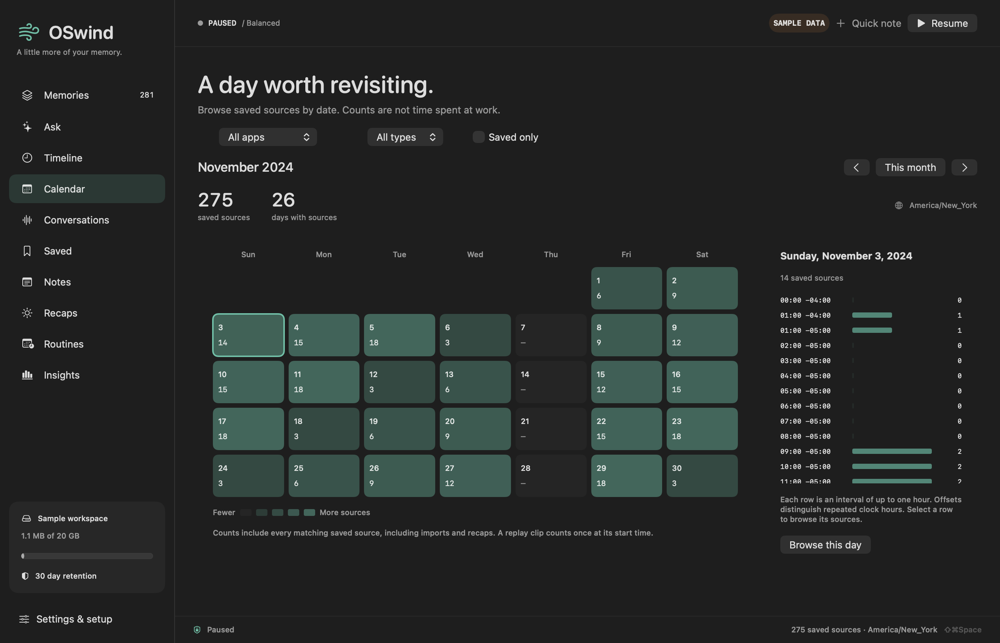
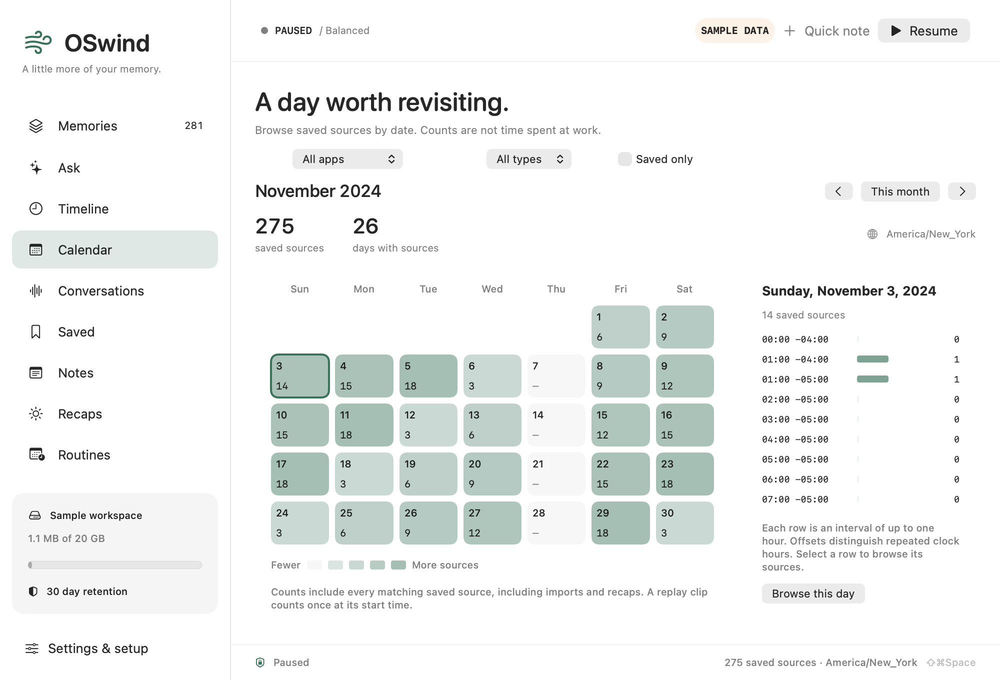

# Browse saved sources by date

The **Calendar** sidebar shows a complete Gregorian month heatmap and a selected day's hourly breakdown. Choose an application, source type or Saved only. Selecting an hour or **Browse this day** opens Memories with the exact UTC interval, application and metadata scopes preserved. The visible calendar slice can be cleared or used for Ask.

Counts are saved **sources**, not time spent working, attention, recording coverage or productivity. Imported notes and recaps count too. A sampled text span, replay clip or audio chunk counts once at its start timestamp; its duration is not spread across buckets. Calendar counts include every matching source rather than the search result cap. Browsing the resulting source list still uses its normal result window and source-start-only time matching. Ordinary time-scoped search also includes bounded sampled text span overlap; use `--source-starts-only` or `sourceStartsOnly: true` for start-only behavior.

## Civil time and scope

The calendar starts in the Mac's time zone and locale's first weekday. The visible zone is shown with the month. A system time zone change reloads the same civil month in the new zone. CLI/HTTP/MCP clients can choose a zone and weekday explicitly. Spring-forward days can have 23 hour rows; fall-back days can have 25. Repeated clock hours show different UTC offsets and select different exact intervals. Half-hour transitions produce shorter intervals where required. A skipped civil date remains unavailable instead of selecting the next day.

An empty date shows zero, rather than being omitted. Scope timestamps are inclusive at the start and exclusive at the end, intersecting each bucket. Application names match their stored spelling exactly; speaker labels use the existing canonical recording-local name index. A speaker name is not cross-recording identity. Calendar does not apply search text, semantic similarity, Boolean content conditions or relevance thresholds. Those requests fail explicitly.

## Interfaces

```bash
oswindctl --data /path/to/library activity --month 2024-11 \
  --day 2024-11-03 --time-zone America/New_York --first-weekday 2
oswindctl --data /path/to/library activity --month 2024-11 \
  --app Safari --kind screen --favorites --tag release \
  --from 2024-11-03T05:00:00Z --to 2024-11-03T06:00:00Z
```

`GET /v1/activity?month=2024-11&day=2024-11-03&timeZone=America%2FNew_York` uses the existing loopback token, Host and Origin boundaries. MCP **memory_activity** is read only. Both accept `month`, `day`, `timeZone`, `firstWeekday`, `app`, `kind`, `favorites`, `tag`, `speaker`, `start` and `end`; MCP favorites is a Boolean and firstWeekday an integer. Responses include complete `days`, selected-day `hours`, exact ISO boundaries, metadata `scope`, `totalSources` and `recordedDays`. See [integrations](INTEGRATIONS.md).

## Storage and refresh

One bounded SQLite statement counts all daily and hourly buckets in one read snapshot. Ordinary counts use timestamp indexes without hydrating sources, reading embeddings or opening retained media. Tags now use a transactionally maintained covering metadata projection, while combined source filters use a covering index. See [indexed tags and responsive opening](TAG-INDEX.md) for ready-query performance, write costs and first-installation limits. Derived kind/time and saved/time indexes are created when an existing library opens. The original calendar index change was additive under schema20. Current schema24 also fences newer curated metadata and sampled-span semantics; older clients now refuse the library. Large libraries pay a one-time index construction cost at first open. On a one-million-source owned clone, first open took 1.91 seconds and repeated open 47 ms, adding 26.1 MB of derived indexes to the 5.8 GB database. Logical payload hashes and schema stayed identical. Payload hashing warmed the cache; this is not a cold-start measurement.

Library preparation and the native calendar query run on utility workers with cooperative SQLite cancellation. Newer controls and library changes discard late replies. Capture invalidations coalesce; the active visible calendar checks a cheap revision every three seconds, or ten in low-power mode, only while the app is active and the session is unlocked. Reads alone do not cause recounting. No calendar monitor remains after leaving the view. Successful deletion and retention clear old counts before refresh; library switching, history erasure and vault lock cancel work and clear the view. Plain count values do not retain an encrypted volume descriptor. A closed store cannot be queried.

## Evidence and remaining work

[Aggregate evidence](../benchmarks/activity-calendar-v1.json) binds the tested source, signed package, process checks, race checks, renders and synthetic archive measurements. The public `scripts/activity-calendar-smoke.py` exercises 600 owned imports through actual CLI, HTTP and MCP processes, exact repeated-hour ranges, combined metadata scopes, complete counts, malformed requests and server refresh after another writer. The benchmark harness uses an independent Python zoneinfo oracle for every day and hour count, including a 23-hour day.

These are synthetic metadata and component-render checks. Physical keyboard, picker, scroll and VoiceOver interaction, active capture energy and real long-running desktop acceptance remain open. The earlier one-million/year fixture had a roughly 200 ms tag median and 2.97 s maximum/p95; those samples remain in the original evidence. The newer indexed path measures 2.67/2.76 ms median/p95 on its paired trial. Its 18.74-second initial installation stays a startup optimization TODO; the native opening state now stays responsive with cooperative Stop. Controlled cold-cache, native input and energy acceptance remain open. No comparison establishes a competitor ranking or broad parity.




