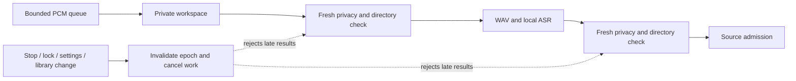

# Bounded audio privacy observations

Live audio startup, polling, PCM processing and transcript admission now use asynchronous Accessibility observations. No synchronous AX tree traversal remains in the app. The utility reader retains the existing per-object 40 ms timeout, cooperative 350 ms traversal budget, 1,000-node/8,192-message limits and 16,000-character text bound. These are configured work limits, not a hard real-time guarantee from macOS.

Screen snapshots, replay and audio can share a currently running observation of the same application PID/bundle. At most eight consumers observe that read. Cancellation releases only the caller's lease; the producer is cancelled only after its last observer leaves. Its slot remains occupied until the actual operation ends. A different target waits for the preceding operation to release its slot, then rechecks admission. Completed observations and native AX objects are not cached for later requests.

## Audio lifecycle

Audio repeats epoch, lock, open-store, foreground identity, secure-input and exclusion checks after suspension. Missing/incomplete observations refuse startup or stop recording. Device authorization, speech preparation and stream startup cannot publish an obsolete attempt. Ordinary polling runs once per second with at most one controller poll in flight. Starting a new run cancels unfinished old work and discards its pending chunks; each queued chunk keeps its original epoch and recording session ID.



There are at most three waiting transcription chunks, in addition to the one being processed. Privacy is renewed before WAV creation and again after transcription, immediately before synchronous admission. Directory replacement cannot redirect these writes. Explicit **Stop audio** finishes eligible queued/final data; Pause/privacy/lock discard it. Recognizer failure still reports the segment error while preserving otherwise allowed recording. A privacy failure stops hardware and pending work. Settings → Audio shows the reason.

When AX permission is absent, the existing identity-only path for native applications remains available. Secure-field detection and accessible title/URL context are absent in that mode; browser URL rules can refuse recording. Identity-only data is not equivalent to a complete AX observation. The one-second foreground check can miss brief transitions, and observations are not atomic with later system events. Background audio/tab isolation and physical device/permission recovery remain separate acceptance work.

Cancellation is cooperative. A current native IPC or inference call can finish after cancellation; its result cannot enter a different epoch. File/workspace reservations remain until the corresponding work actually releases them. The original directory is retained for safe close after a move; a replacement database, WAL and shared-memory file remain unchanged in the owned regression fixture.

## Interfaces and evidence

The Swift helper `AccessibilityContext.current(targetBundleID:)` is now async and delegates to the same reader; use `await AccessibilityContext.read(...)`. HTTP, MCP, source schema20 and the import CLI retain their contracts. This change does not add live-device capture to the CLI.

[Aggregate evidence](../benchmarks/audio-privacy-v1.json) binds the tested source, all three signed/raw payloads, complete package tree and process checks. Tests use synthetic contexts, PCM, speech backends and stream/permission factories: no test requests real microphone permission or constructs a real input device. The existing native/model suite uses owned encrypted volumes and local converted models. Signed audio-import process checks use a deterministic ASR fixture, not recognition-quality evidence.

```bash
swift test --filter 'AccessibilityCoordinatorTests|AccessibilityReaderTests|AudioLifecycleTests|AudioPrivacyTests|LibraryWorkspaceTests'
OSWIND_TEST_NATIVE_VAULT=1 swift test --sanitize=thread \
  --filter 'AccessibilityCoordinatorTests|AudioPrivacyTests|AudioLifecycleTests|AudioMemoryTests|LibraryWorkspaceTests|SnapshotAdmissionTests|Replay'
```

Physical microphone/system-audio, mixed foreground transitions, dense browser availability, interruption/device recovery, actual AX latency, energy and VoiceOver/input acceptance remain open. Sharing one in-flight producer removes duplicate observations by contract; it does not establish a measured power or capture-performance improvement. Broader feature parity and a competitor ranking remain unverified.

## Native sample interaction

On 24 October the signed candidate was exercised through native automation in an explicitly selected sample library with capture paused. Calendar day/hour counts, four-source hour browsing, preservation of that interval in evidence-only Ask, citation expansion and original-source opening were observed. Audio with both sources disabled refuses to start; Escape dismisses settings and ⌘K focuses search. These are interaction checks, not live-device or VoiceOver acceptance.

Fresh CLI doctor reports unlocked, correcting earlier lock-state prose. The staged GUI shows ungranted capture controls despite CLI preflights passing; no permission change was attempted. The initial automation selection launched before its isolated environment was set and displayed onboarding only. It was terminated, then relaunched with an explicit sample root; the initial default-library open cannot be excluded. Aggregate evidence records this boundary.
