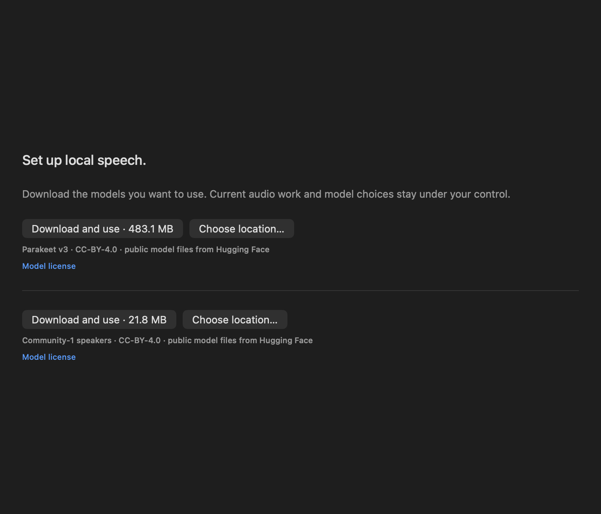
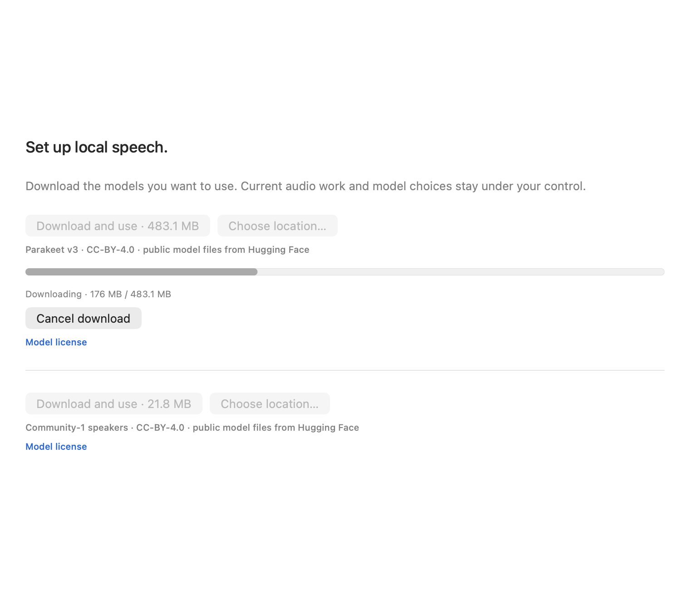

# Audio clips, transcripts and imports

Settings → Audio controls microphone and system audio independently. **Start audio** begins local transcription. **Stop audio** finishes the last voiced segment; Pause/privacy/lock stops discard pending capture. Recording is off by default.

Enable **Retain audio clips for playback** to keep future source clips. It starts off. A detected secret suppresses the entire clip because redacting transcript text cannot remove speech from a recording. Sensitive values can span segment boundaries, so detected secrets hide all timed fragments for that clip. Recognized English credential phrases such as “my password is…” conservatively hide the whole transcript as well. Sanitized full text remains available when only a key/value span was masked. Redaction is pattern-based, can over-redact and does not guarantee complete PII removal. The microphone/system labels identify capture tracks, not individual people.

Open an audio memory to play/pause, adjust volume, scrub, or seek to a transcript segment. Clips follow normal retention/storage cleanup and source deletion. Backup/restore preserves clips, structured transcripts and session identifiers. Text JSON interchange strips media paths and sanitizes both transcript representations.

**Import audio file…** processes a chosen local file. WAV and stereo AAC have real conversion tests; other formats depend on AVFoundation decoding and the configured recognizer. OSwind privately snapshots the input before transcription, streams conversion into a separate mono 16 kHz PCM WAV, and optionally retains the original recording's bytes. Editing/deleting the original after snapshot cannot alter that operation's copy. Conversion uses bounded buffers; files longer than 24 hours are refused. The import's time is when it was added, not inferred meeting time; its relative media duration does not create a future recording end time.

```bash
.build/release/oswindctl --data /path/to/library import-audio /path/to/meeting.m4a --retain-audio
.build/release/oswindctl --data /path/to/library import-audio /path/to/meeting.wav
.build/release/oswindctl --data /path/to/library search 'kind:audio checklist'
```

CLI retention is explicit per import with `--retain-audio`. The app import follows the current Audio retention setting. Importing is an explicit file action; foreground capture exclusions do not classify the file's contents. Both paths apply transcript redaction.

Audio settings offer **Whisper.cpp** or **Parakeet v3 · Core ML**. Whisper uses a configured local executable and ggml model. Parakeet uses pinned FluidAudio 0.17.7, an explicitly selected directory of compiled `Preprocessor.mlmodelc`, `Encoder.mlmodelc`, `Decoder.mlmodelc`, `JointDecisionv3.mlmodelc` and `parakeet_vocab.json` files. Recognition never downloads/resolves model repositories or purges a caller's cache. In Settings → Audio, choose **Parakeet v3 · Core ML**, then **Download and use** to install the pinned model (483 MB / 22 files). Progress and cancellation are built in; no terminal script is needed. **Choose location…** installs into a versioned folder under another cache location. The CLI and Python installer remain available for automation. Existing installs are verified without downloads; `--verify-only` fails locally if absent. Corrupt existing directories are preserved and refused. The native app/CLI streamer cleans private leased staging after cancellation and recovers abandoned jobs on the next install, including killed processes. Partial-byte resume remains pending. The standalone Python installer does not share native crash recovery. You can also choose an existing compatible local directory. NVIDIA's [base weights](https://huggingface.co/nvidia/parakeet-tdt-0.6b-v3) are CC BY 4.0; preserve NVIDIA/FluidInference attribution. The [conversion card](https://huggingface.co/FluidInference/parakeet-tdt-0.6b-v3-coreml) has inconsistent prose (Apache) versus metadata (CC BY); no weights are redistributed here.

Parakeet exposes Neural Engine + CPU, GPU + CPU and CPU-only Core ML policies. Intel requires CPU-only or Whisper. A policy requests available compute units, not proof of where every operation executes. One model remains resident; capture/import requests serialize. **Release resident speech model** frees it when current work finishes. Changes of model path/compute replace the resident model. Replacing files at the same path requires releasing it first. Startup prepares native models before requesting microphone access; pause/cancellation/source changes invalidate activation. Queued recognition cancels promptly. Core ML compilation/inference can finish after cancellation or its time budget, but such results are discarded before admission; there is no hard process-kill guarantee for native calls. SDK debug transcript logs and console mirroring are disabled.

```bash
.build/release/oswindctl --data /path/to/library import-audio /path/to/jfk.wav \
  --engine parakeet --native-model /path/to/compiled-parakeet-v3 --compute neuralEngine
```

Parakeet returns word timings; Whisper returns recognizer segments. English-only `.en` models are intended for English; choose multilingual weights for other languages. Timestamp resolution follows the recognizer's segments. Session IDs are preserved for grouping. Imported recordings can now receive recording-local speaker labels and manual names; live speaker tracking, meeting detection/session UI and hotwords remain open work.

Temporary input/recognizer workspaces use private permissions and held leases outside the live library. Normal completion/cancellation removes owned work; subsequent operations conservatively clean recognized abandoned stages. Saved transcripts survive optional additional-index failures. Library switching cancels an in-flight import. Live capture rechecks lock, epoch and current privacy rules after ASR; polling gaps and changing foreground context remain limitations.

Schema 9 protects diarization provenance/scope/unknown counts from older writers. Schema-6/7/8 identities and vector keys survive upgrade. A muted runtime test on this Mac verifies the actual player clock, pause, seek, finish and stopping on deletion; it also passes ThreadSanitizer. Native microphone/device-change, button/focus/accessibility and file-panel acceptance remain separate.


## Speaker labels for imported recordings

Under **Identify speakers in imported recordings**, use **Download and use** for the pinned Community-1 model. Native setup runs inside the packaged app. `oswindctl native-model install speakers` and the standalone Python installer are alternatives. This pinned Community-1 download contains 28 files / 21,816,863 bytes, including original license, attribution, citations and reconstructed provenance. Only the supported capitalized Community-1 models are included; legacy lowercase online models are excluded. The scoped [upstream notice](https://huggingface.co/FluidInference/speaker-diarization-coreml/blob/df2625ac79a7ac6b65ad868fee6d80f320da4232/NOTICE.md) identifies pyannote, WeSpeaker, BUT Speech@FIT and Fluid Inference. No weights ship inside the app.

Speaker recognition requires macOS 15+ because the SDK documents a crash-prone BNNS path on macOS 14. Plain transcription still works without this option. Loading uses exact local Core ML files and bounded PLDA parameter decoding; it cannot download, recover or purge model caches. One serialized speaker runtime remains resident until released. Cancelled queued jobs disappear; cancelled/overdue inference cannot be saved. Core ML calls may finish after cancellation. No speaker embeddings, profile database or diagnostic embedding exports are persisted.

```bash
oswindctl --data /path/to/library import-audio /path/to/meeting.m4a \
  --engine parakeet --native-model /path/to/parakeet-v3 \
  --speaker-model /path/to/community1 --retain-audio
oswindctl --data /path/to/library name-speaker MEMORY_ID --from "Speaker 1" --name "Maya"
```

`--speaker-model` enables diarization for that import; `--diarize` uses the configured path and `--no-diarize` disables it. A failed requested speaker stage fails the import before saving, rather than silently reporting success without labels. Original media remains untouched. Native word timings permit finer speaker attribution; a coarse Whisper segment containing multiple voices may stay wholly unassigned. It is never fabricated into independently timed words.

Labels follow first appearance within the file. Attribution merges duplicate same-speaker turns and uses unambiguous temporal coverage; overlapping, weak and boundary spans can remain **Unassigned or mixed**. This threshold is a heuristic, not calibrated speaker confidence. A prefix-duration index avoids scanning every turn for every word, including long/nested ASR intervals. The UI reports estimated speaker count and assigned span coverage. Adjacent same-speaker spans become readable paragraphs without changing source timings. Selecting a word seeks to its original segment and the current timed span highlights during playback; this is word-level with Parakeet and coarse-segment-level with Whisper. Unknown spans remain separate. Paragraph ranges are cached rather than rebuilt on each playback tick. Native link/keyboard acceptance remains unverified while the Mac is locked. Select a label to name it within this recording. Naming refuses missing sources, duplicate identity names, invalid labels and detected secrets; changes are transactional and preserve unrelated metadata. Names are labels, not persistent voice identities. Names now have a separate local keyword index, available in Keyword/Hybrid search, and an exact `speaker:"Maya"` scope in every search mode. Names compare without case/diacritics; a speaker scope selects entire recordings containing that label, preserving other voices as context. It does not identify one person across files. CLI also accepts `--speaker NAME`; HTTP/MCP accept the `speaker` parameter. People memory and cross-recording/live identity matching remain pending.

Answers use speaker-tagged literal excerpts with segment time bounds. Alignment must account for every non-punctuation source character in sequence; if it fails, evidence falls back to the original raw text without assigning speakers. Unknown spans stay unknown. Semantic passage ranges still refer to original UTF-16 source offsets; annotations never replace the source text. Names remain separate from transcript embeddings, so renaming preserves expensive vectors. Renaming or revising speaker/timing evidence invalidates dependent saved answers and rejects stale in-flight answers. Favorite/tag edits preserve answers. Source deletion also erases name-index entries. Schema 10 rebuilds the derived name index during migration and restore.

The real stock-voice A/B/A/B fixture returns 80 ASR words with normalized WER 0. Of 76 words whose ASR-timed midpoint is at least .25 s from an authored utterance edge, 71 receive the expected synthetic voice label, five stay unassigned and none receive the other voice's label. Nine of all 80 words stay unassigned. This uses known generated-voice intervals and model-generated word timings, not independent word-alignment ground truth or natural-meeting DER/WDER. Naming, retained bytes, full backup/restore, text interchange and deletion pass through actual CLI processes. Native GUI controls, real meetings, overlap/noise and sustained power remain unverified.


## Native model download behavior

Both native catalogs are compiled into the app from reviewed JSON, checked in CI; no runtime source checkout or Python is required. Transfers use HTTPS, reject downgrade redirects and authentication URLs, omit application credentials/cookies, and stream bytes directly into private staging files. Pinned size limits apply during transfer and SHA-256 checks apply before atomic no-replace publication. Existing model directories are verified and preserved; unexpected components, links, corrupt members and invalid destinations fail. Model caches cannot be nested inside memory libraries, backup packages or existing model packages. Choose another location to install a fresh version without altering an existing folder.

A download completing after manual model edits leaves those edits intact and offers **Use model**. Active recording/transcription/import work also defers selection. Switching libraries cancels the old setup context; late results cannot select a model in the new library. Installing models never starts capture. A successfully published model can remain cached if cancellation arrives just after publication; incomplete private work is cleaned. Models stay outside the live recording quota and full library backups.

```bash
oswindctl native-model list
oswindctl native-model install parakeet --cache-root /path/to/model-cache
oswindctl native-model verify parakeet --cache-root /path/to/model-cache
oswindctl native-model install speakers --cache-root /path/to/model-cache
```

These CLI commands run before opening/creating a memory library. Progress goes to stderr; stdout is JSON with the installed directory as a filesystem path. First Ctrl-C cancels and cleans up, exiting 130; another interrupt exits immediately and leaves a recoverable job. Model files and their original notices/attribution are retained; no recordings/transcripts/API keys are included in download requests. **Verify files** is local-only. Native transfer resume/parallelism and model-cache eviction remain pending; actual UI clicks/panels/keyboard acceptance is still separate from rendered and controller tests.






```bash
oswindctl --data /path/to/library search --mode keyword Maya
oswindctl --data /path/to/library search --speaker "Maya" archive
oswindctl --data /path/to/library ask --provider evidence 'Who owns capture? speaker:"Maya"'
```

Name-only natural-language lookups should use Keyword/Hybrid; semantic-only search still ranks transcript content, with explicit speaker scopes supported. Speaker tags are diarization estimates and manual labels, not verified identity or correctness guarantees. A language model can still misattribute a claim or produce invalid citation numbers; warnings and the original source remain reviewable. The authored `scripts/speaker-evidence-smoke.py` records actual responses and failures instead of hiding them behind a success-only score.


The app now browses explicit long-transcript previews, retaining the original text while deferring timed arrays until a source is opened or chosen for an answer. Opening runs off the UI thread with cancellation and revision checks. External API/CLI search stays complete by default; see [preview contracts](INTEGRATIONS.md#long-transcript-search-previews). Full transcripts, playback timings, local names and original passage anchors remain available after hydration.
