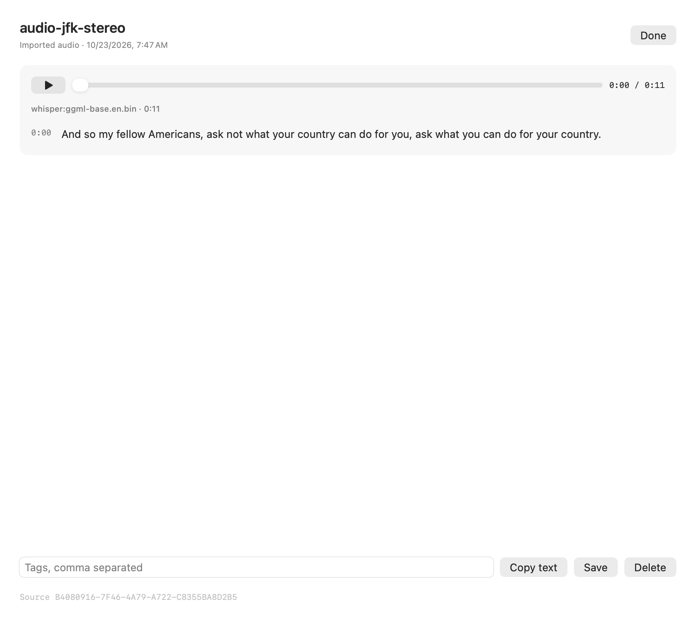
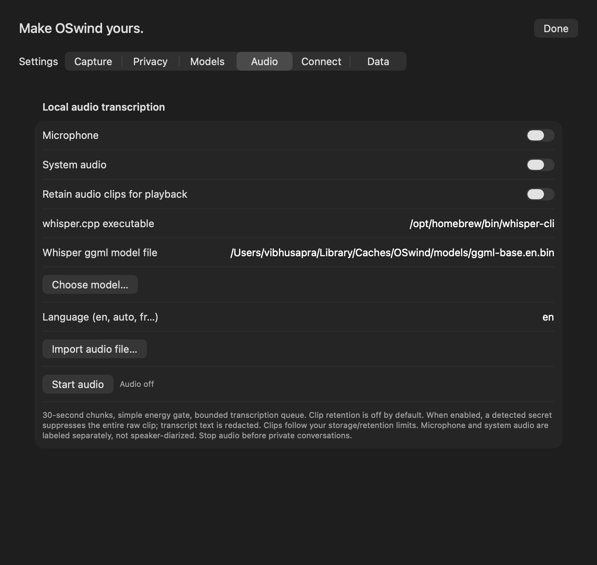

# Audio clips, transcripts and imports

Settings → Audio controls microphone and system audio independently. **Start audio** begins local transcription. **Stop audio** finishes the last voiced segment; Pause/privacy/lock stops discard pending capture. Recording is off by default.

Enable **Retain audio clips for playback** to keep future source clips. It starts off. A detected secret suppresses the entire clip because redacting transcript text cannot remove speech from a recording. Sensitive values can span segment boundaries, so detected secrets hide all timed fragments for that clip. Recognized English credential phrases such as “my password is…” conservatively hide the whole transcript as well. Sanitized full text remains available when only a key/value span was masked. Redaction is pattern-based, can over-redact and does not guarantee complete PII removal. The microphone/system labels identify capture tracks, not individual people.

Open an audio memory to play/pause, scrub, or seek to a transcript segment. Clips follow normal retention/storage cleanup and source deletion. Backup/restore preserves clips, structured transcripts and session identifiers. Text JSON interchange strips media paths and sanitizes both transcript representations.

**Import audio file…** processes a chosen local file. WAV and stereo AAC have real conversion tests; other formats depend on AVFoundation decoding and the configured recognizer. OSwind privately snapshots the input before transcription, streams conversion into a separate mono 16 kHz PCM WAV, and optionally retains the original recording's bytes. Editing/deleting the original after snapshot cannot alter that operation's copy. Conversion uses bounded buffers; files longer than 24 hours are refused. The import's time is when it was added, not inferred meeting time.

```bash
.build/release/oswindctl --data /path/to/library import-audio /path/to/meeting.m4a --retain-audio
.build/release/oswindctl --data /path/to/library import-audio /path/to/meeting.wav
.build/release/oswindctl --data /path/to/library search 'kind:audio checklist'
```

CLI retention is explicit per import with `--retain-audio`. The app import follows the current Audio retention setting. Importing is an explicit file action; foreground capture exclusions do not classify the file's contents. Both paths apply transcript redaction.

The current app backend is a configured local whisper.cpp executable and model. English-only `.en` models are intended for English; choose multilingual weights for other languages. Timestamp resolution follows the recognizer's segments. Session IDs are preserved for grouping, but meeting detection, a meeting-session UI, word highlighting, named speakers, diarization and hotwords remain open work.

Temporary input/recognizer workspaces use private permissions and held leases outside the live library. Normal completion/cancellation removes owned work; subsequent operations conservatively clean recognized abandoned stages. Saved transcripts survive optional additional-index failures. Library switching cancels an in-flight import. Live capture rechecks lock, epoch and current privacy rules after ASR; polling gaps and changing foreground context remain limitations.

Schema 8 prevents older binaries from silently rewriting away structured transcript fields. Schema-6/7 identities and vector keys survive upgrade. Native microphone/device-change, playback/seek/focus and file-panel acceptance remain separate from offscreen rendering and backend tests.




