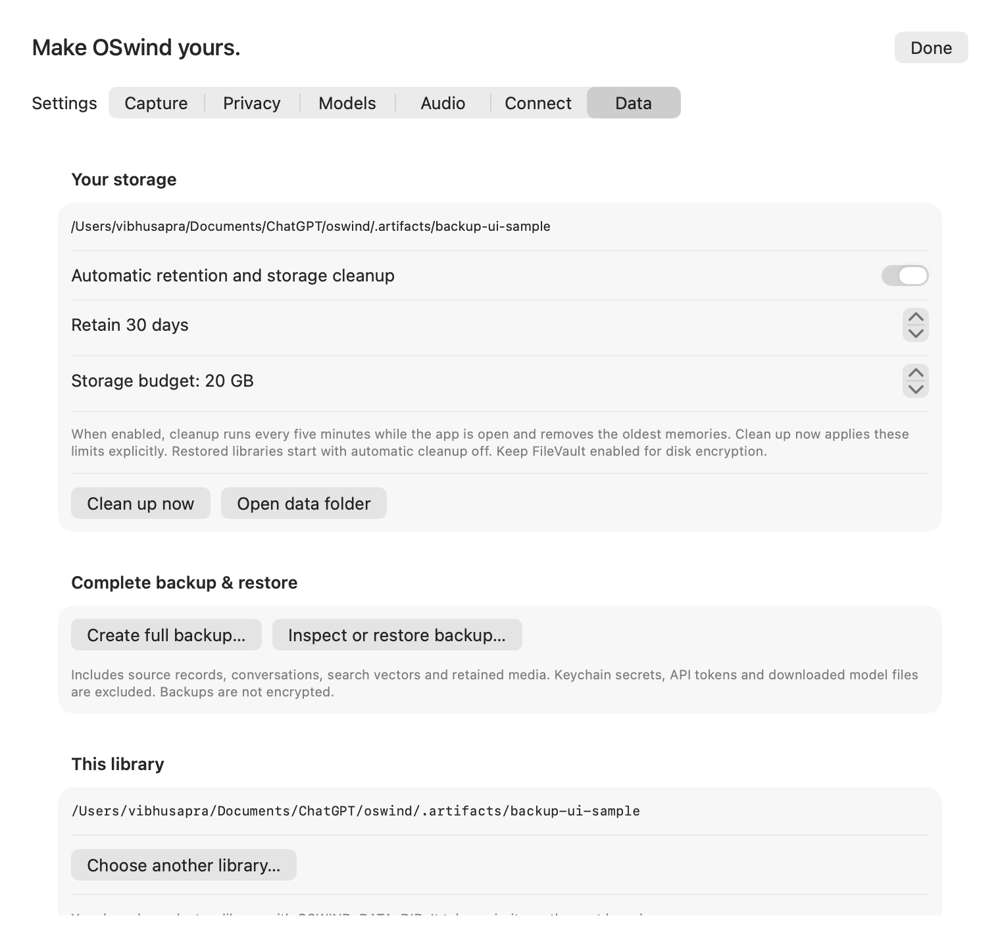

# Full library backup and restore

Use **Settings → Data → Complete backup & restore** to create a `.oswindbackup` package, inspect one, or restore a new library. After restoration, choose **Open restored library**. **Choose another library** opens an existing library; a missing selected drive shows a recovery screen on the next launch. The current library is left intact.

A package contains its source database, notes, tags, favorites, timestamps, retained screenshots/audio, saved conversations and source anchors, supported search vectors/passages, people/project definitions and aliases, source links and rejected matches, and settings. Entity index completion is rebuilt on restore; entity catch-up stays off. See [entity portability and erasure](ENTITY-MEMORY.md). It excludes Keychain credentials, the local API bearer token, downloaded model weights and disposable search caches. Hashes detect corruption; they do not establish who created a package.

**Backups are plaintext and not encrypted.** Package directories/files are created with private permissions. Keep them on trusted storage. Encrypted live libraries are available separately; encrypted backup packages and password/biometric backup opening remain open requirements.

The command line works independently of the app:

```bash
.build/release/oswindctl --data /path/to/library backup create /path/to/October.oswindbackup
.build/release/oswindctl backup inspect /path/to/October.oswindbackup
.build/release/oswindctl backup restore /path/to/October.oswindbackup --to /path/to/new-library
.build/release/oswindctl --data /path/to/new-library search --mode keyword "release checklist"
```

Inspect returns an `archiveFingerprint`. Optionally pass `--fingerprint HASH` to restore to require the exact inspected header. Restore always checks every listed payload hash and reference. It reconstructs data into OSwind's compiled schema; it does not execute archived triggers or import archived indexes/control metadata. Existing destinations, symlinks, unlisted/missing files, changed content and invalid paths are refused.

Restored libraries start with recording, microphone/system audio, API service, remote AI and automatic retention/storage cleanup **off**. Model endpoints and executable paths need setup on the new machine. Original privacy rules, retention values and other portable settings are preserved. Enable automatic cleanup deliberately, or use **Clean up now** to apply retention/storage limits. Search caches can be prepared again from retained vectors.

App library selection persists for the app. CLI/MCP defaults remain the normal data directory unless `--data` or `OSWIND_DATA_DIR` selects another. The app's Connect page generates MCP arguments with the current library path. A launcher-provided `OSWIND_DATA_DIR` takes priority over saved app selection on the next launch.

Capture can continue on other connections during backup. Media is privately pinned before a WAL-consistent database snapshot. Newly referenced assets are filled afterward; disappearing unpinned assets trigger bounded snapshot retries (`--max-attempts 1` through `10`, default `3`). Sustained inconsistent sources fail instead of silently dropping media. External tools that overwrite reused asset paths across the snapshot are outside the immutable-capture contract.

Cancel in the app or press Ctrl-C once in the CLI to clean unfinished work. A second Ctrl-C exits immediately. Forced exits can leave private staging directories. A later operation conservatively removes recognized abandoned work whose creator has exited and whose kernel lease is unlocked. For explicit cleanup:

```bash
.build/release/oswindctl backup cleanup
.build/release/oswindctl backup cleanup --directory /path/to/backup-parent
```

Cleanup never removes a published backup or restored library. PID reuse, changed stage identity or unrecognized files can cause a stale directory to be retained rather than guessed at.

Format v1 accepts source database schema 6–9. Older normal libraries upgrade when opened for creation; records are limited to 128 MiB of serialized payload. Schema 7 prevents older app versions from opening a restored library and ignoring its cleanup-off setting. The schema-6 upgrade preserves existing cache identity/keys.

See [design and validation](BACKUP-DESIGN.md), [raw benchmark evidence](../benchmarks/README.md), and [remaining product work](PROGRESS.md). Cross-volume/non-APFS integration, disk-full/power-loss fault injection, native panel/keyboard acceptance and encrypted backup remain open.





