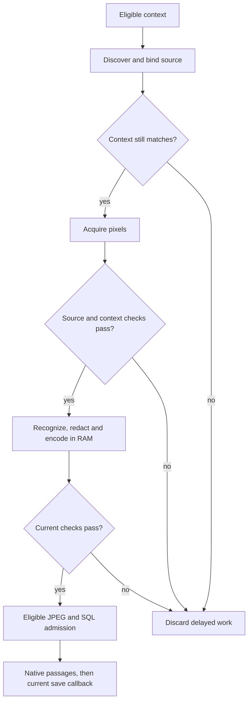

# Snapshot admission and privacy

Snapshots now refresh their context around asynchronous source discovery, pixel acquisition and recognition. The original process, bundle, focused title, URL and available window bounds must still agree. A detected protected field, lock, permission loss, pause, capture-setting change or cancellation discards delayed work. Accessibility text is taken after image receipt, rather than merging the initial page's stale text into a later image.



For focused windows, fresh ScreenCaptureKit inventories must still identify the same unambiguous window ID, title and geometry after capture and recognition. A missing or newly ambiguous focused window defers capture; it cannot fall back to another window. These are separate OS observations, **not an atomic guarantee that AX metadata and pixels describe the same instant**.

## Full-display masks

Full-display snapshots mask recognized browser applications because background URLs cannot be verified. They also mask configured excluded applications and the whole application owning any window with an excluded title. Safe windows belonging to that application are masked too. Case-insensitive application rules use the same policy as focused capture.

If an excluded window has no application identity that can be masked, capture defers. Window-owner application objects are included even if absent from the separate application list. After pixel acquisition and recognition, OSwind refreshes the inventory: a newly excluded application outside the original mask discards the frame. The next capture can build a new mask. This coverage check does not establish complete sensitive-content detection.

## Image and library admission

Vision, redaction, JPEG encoding and embeddings run in the utility worker. JPEG encoding uses memory; OSwind writes no screenshot file before the post-recognition context and source checks. Recognized secrets or redacted title/URL metadata suppress the image; redacted text also suppresses OCR-region text.

Before writing, a cooperative media reservation must belong to the same open library. Directory descriptors and the original library device/inode bind the destination. Files are created exclusively with mode `0600`; symlinked image directories and replaced library roots are refused. A final context check and SQLite admission run without actor suspension. A failed admission removes its newly written file through the retained descriptor. Capture-generated files remain subject to ordinary retention, erasure and full-library wipe. Native capture passages finish before the save callback can launch automatic catch-up, avoiding duplicate work for a long source. A passage-index failure keeps the already committed keyword source/JPEG, reports pending indexing and can recover without recapturing. Stale callbacks after pause, capture-setting invalidation or task cancellation are suppressed.

Encoding stays off the main actor. Final file flush/SQL admission is synchronous. AX context reads currently remain on the main actor and are refreshed several times; bounding that work and moving appropriate AX reads off the main actor is a remaining performance gate. Physical capture latency, slow-disk responsiveness and sustained energy still need device measurements. Cancellation waits for the owned recognition worker to return; a synchronous Vision operation already executing is not forcibly terminated. Pause, relevant setting changes and sleep also cancel the owned recognition/index tasks; work already executing in a synchronous OS call reaches its next cancellation check. Pausing invalidates the result even if recognition finishes later.

The same path is exercised inside an owned encrypted APFS library. A valid screenshot survives lock/unlock; delayed work after pause cannot add a second source or image. The backing device detaches while controller objects remain referenced. This is a synthetic fixture, not real authentication or unlocked native capture acceptance.

## Browser URL rules

With **Skip browser capture if URL is unavailable** enabled and website exclusions configured, recognized browsers require an HTTP(S) URL with a nonempty hostname. Empty, malformed, internal-page and file URLs are unavailable for this check. The explicit opt-out remains available; native applications do not require a web URL.

Domain exclusions normalize case, terminal DNS dots, percent-encoded host spelling and Foundation's Unicode/IDNA representation. Exact hosts and their subdomains match; lookalike suffixes and a hostname appearing only in userinfo do not. Common ASCII rules avoid a second URL parse on the hot path. [RFC 3986 §3.2.2](https://www.rfc-editor.org/rfc/rfc3986#section-3.2.2) describes host case, terminal DNS dots and internationalized host representation; the actual Foundation behavior is covered by local fixtures.

These settings exclude **new capture**. They do not erase or automatically hide previously recorded text. Use history erasure to remove past sources and dependent answers. Visual retrieval/previews and optional exports apply their separately documented current-policy checks. JSON import filters configured app/domain/title exclusions before inserting records; imported notes are not treated as live browser permission evidence.

## Verification and remaining gates

The [aggregate evidence](../benchmarks/snapshot-admission-v1.json) separates normal tests, TSan, actual encrypted-volume/model tests, synthetic process tests, package binding and own-app layout checks. `SnapshotAdmissionTests` drives the real controller, JPEG encoder and SQLite writer with owned image/context/recognition seams. One case runs actual Vision on owned pixels. These seams are internal; the public initializer always uses native permission/session checks and ScreenCaptureKit.

The [capture panel](../assets/snapshot-capture-light.png) and [privacy panel](../assets/snapshot-privacy-dark.png) were rendered in both appearances using isolated sample libraries. Permission checkmarks come from read-only preflight. The Mac was locked; these layouts do not establish native input or live capture acceptance.

```bash
swift test
OSWIND_TEST_NATIVE_VAULT=1 swift test --filter 'SnapshotAdmissionTests|NativeVaultVisualIndexTests'
swift test --sanitize=thread --filter 'SnapshotAdmissionTests|SnapshotDisplayPrivacyTests|BrowserPrivacyContextTests'
python3 scripts/domain-privacy-smoke.py /absolute/oswindctl --root /absolute/NEW-owned-artifacts
```

The domain process harness imports synthetic notes, verifies excluded records were never admitted, then checks CLI/HTTP/MCP search and direct reads. It does not claim retrospective hiding of existing history. The preceding signed package admitted six fixture records instead of the expected three; the failing report is retained.

Unlocked browser/window transitions, rapid context changes between observations, secure overlays, unknown browser detection, arbitrary visual PII, broader hardware/OS coverage, all-display device behavior, power and keyboard/accessibility acceptance remain open. Pattern filtering and context fencing are incomplete protection; no comprehensive DLP, atomic pixel/context, energy or competitor-ranking claim is made.
