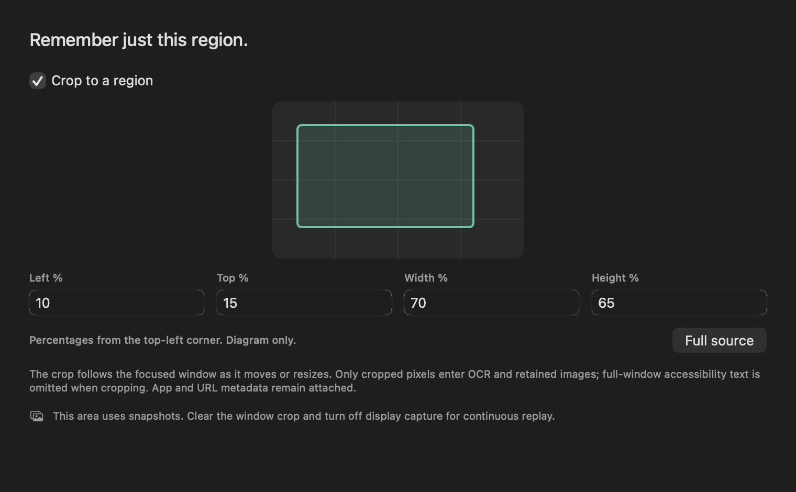
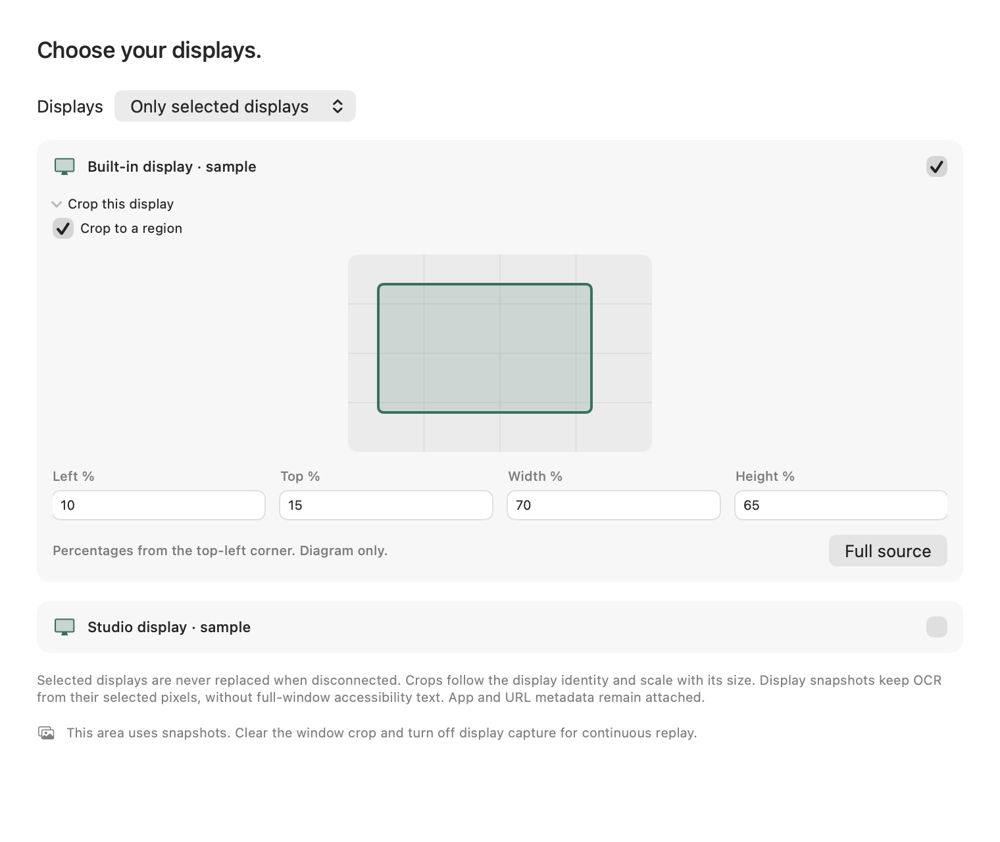

# Choose displays and crop regions

Settings → Capture → Capture area controls which pixels enter snapshot OCR and retained images. Default capture remains the focused window, without a crop. Turning on display capture exposes **All attached displays** or **Only selected displays**, with a crop editor for each included display. An empty selection captures no displays and idles before app-context reads or source discovery. A disconnected selected display is not replaced with another screen.

Crops use percentages from the source's top-left corner: left, top, width and height. The schematic is a diagram, not a desktop screenshot. The region follows a window's size or the display identity as resolution changes. Invalid dimensions defer capture instead of falling back to a full source. App/window/URL metadata remains capture context; cropping is not comprehensive redaction or deletion of previously recorded material.

## Execution and privacy

Display identities are canonical UUIDs obtained from macOS, rather than persisted numeric display IDs or their order. Each capture resolves them against the current ScreenCaptureKit inventory. Ambiguous selected identities defer; disappeared or moved/resized/replaced display sources fail renewed checks. Explicit targeted-window and replay commands cannot override an active display scope. Broader device/virtual-display/rotation coverage remains a hardware acceptance gate.

For display crops, `SCStreamConfiguration.sourceRect` selects a display-local rectangle in logical points, and output dimensions preserve its aspect ratio within the profile size. The source rectangle does not include the display's global desktop origin, which can be negative. Apple's [sourceRect documentation](https://developer.apple.com/documentation/screencapturekit/scstreamconfiguration/sourcerect) notes that this setting is ignored for independent windows. Therefore window crops remove framing/shadows and crop the returned bitmap inward to complete pixels **before OCR, fingerprinting and image encoding**. This still acquires the complete window in memory first; it does not demonstrate lower window-capture GPU or memory cost.

Cropped windows and all display snapshots omit full-window accessibility text. Otherwise a source outside the selected pixels could be merged into the saved text. Accessibility still supplies the foreground privacy/context decision. Existing browser/app/title exclusions, full-display application masks, secret filtering, post-image/post-recognition source checks and private image/SQLite admission remain active. Display mask and source-identity checks share each fresh inventory rather than adding an independent inventory read for each condition. See [snapshot privacy](CAPTURE-PRIVACY.md).

Editing a region invalidates in-flight capture and replay work and resets snapshot deduplication fingerprints. A configured window crop uses snapshots even if replay was selected. Explicit replay refuses a window crop or display mode; clear the crop and use focused-window mode for continuous replay. All-display/cropped replay is not implemented. There is no silent uncropped replay fallback.

## Saved configuration and compatibility

Schema20 is a compatibility fence for capture clients. Earlier schema19 builds do not understand region settings; allowing them to open a cropped library could widen recording. They must refuse the newer library before use. The migration changes the version marker and preserves existing source identities, text and saved settings. Schema19 remains a supported import/upgrade source.

Malformed region settings become a persistently blocked capture configuration. An unreadable existing settings file also blocks screen capture and disables automatic cleanup, instead of resuming with replacement defaults. Missing settings on a new installation still use normal defaults. The native panel explains invalid capture areas and provides an explicit way to choose them again. Correctly decoded privacy rules remain available when only the new region selector was malformed.

Backup/restore preserves selected UUIDs and both window/display crops. Restored libraries stay quiet: capture-on-launch and API access are off. A display from another Mac cannot be substituted simply because it occupies the same numeric position. The user must select an attached screen when the saved identity is unavailable.

## Evidence and limits

[Aggregate evidence](../benchmarks/capture-regions-v1.json) records 643 distinct passing cases, six remaining opt-in cases, 142 TSan passes, eight signed process groups, exact schema19 refusal and signed-package binding.

Owned pixel fixtures check horizontal and top-left vertical selection, inward rounding and output bounds. Controller fixtures exercise omission of outside-region accessibility text, cancellation when the region changes, malformed-policy blocking and refusal of scope-overriding window/replay requests. Settings/migration/restore fixtures and `scripts/capture-region-smoke.py` check persistence, schema compatibility and quiet portability without screen access. The optional `--old-cli` argument exercises an actual pinned older binary; without it, the harness labels the schema19 fixture as simulated.

Dark/light component renders use isolated sample libraries and invented display identities. They are layout evidence, not native keyboard/picker acceptance or actual ScreenCaptureKit crop alignment. Physical window/display crops, negative-origin and mixed-DPI monitors, hotplug, rotation, dense browser behavior, energy and broader native interaction remain release gates. The Mac remained locked during this increment. No normal history, authentication, Keychain credential or permission change was required.

