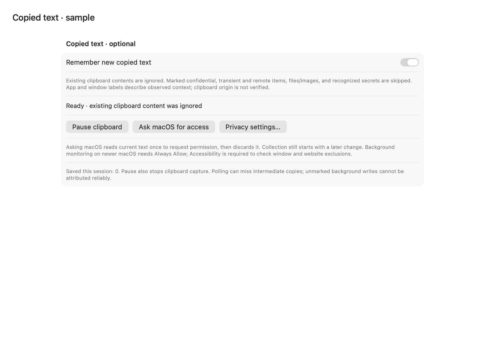
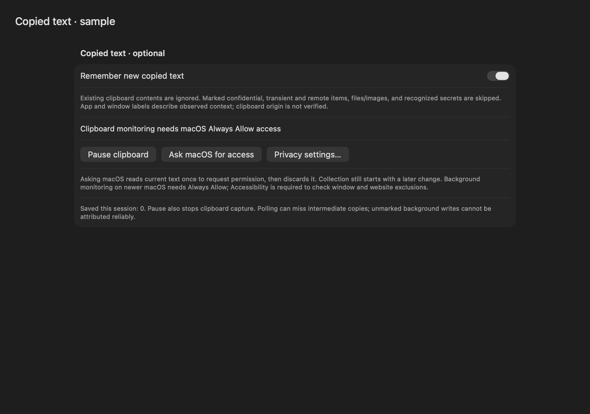

# Optional clipboard context

Status: **software/package qualified; native permission/foreground/power acceptance open (F082 partial)**. The [765-input receipt](../benchmarks/clipboard-context-v1.json) binds source `8799e3f` to13 passing stages:1,794 full passes/83 explicit skips; all102 mandatory clipboard/MCP methods under debug, sanitizer and optimization (32 new clipboard cases,70 parent MCP cases), no focused skips or race warnings;22 signed MCP process checks, SDK/API/MCP, actual quiet backup/restore with SIGINT/SIGKILL interruptions, strict signed/extracted34-file equality. Installed15 files and15 prior app trees remain unchanged. Signed modern officialPythonSDK2.3.0 Unicode interoperability also passes. The extra full-suite skip relative to the native parent is the existing visual-wake guard; it is not new clipboard acceptance.

Eight actual off/ready/permission/paused light/dark component renders were inspected. They use an injected reader and constant UI binding in an earlier debug binary with unchanged view source. No general/personal clipboard, actual permission request, foreground AX/native input, cloud inference or device setting change was used. The native UI tool is blocked by the locked Mac; no unlock workaround was attempted.

Collection defaults off. Starting or resuming baselines the current change count and ignores existing contents; only new eligible plain-text changes can be admitted. Quiet restore resets the choice to off. Global pause, sleep/lock, settings changes, erasure and library departure invalidate pending observations. Current-policy admission and active imports join before SQLite closes or the app exits.

The policy admits one bounded UTF-8 plain-text item, rejects known confidential/transient/generated/restored/Handoff/file/image/PDF markers, and always drops recognized secret patterns. Both fresh foreground observations must agree, be nonsecure and pass app/title/domain rules. Browser context without a usable URL refuses. A mismatched or explicitly unknown source marker refuses; a matching marker does not prove origin. Saved text labels foreground app/window as observed context, never verified origin. Event identity is stable, and the deduplication state needs only a32-byte digest.

macOS15.4+ exposes per-app pasteboard access behavior. Background polling must respect it and never repeatedly prompt or change System Settings. Any permission request belongs to an explicit user action. Source: [Apple API](https://developer.apple.com/documentation/appkit/nspasteboard/accessbehavior-swift.enum) and the installed SDK NSPasteboard.h, checked November1,2026.

The marker registry treats source as informational and defines confidentiality/transience signals. These are useful refusals, not complete protection or authenticated attribution. Source: [NSPasteboard marker specification](https://nspasteboard.org/), checked November1,2026.

Native reads use one process-wide off-main worker. A timed-out or cancelled waiter returns while the actual provider retains the worker slot; another poll cannot create another reader until that provider returns. Late responses are discarded. Provider operations do not capture a library or admission lease. The timeout race test uses an injected deadline so scheduler timing is not the assertion. AppKit may allocate provider data before its size can be rejected; the saved64KiB bound is not a provider-allocation bound. This limitation must remain explicit until an independently verified isolation strategy improves it.

The injected controller checks permission/count first, ignores existing contents on start/resume, skips text/context reads for unchanged counts, rejects changed/protected observations, deduplicates repeated text, and drains cancellation-ignoring reads before acknowledging Stop. Native cadence is one second, or five under low-power/thermal limitation, with idle/session guards. These are software/work-count facts, not power measurements.

Implemented tests cover actual searchable source admission, disable during held import preparation, source deletion during a cancellation-ignoring read, clipboard-only Pause/Resume without starting screen capture, actual plain Quit/session switching, retired/replaced libraries, permission denial/reapproval with no backfill and zero quiet-poll UI invalidations. Quiet polls perform no text/context read, source write or embedding request. These are work-count and software checks, not physical energy measurements.

Remaining work: actual general clipboard and permission/foreground/native input acceptance, valid promised-provider behavior, real scheduler/wake/physical power acceptance, broader user acceptance and hosted PR validation. The software receipt does not establish these gates or full parity. The Mac is currently locked; do not retry or bypass the refused native UI path.

The native adapter tests create and release only names prefixed `org.oswind.owned.clipboard.`; they never select the general pasteboard. Exact Unicode, confidential markers and changed counters pass with `OSWIND_TEST_NATIVE_CLIPBOARD=1`. This is independent owned API evidence, not a native UI/unlock test. The first worker test compile failed because an async helper closure lacked an escaping annotation; its log remains retained. No automatic clipboard capture or F082 parity is claimed.

A retained cold lazy-provider counterexample shows that source mismatch already refused storage but fetched text first. The native reader now accepts the observed bundle and rejects a mismatched/unknown source claim before requesting text; the corrected case records zero lazy text-provider calls. The original red log emits an AppKit warning about synchronous promise fulfillment from a background thread. Valid promised-provider behavior remains native acceptance work; no no-warning or full provider-compatibility claim is made. The current GUI attempt stays blocked by the locked Mac, with no unlock workaround.

## Reviewed component samples

## Hosted follow-up

Publication0c9b5b7 passes the benchmark job and full1,877-case software suite in [run41288968230](https://github.com/vibhusapra/OSwind/actions/runs/41288968230), but its native owned-APFS move case fails with a missing vaultSession member. The attached fixture is preserved. [Phase diagnostics](VAULT-MOVE-PHASE.md) retain that failure and add an instrumented comparison; the cause and hosted native qualification remain open. This does not change the source8799e3f local software qualification.
