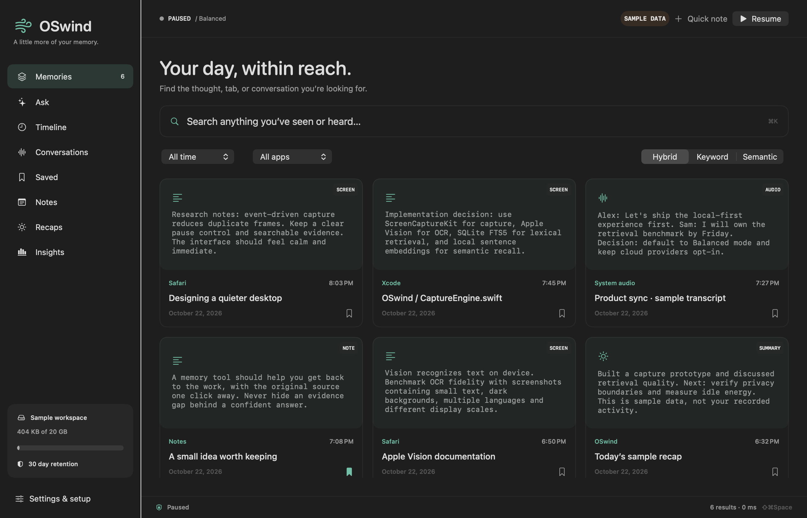

# Component qualification history

These milestone notes preserve the former README opening in reverse chronological order. Each source, count and artifact belongs to its named historical component; use the [progress ledger](PROGRESS.md) and [current feature matrix](features.json) for current scope. Earlier native-format results are not promoted to newer formats.

[Native collection retirement](SYNC-NATIVE-RETIREMENT.md), source `2345a25`, passes all 445 required controls in three builds, 62 native methods, nine current native-collection fixture parents without skips, and 34 package/process stages. Current-source readers verify 13-kind/native/raw/staged/cache/original/publication/media erasure, exact rollback, actual pre/post-commit SIGKILL and preservation of later lifetimes and media. Final review checks all 34 app/archive files and preserves 61 earlier trees. Public service/lifecycle and provider/device acceptance remain open; all 83 feature statuses stay unchanged. The parent PR's hosted missing-session failure remains causally unresolved.

[Collection erasure and final sync publication](SYNC-LIBRARY-BARRIERS.md), source `26461f5`, passes all 422 required controls in three builds, 62 native methods and 32 package/process stages. Independent review preserves 59 earlier artifact trees. Immutable birth eras prevent old offline lifetimes from reappearing after a wipe; local wipes require explicit group review before export. Final publication rechecks exact typed owners and the whole graph after policy callbacks. This remains internal infrastructure: complete native retirement, service lifecycle, trust/recovery and real provider/two-Mac acceptance are open. All 83 feature statuses remain unchanged.

[Search and indexing lifetime](SEARCH-INDEX-LIFECYCLE.md) now owns actual query and text/visual index work through Quit, switch, wipe and encrypted lock. Privacy erasure cancels pending query/source/import work and clears already-read results. All 362 required controls pass in three builds, with 62 native passes and 32 fresh package/process stages; independent review preserves 55 earlier app trees. Full sync, physical power, native device UX and distribution remain open. All 83 feature statuses stay unchanged.

[Selected source reader lifetime](SELECTED-READER-LIFECYCLE.md) now owns actual privacy metadata, source hydration and active historical validation through Quit, switch, wipe and encrypted lock. Idle validation timers do not hold exit ownership. All 298 required controls pass in three builds, with 56 native passes and 32 fresh package/process stages; independent review preserves 53 earlier app trees. Search/index now has its own later qualification above; model/device and whole-product acceptance remain open. All 83 feature statuses stay unchanged.

[Audio import lifetime](AUDIO-IMPORT-LIFECYCLE.md) now joins actual local decoding/speaker/file/database work through Quit, switch, wipe and encrypted lock. Admission runs off the UI thread and fences current saved privacy/retention through commit; canceled rollback removes only its new clip. The receipt passes all 266 required controls in three builds, 53 native methods and 32 fresh package/process stages; independent review preserves 51 prior app trees. Selected readers now have their own later qualification above; index/model setup and whole-product acceptance remain open. All 83 feature statuses stay unchanged.

[Answer lifetime and saving](ANSWER-LIFECYCLE.md) now joins actual Ask work through Quit, switch, wipe and encrypted lock, rejects retired launches, and atomically creates the first conversation with its turn. The source-bound receipt passes all 225 required controls in three builds, 51 native methods and 30 fresh package/process stages; independent review preserves 49 earlier app trees. Other worker lifetimes and whole-product acceptance remain open; audio import is separately qualified above. All 83 feature statuses stay unchanged.

[Source worker lifetime](SOURCE-WORK-LIFECYCLE.md) now joins actual note, recap, statistics and storage jobs through Quit, switch and encrypted-library lock. The source-bound receipt passes 190 required controls in three builds, 49 owned native methods and 30 package/process stages; independent review preserves 46 earlier apps. Audio import and Ask have separate later qualifications above; other reader/model setup lifetimes remain open. All 83 feature statuses stay unchanged.

[Committed file cleanup](PENDING-MEDIA-CLEANUP.md) resumes durable deleted-media work through current supported writer events and pending-only backoff, with no periodic idle probe. The source-bound receipt passes149 required controls in three builds,43 owned native methods,30 package/process stages and independent app/archive review with44 earlier apps unchanged. Older producers may need startup/wake/explicit retry. Complete sync, other worker categories, native input, power and distribution remain open; all83 feature statuses stay unchanged.

[Cleanup worker lifetime](CLEANUP-LIFECYCLE.md) owns deletion/maintenance through cancellation and workspace closure. The current source-bound receipt covers127 required controls in debug, sanitizer and optimized builds,41 owned native cases and30 package/process stages. All83 feature statuses stay unchanged; pending-media scheduling and complete product acceptance remain open. The predecessor PR128 hosted canceled-unlock busy failure remains unresolved.

[Native33 media compatibility](NATIVE-MEDIA-COMPATIBILITY.md) prevents an initialized prior32 collector from draining media reserved by a current process. The [1,346-input receipt](../benchmarks/native-media-compatibility-v1.json) passes 2,042 full methods, 755 sanitizer/optimized methods each, all88 mandatory controls, 30 package/process stages and39 owned native cases. Independent review verifies34 app/archive files and40 prior apps unchanged. Older native binaries must update. Complete sync, native input, sustained power and distribution remain open.

[Prior native32 media cleanup app qualification](MEDIA-CLEANUP-ADMISSION.md#schema32-app-and-native-qualification) passes 27 package/process stages and 39 owned native APFS/app-session methods. The [1,334-input receipt](../benchmarks/media-cleanup-native-v1.json) independently verifies every app/archive byte, strict ad hoc signing, 38 unchanged prior apps and actual packaged-CLI concurrency probes. CI now repeats the packaged media/backup regression. Complete sync, native input, sustained power and notarized distribution remain open.

[Media reservation and backup erasure safety](MEDIA-CLEANUP-ADMISSION.md) now defers physical cleanup while supported writers/snapshots are active and fences backup publication against concurrent erasure. The [software receipt](../benchmarks/media-cleanup-admission-v1.json) at `ab571d4` records 2,023 full passes, 702 sanitizer/optimized passes each and all 70 mandatory controls in three builds. Four CLI process harnesses and two authored 20,000-record scaling observations pass. The initial software receipt is separate from the later app/native qualification. Complete personal sync and native input remain open.

[Durable answer admission](SYNC-DURABLE-PUBLICATION.md) adds bounded restartable work, exact native retraction, version-aware evidence erasure and pre-retention library/inbox checks. The [software receipt](../benchmarks/sync-durable-publication-v1.json) at `4cbe898` records 2,005 full passes, 594 sanitizer/optimized passes each and all 51 mandatory controls in three builds, plus independent review of eight recovered debug databases and actual prior32 native client checks. **Complete personal sync remains TODO**; service/providers, key and collection lifecycle, cleanup and current-source package/native acceptance remain open.

[Complete answer publication](SYNC-ANSWER-PUBLICATION.md) now withholds incomplete synced answers and atomically projects their declared evidence. The [31-stage component receipt](../benchmarks/sync-answer-publication-v1.json) passes 1,953 full cases, 543 sanitizer/optimized cases each, all 57 mandatory controls and 39 native vault cases; six recovered databases and the signed archive pass independent review. **Complete personal sync remains TODO**, including service integration, production policy/media/transport, collection lifecycle and provider acceptance.

[Unavailable entity scopes](SYNC-UNAVAILABLE-SCOPES.md) preserve saved answers when a project/person is removed while refusing broad or retargeted queries. Native schema 32, calendar/Markdown round trips, exact peer/run provenance and actual old-client/crash recovery pass the [33-stage receipt](../benchmarks/sync-unavailable-scopes-v1.json):1,933 full passes, 523 sanitizer/optimized passes each, 37 mandatory controls and 39 owned native cases. One warm native deletion retires 20,000 authored history filters in 1.347 s; this is no sync/energy/rank comparison. **Complete personal sync remains TODO.**

[Optional conversation references](SYNC-OPTIONAL-REFERENCES.md) now preserve exact imported run history when a conversation is deleted, including late offline runs, local deletion, quiet restore and actual process-death recovery. The [804-input receipt](../benchmarks/sync-optional-references-v1.json) passes all 18 local stages: 1,896 full passes, 433 sanitizer/optimized passes each, 39 native vault cases and independent recovery/package review. A separately pinned warm 1k/10k metadata observation verifies 11,000 originals. **Complete personal sync remains TODO**; entity scopes, service/enrollment, media/epochs and providers/two-Mac acceptance remain open.

[Source-linked narrated workflows](NARRATED-WORKFLOWS.md) now have an app editor and deliberate CLI export using offline local Kokoro, original retained frames, complete narration and portable source manifests. The [803-input receipt](../benchmarks/narrated-workflows-v1.json) passes all 21 local stages, including 58 actual local-narration methods, 39 owned native cases and 35 signed CLI checks. F081 is partial: native input, fresh-machine narration setup and broad parity remain open.

[Bounded vault busy recovery](VAULT-BUSY-RECOVERY.md) retries normal exit-16 detaches at most twice after fresh same-image checks. Held readers still block locking; two fresh absent observations remain required. The [source-bound receipt](../benchmarks/vault-busy-recovery-v1.json) passes all 12 local stages, including 38 owned native cases and signed CLI interruption checks. Earlier hosted failures and broader acceptance gaps remain explicit.

[Reviewed local voice typing](VOICE-TYPING.md) adds deliberate30-second recording, local Whisper/Parakeet decoding, an editable preview and a fresh target choice after inference. The774-input [receipt](../benchmarks/voice-typing-v1.json) passes all15 software/package stages,1,818 full cases/84 skips and155 mandatory sanitizer/optimized cases. Actual microphone/permission/native input, dictation quality and power remain open; inherited native-vault CI failures are retained.

[Optional clipboard context](CLIPBOARD-CONTEXT.md) adds default-off copied-text capture, privacy/context/secret checks, current-policy source admission, quiet restore and pause/quit/library-switch drainage. The765-input [receipt](../benchmarks/clipboard-context-v1.json) passes13 software/package stages and all102 mandatory clipboard/MCP cases, including32 new cases. General clipboard permission/foreground/native input, valid promised providers and physical power remain open.

[Native external tools](MCP-WORKSPACE.md) adds local stdio MCP connections, per-operation command/tool/argument review, a scoped Keychain adapter and explicit privacy-checked result-text saving to searchable memory. All70 MCP cases and13 package/process stages pass over752 pinned inputs. [Receipt and limits](../benchmarks/mcp-workspace-v1.json). Native input/real Keychain acceptance, HTTP/auth and model-driven tool workflows remain open. The [manual CLI client](MCP-CLIENT.md) remains available.

[Calendar-linked meeting context](MEETINGS.md) adds opt-in calendar selection, upcoming meetings, source-linked briefs using the selected local/BYOK engine, reviewed join links and generic reminder attempts. Software and package checks pass; real Calendar/notification acceptance remains open. [737-input qualification and retained native failures](../benchmarks/calendar-context-v1.json).

A native, local-first memory for your Mac. Capture the windows you choose, search what you saw and heard, and ask questions with the original evidence alongside the answer.

**v0 is in active development.** The [feature ledger](features.json) tracks 83 requirements across [20 researched offerings](landscape.html). Broad parity and a top-three ranking remain goals. Sustained desktop power, complete migrations/sync, notarized distribution and matched whole-product competitor measurements are still open.

[Late dependent records](SYNC-LATE-DEPENDENCIES.md) now retire unseen child lifetimes after known parent erasure, preserving causal barriers and later sender progress. The 22-stage local receipt passes 1,635 full cases/82 skips and 635 each under sanitizer/release. Conflicts, invalid reservations, cancellation and owned pre/postcommit death are covered. Warm [positive-path paired measurements](../benchmarks/sync-late-dependency-performance-v1.json) now pass all12 workloads/reviews,60 storage checks and11 corruption controls; whole-workload median differences are under1% across three pairs. Optional references, publication visibility, service delivery, late-only scale and broad performance acceptance remain open. Both published heads now pass hosted checks; the original parent detach failure's cause remains unresolved.

[Sync child-retirement costs](SYNC-MUTATION-COST.md) now have complete paired evidence: all twelve workloads pass, covering66,000 exact originals and66,000 causal child barriers. At10k children, deletion median falls72.20→19.31s; total deletion workload falls227.82→183.20s. The index adds about1.36MB and projection wall time rises3.9%; setup/write costs remain explicit. All22 functional stages pass, including1,619 debug cases and619 each under sanitizer and release. Complete sync and whole-product parity remain unfinished.

The latest component qualifies [incoming source projection and cited-original preservation](SYNC-INCOMING-SOURCES.md). Its [24-stage receipt](../benchmarks/sync-incoming-sources-v1.json) passes 1,547 full cases / 77 explicit skips, 422 sanitizer and 424 optimized cases, signed package/API/SDK and actual older-client/backup checks over 677 unchanged tracked repository inputs. Independent review covers 11,000 actual outgoing-to-incoming sources, native/archive/citation/pin bindings and eight corruption controls. Warm 1k/10k incoming runs take 8.93 / 90.66s in 128-record transactions; ten cited updates take 1.70 / 1.67s. Models/media/transport, power and competitor rank are excluded. Complete incoming graph, safe staging, service/enrollment/providers/two Macs and overall v0 acceptance remain open.

[Incoming recipe/run history](SYNC-INCOMING-ROUTINES.md) now has a tested internal schema29 adapter: disabled local AI defaults, exact old prompts/status attribution, quiet restore/re-export and mutation cleanup. Its [25-stage validation](../benchmarks/sync-incoming-routines-v1.json) passes 1,561 full cases/77 skips, 429 sanitizer and 429 optimized cases plus staged signed SDK/API/portability checks. [Run-specific recovery and authored scale](SYNC-RUN-RECOVERY.md) now have frozen evidence: four create/update pre/postcommit SIGKILL cases, all 11,000 exact run originals and independent corruption controls. Complete device-sync delivery remains open; F059 stays TODO.

[Incoming entities and corrections](SYNC-INCOMING-ENTITIES.md) now complete internal positive projection paths for all 13 canonical record types. The schema30 [20-stage receipt](../benchmarks/sync-incoming-entities-v1.json) passes 1,582 full cases/79 skips and 563 sanitizer/563 optimized cases, plus a newly staged signed app and actual old29/API/MCP/backup checks. Complete device-sync delivery and representative entity replay/power/ranking acceptance remain open.

[Incoming metadata tombstones](SYNC-INCOMING-DELETIONS.md) now retire conversations, turns/citations, recipes/runs and evidence pins. The [20-stage receipt](../benchmarks/sync-incoming-deletions-v1.json) passes 1,590 full cases/79 skips and 571 sanitizer/571 optimized cases, plus a new strict signed package. This schema30 milestone precedes the source-erasure component below; graph-wide retirement/epochs and complete sync delivery remain open.

[Whole-source peer erasure](SYNC-SOURCE-ERASURE.md) now has a schema31 internal adapter covering retained originals, cached citation owners and deferred media cleanup. Its [20-stage receipt](../benchmarks/sync-source-erasure-v1.json) passes 1,603 full cases/78 skips and 583 sanitizer/583 optimized cases, plus a strict signed package and actual old30 refusal. This receipt precedes the child-retirement component below; collection epochs and complete device-sync delivery remain open.

[Derived child retirement](SYNC-DERIVED-RETIREMENT.md) now propagates deletions for receiver-created recaps, answers and metadata, including removals caused by incoming source updates. The [20-stage receipt](../benchmarks/sync-derived-retirement-v1.json) passes 1,612 full cases/80 skips and 612 sanitizer/612 optimized cases, plus a strict signed package, three-replica and actual process-death checks. Complete sync, collection epochs and representative power/performance acceptance remain open; F059 stays TODO.

The preceding component qualifies [original-field erasure and retention](HISTORICAL-ERASURE.md): erase an older Safari original while preserving its newer Notes owner, remove dependent recaps/answers, and revoke exact local typed-cache versions. The [21-stage receipt](../benchmarks/historical-erasure-v1.json) passes 1,525 full tests / 75 explicit skips, 246 sanitizer and 247 optimized tests, signed package/process and actual older-client checks, and independent review of 11,000 originals. At 10k originals, a warm narrow time preview takes 1.2ms median and erasing 1k takes 193ms in this bounded workload. Complete sync, cache-only scope selection, native/physical acceptance and competitor ranking remain open.

The preceding component qualifies [immutable exact-version original evidence](SYNC-ORIGINAL-EVIDENCE.md), keeping a cited original separate from a newer canonical edit. Its [18-stage receipt](../benchmarks/sync-original-evidence-v1.json) passes 1,541 full cases / 14 skips, 411 sanitizer and 411 optimized cases / 13 skips each, real process-death recovery, staged package/process checks and independent review of 11,000 originals. Earlier failures remain retained. Incoming citation binding/native opening, enrollment and complete sync remain unfinished.

The preceding milestone improves [phrase and Boolean query scaling](KEYWORD-CONSTRAINT-SCALE.md), preserving exact paired results through one million authored sources. Its [40-stage receipt](../benchmarks/keyword-scope-scale-v1.json) records 1,381 full passes, sanitizer/optimized checks, signed processes and independent source/result/timing review. Broad semantic scale, physical energy, complete sync and distribution remain open.

The preceding milestone qualifies [disabled canonical mutation capture](SYNC-CHANGE-CAPTURE.md) across 13 source/graph tables, with a [774-input, 31-stage receipt](../benchmarks/sync-change-capture-v1.json). It covers same-transaction intents, crash/rollback, older-writer refusal, quiet backup/restore and authored scale through one million sources. The script-only follow-up passes eight focused loader checks against identical signed product bytes; all 12 known current raw fixture writers are inventoried. The full suite passes 1,377 cases with 5 explicit skips; expanded sanitizer and optimized checks pass. Qualification found and fixed unnecessary budget-driven history deletion caused by reclaimable VACUUM WAL; the failed run stays retained. **User-facing sync remains TODO** pending complete typed processing, enrollment and provider/two-Mac acceptance.

The preceding milestone qualifies the [internal personal-sync foundation](PERSONAL-SYNC.md). Its [631-input receipt](../benchmarks/personal-sync-foundation-v1.json) passes all nine stages: 1,351 full passes / two skips, 165 sanitizer and 165 optimized passes / one worker skip each, plus signed-package and process checks. New fixtures cover encrypted two-library note exchange, explicit conflict resolution, late deletion and real owned-process crashes. The original sanitizer-launch failure is retained. **Complete user-facing sync remains TODO**: automatic graph/media adapters, current-policy egress, enrollment and actual two-Mac/provider acceptance are still required.

The preceding qualification adds [collector vault lock-phase evidence](VAULT-COLLECTOR-TRACE.md). Native controls now identify a known held reader at either lock, recover normally and preserve imported history. The [613-input run](../benchmarks/vault-collector-trace-v1.json) passes 1,304 full tests / two explicit skips, all 127 selected sanitizer cases and all 127 optimized cases. All 15 traced images are absent afterward. This changes test diagnostics; the historical sporadic detach cause and production release acceptance remain open.

The preceding milestone publishes a [stock Screenpipe keyword HTTP comparison](SCREENPIPE-COMPARISON.md) at 1,000 and 10,000 identical authored records. Both products preserve exact original text and hit all positive first results; Screenpipe has 70/70 exact result sets versus OSwind 65/70, and lower warm HTTP p95 at both sizes. [All measurements and retained failures](../benchmarks/screenpipe-keyword-http-v1.json) include 21 passing contract cases, independent physical Parquet checks and frozen signed binaries. This is a restricted component workload. Earlier benchmark startup added task-only Spotlight exclusions; final restoration remains unverified, and a separate native vault CI detach failure remains unresolved.

The preceding milestone adds [owned native helper phases and safe missing-member diagnostics](VAULT-HELPER-PHASE.md). Create/attach cancellation no longer depends on process-list polling. The [605-input qualification](../benchmarks/vault-helper-phase-v1.json) passes all 19 stages: 1,299 full-suite passes / three explicit skips; sanitizer and optimized each pass 359 / one skip; signed process, million-record and package checks pass. Both exact-source CI jobs pass. Historical missing-member and detach failures remain unresolved.

The preceding milestone fixes [native input activity accounting](NATIVE-INPUT-ACTIVITY.md): automatic snapshot/text capture and replay now read any-input age instead of null-event age. The old query reports about 16 days idle despite recent input. The 267-case focused run passes 266 with one opt-in skip, including all five new regressions. A short owned native controller probe verifies repeated sampled spans, stable answer evidence and continued capture without injected text, clocks or idle values. The [preceding receipt](../benchmarks/native-input-activity-v1.json) retains 1,291 full-suite passes / two skips / one failed native-cancellation case, 266 TSan and 266 optimized passes / one skip each, all 18 other ordered stages, and four unchanged native-cancellation follow-up passes. Both exact-source CI jobs pass. The original broad run remains partial.

The preceding milestone adds [sampled text observation spans](TEXT-OBSERVATION-SPANS.md): repeated automatic text stays findable in a later time scope, with first/last samples and gaps explicitly shown. Inspection and answers pin the extent they use; later observations start a new source. Frozen product qualification and the explicit harness-only follow-up are recorded below.

The preceding milestone adds [standalone Accessibility text capture](ACCESSIBILITY-TEXT-CAPTURE.md): an explicit desktop mode that reads permitted focused-window text without screen pixels or OCR. Setup explains the required Accessibility access, and saved crop/display scopes remain blocked until explicitly resolved. Native app coverage and physical power remain open. [Replay context duty](REPLAY-CONTEXT-DUTY.md) separately reduces full-tree polling while retaining per-frame privacy checks.

[Preceding qualification](../benchmarks/text-observation-spans-v1.json): 1,286 full passes / three explicit skips, 261 selected sanitizer passes / one skip and all 262 optimized cases. The original 16/19 stage passes retain three harness failures; an explicit fixture-only follow-up passes the affected contracts. Owned manual native text capture, audio isolation and playback follow-ups pass separately. Native automatic spans, application coverage and sustained power remain acceptance work.

The preceding native automatic-capture pilot exposed a false-idle bug: snapshot/replay query null-event age rather than any-input age, so recent activity can still be treated as idle. The [retained counterexample](TEXT-OBSERVATION-SPANS.md#native-idle-counterexample-found-after-qualification) is retained as a before-fix result; the shared correction above has focused/native passing observations and has the separately published partial broad-run receipt and passing exact-source CI.

[Experimental local PII import masking](LEARNED-IMPORT-PRIVACY.md) and [per-memory check records](PII-SCAN-RECORDS.md) are available for explicit text imports. The model stays off by default and has known misses. A recorded check does not establish that personal information is absent; learned capture/media/egress protection remains open.

Builds are staged and ad-hoc signed. [Benchmark receipts](../benchmarks/README.md) retain successes, failures and their scope. Physical desktop, native vault detach and release acceptance remain open. [October 29 research notes](landscape-source-checks-2026-10-29.json) record the four newly integrated profiles and retain pricing/access caveats.

*Native sample workspace rendered for layout review; these are synthetic memories.*
