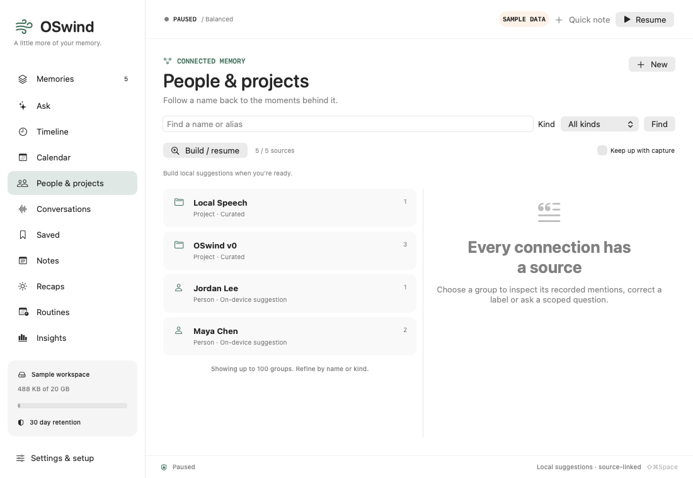

# People and project memory

OSwind groups recorded source text into local people, organization, place and project pages. Open **People & projects**, create a project, add aliases and choose **Build / resume**. Apple’s on-device name tagging supplies suggestions for people, organizations and places. Project aliases match sequences of recorded words, ignoring case and intervening punctuation while retaining accents. No language model, model download or cloud request is required for this step.

Suggestions are labels to review, not verified identities. Two people can share a name; OCR can misread names. OSwind does not recognize faces, link voiceprints across recordings, infer biographies or use a generated knowledge graph as answer evidence. Automatic extraction currently uses the source body, including OCR/AX text or transcripts, rather than title-only names. Multilingual entity quality remains unmeasured.



*App-owned NSHosting layout render with five synthetic sources, not desktop capture or click/keyboard acceptance. [Dark layout](../assets/entity-memory-dark.png).*

## Review and use

- Select a group to see its aliases, your notes and original text mentions. Opening a mention rechecks the source revision and UTF-16 span before displaying the complete source.
- Edit a label and aliases, or explicitly merge two groups of the same kind. Merging retains both sets of notes, aliases and distinct source links. OSwind does not decide that two people are identical.
- Open any source and choose **Link to entity** to add a deliberate link. **Remove link** suppresses automatic matches for that source and the group’s current aliases; it survives subsequent indexing until the source changes or you manually relink it.
- **Search sources** and **Ask about sources** apply entity membership as a source filter. The native interface displays a removable scope, and leaving Memories/Ask clears it. Saved conversations retain the entity ID in their recorded scope. Answers still use source content and citations, not entity notes as factual evidence.
- **Keep up with capture** is off by default. Enabling it starts a backfill and then processes newly captured sources. Restored backups leave this switch off.

## Bounds and lifecycle

One utility worker performs extraction. Each source commits atomically; cancellation retains completed source indexes for resumption. Stop waits for the cancelled producer to finish before starting another. Capture catch-up queues at most 256 distinct source IDs and processes those IDs directly; it does not rescan the archive after every capture. Overflow is explicit and requires Build / resume. Full backfill uses source-ID pages and compiles the project-alias trie once per run. The UI reports progress every 64 processed sources without spawning a task for each entity or token.

The native worker defers for session lock, Low Power Mode or serious/critical thermal pressure. Capture and wake can resume opted-in work. A process restart, rule change or missed capture can be caught up through Build / resume. This is cooperative deferral between sources, not hard real-time cancellation inside Apple’s NLP framework.

Each source admits at most 256 automatic groups, with an explicit limited flag. Input is processed in approximately 24k-UTF-16 chunks with overlap. Names use at most 240 UTF-8 bytes, notes 8 KiB and groups 32 aliases. Project rules support at most 1,000 projects and a 262,144-token trie budget. The native list displays up to 100 groups and 100 source links; name/kind filtering and scoped search provide further browsing. The entity list/sources CLI commands each return up to 100 rows; read-only HTTP/MCP limits are 1–100. This release does not provide an unbounded graph browser.

An automatic mention requires the original source revision and an exact valid source span. Admission rechecks current stored project rules rather than trusting a caller-supplied plan. Changes to source text, title, app, URL, time or kind invalidate its links, corrections and index completion. Favorite/tag changes preserve links. Entity-membership writes invalidate SQL scope revisions, including cached Metal filters in other connections.

## Erasure and portability

Deleting a source removes its links, index state and corrections. Suggested, uncurated names with no remaining sources are pruned. **Deliberately saved labels, aliases and notes are independent user content and remain with zero sources.** Delete the group to remove that content, or use whole-library wipe to erase all entity definitions and corrections too. Deleting an automatic group is not a permanent global ban on that name; future changed sources can suggest it again.

Full `.oswindbackup` packages include entity definitions, aliases, original source links and rejected matches. Restore reconstructs trusted tables and validates kinds, bounds, canonical aliases, source revisions and spans. Derived index completion is reset under this Mac’s NLP version and fresh project rules. Restored settings leave capture, entity catch-up and other automatic services off. Source JSON and Markdown exports remain source/conversation exports; they do not currently preserve the entity layer. Use full backup for that round-trip.

Schema **21** prevents older OSwind clients from opening a library they cannot safely preserve or erase. Back up before upgrading. Existing schema-20 sources are preserved during the atomic upgrade; name extraction is not performed while opening the library.

## CLI and integrations

```bash
oswindctl --data /path/to/library entity create project 'Apollo Launch'
oswindctl --data /path/to/library entity edit ENTITY_ID --aliases 'Apollo Launch,ALPHA42'
oswindctl --data /path/to/library entity index
oswindctl --data /path/to/library entity progress
oswindctl --data /path/to/library entity list --kind person --query Maya
oswindctl --data /path/to/library entity sources ENTITY_ID
oswindctl --data /path/to/library entity link ENTITY_ID SOURCE_ID
oswindctl --data /path/to/library entity unlink ENTITY_ID SOURCE_ID
oswindctl --data /path/to/library entity merge ENTITY_ID --into DESTINATION_ID
oswindctl --data /path/to/library search --entity ENTITY_ID 'launch'
oswindctl --data /path/to/library ask --entity ENTITY_ID 'What was decided?'
```

The `entity:ID` query operator intersects other selected scopes and refuses a conflicting entity filter. Unknown IDs produce no members. There is no fuzzy name-to-identity guess during query execution.

Read-only MCP tools `memory_entities` and `entity_sources` expose groups and source anchors. `search_memory` and `memory_activity` accept an explicit `entity` ID. The token-authenticated loopback HTTP API provides `/v1/entities`, `/v1/entity-sources?id=…`, and the `entity` search/calendar parameter. Notes and recorded names are untrusted source material, not agent instructions. Network entity creation, merging and indexing are not exposed.

The [signed qualification report](../benchmarks/entity-memory-v1.json) records 773 distinct functional passes, 318 distinct TSan passes and twenty-two final operations. The project oracle covers 667 members in 1,000 repeated synthetic sources; its first-index/resume wall time is 0.714/0.062 seconds with uncontrolled caches. Apple NLP fragmented a person name in that fixture, so no general entity accuracy is claimed. An unlocked continuation verifies native project creation/editing/manual links, incremental note indexing, scoped search/Ask and opening complete cited sources, plus targeted CLI capture and normal/TSan physical audio. That package retains a ⌘K stale-results defect; the later [a91f25b qualification](../benchmarks/search-navigation-v1.json) fixes it and verifies six global sources after clearing scope, while preserving deliberate Ask scope. Documents-root startup and full GUI/controller/microphone-to-ASR remain unqualified. Qualification is tracked in the [progress ledger](PROGRESS.md). Project-alias oracle checks are separate from Apple NLP quality, real identity resolution, 24-hour capture, power and competitor comparisons.
