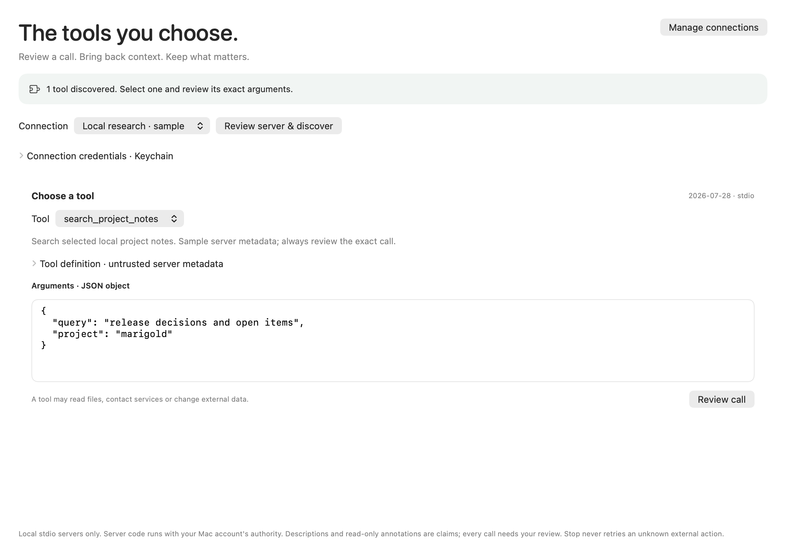
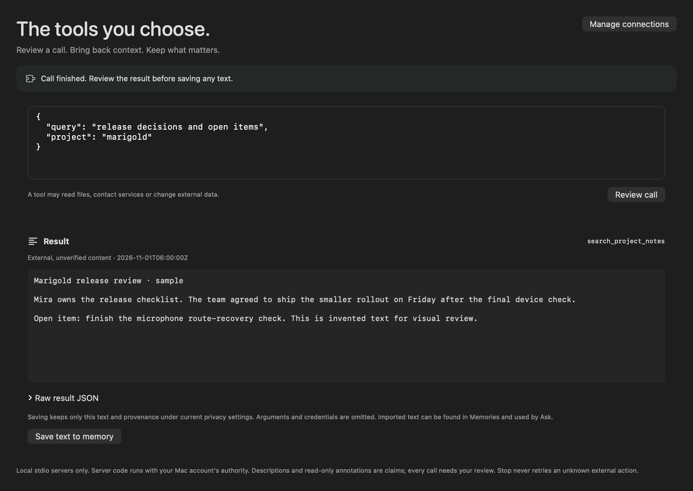

# Native external tools workspace

Status: **software/package qualified; native platform acceptance open (F080 partial)**. The [752-input receipt](../benchmarks/mcp-workspace-v1.json) binds source `46c81b3` to13 passing stages:1,763 full passes/82 explicit skips; all70 MCP cases under sanitizer and optimization without skips or race warnings (38 new native cases,32 parent client cases);22 signed CLI process checks; normal/indexed API/MCP; actual quiet backup/restore and SIGINT/SIGKILL interruptions; strict signed/extracted34-file equality. Installed15 files and13 prior app trees stay unchanged. The signed CLI interoperates with isolated official Python SDK2.3.0 using exact Unicode text.

All12 revised light/dark component renders were inspected after retained layout fixes. They cover authored data and unchanged view source in an earlier debug binary. A final signed-app input attempt was blocked because the Mac was locked. The launched PID was already absent at cleanup; no matching app process, SQLite library or server-start artifact remained. Its startup outcome is unknown. No unlock workaround, real credentials or personal history were used; no native interaction pass is claimed.

## User flow

1. Open Tools, or Settings → Connect → Open tools workspace. Add up to eight named local stdio connections. Enter an absolute executable, a JSON array of arguments and optional credential variable names. Saving never launches a server.
2. Save credential values separately in Keychain, under a connection-specific account. They are never stored in settings or copied from model-provider accounts. Starting a server can expose filesystem/network access with the Mac account's authority; the isolated working directory and filtered environment are not a sandbox.
3. Review the complete command before discovery. Choose a returned tool, enter a strict JSON argument object, then review the exact command/tool/arguments before running. Tool definitions and read-only annotations remain untrusted claims. No automatic model calls, external writes or retries occur.
4. Inspect the returned text/raw JSON. Save text to memory only when explicitly requested. Import uses the existing collector, current settings snapshot, pattern/optional learned PII handling, source exclusions and media-write admission. The record identifies it as an unverified external result, with command/definition/arguments fingerprints. Arguments, credentials, executable paths and raw/binary result content are omitted.
5. Saved text is searchable and available to Ask; Open saved source uses the normal complete-source viewer. A call has one stable collector key, so a retry cannot silently add duplicate original sources.

The server may access files itself; OSwind does not automatically attach its memory library to requests. URLs, icons and resource links are not fetched. The current transport is local stdio; HTTP/auth and model-driven tools remain open.

## Lifecycle and authority

- Loading settings and opening Tools never read credentials or start a process. Each discovery/call has a fresh review token, invalidated by changed arguments, connection bytes, credentials, privacy, pause, lock, onboarding or library departure. Canonically equivalent Unicode arguments are compared by exact UTF-8 bytes.
- Stop keeps the operation busy until its worker finishes. Late results from cancellation-ignoring fixtures cannot republish into a changed scope. External outcomes can be unknown; no action is automatically resumed.
- Global Pause includes tool-only work. Resume capture never repeats an external call. Sleep/session notifications clear visible result/review/argument/credential drafts; vault/library transitions join actual external work and imports before closing the store. Plain-library Quit returns to the run loop until tool/import workers drain, including a tool that ignores cancellation; repeated Quit attempts do not schedule duplicate exit callbacks.
- Quiet restore clears connection choices. The existing history-wipe behavior retains settings and saved credentials; it stops/clears tool work without silently restarting it.
- Removing a connection explicitly removes only its named credential accounts. Keychain success or no matching entry is required before reporting removal. Failures retain the profile for retry; Keychain and settings are not one transaction, so earlier entries may already have been removed.

## Current evidence and remaining checks

Owned tests cover no launch/read before consent, exact argument review, malformed input, canonical-byte edits, credential namespaces, secret-draft clearing, stale result refusal, worker drain, current-policy source admission, duplicate-save identity, direct source search/open, privacy changes during actual import preparation, global pause and actual AppSession library switching. They use injected credentials/runners; no real user keys or calendars are read.

The debug exporter renders the actual components with authored data and an injected server. It does not establish native mouse/keyboard/VoiceOver behavior, real Keychain access, real third-party account behavior, or physical power. The earlier752-input candidate passed full/debug/TSan/optimized/package/API/MCP/archive checks, but did not cover the subsequently discovered plain-Quit gap. The corrected source passes the final gates and Git-blob/input audit. Earlier compiler, visual, harness and quit failures remain retained. The original full run passed but its postvalidation used an incorrect app-test module prefix; its retained log was separately admitted against the correct identities. The final corrected-source full run is fresh, with all70 mandatory identities checked directly.

## Reviewed samples

These are actual component renders with authored data, not a live native-input receipt.

