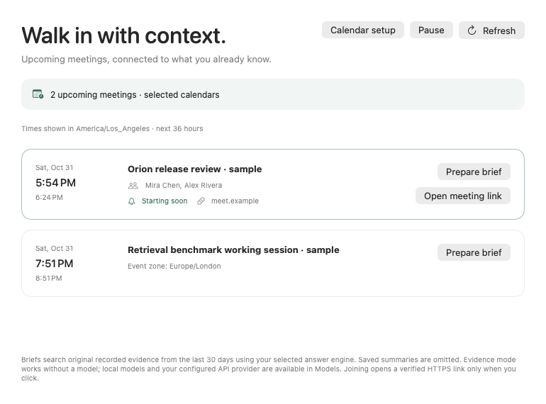

# Calendar-linked meeting context

Status: **implemented and software-tested; native acceptance open (F079 partial)**. The [qualification receipt](../benchmarks/calendar-context-v1.json) binds 737 source/build inputs based on `e453bf6`. Full debug: **1,692 pass / 83 skip**; selected sanitizer and optimized builds: **247 pass / three skip each**, including all 57 mandatory meeting methods once in each build and no sanitizer race warnings. The guarded worker is exercised by two real pre/postcommit SIGKILL parent tests. Twelve further SDK, signed package, API/MCP, conversation/recap, interruption and archive checks pass; eight authored light/dark/compact component renders pass visual review.

The original full native-vault group has **35 passes and two system-operation timeouts** during repeated clamshell/maintenance sleep. Both failed cases pass in one unchanged-build targeted comparison, which still records one maintenance-sleep event despite a temporary idle assertion. The original failures remain retained; neither a resolved cause nor one all-pass full native group is claimed. Initial compile, raw-reader harness and corrected onboarding/manual-pause failures are also retained. Real Calendar permission/account access, native notification delivery/Focus, manual join and interactive main-window acceptance remain open. Poll policy is not measured physical power.

Hosted CI run [41271095273](https://github.com/vibhusapra/OSwind/actions/runs/41271095273) passes both jobs at `70a03fc`: **1,693 debug passes / 82 skips** and a separate **37/37 native-vault pass**. This hosted result does not erase the original local timeouts or establish native Calendar/notification acceptance.

## Intended user flow

1. Open Settings → Connect → Calendar & meeting context. Explicitly connect and select calendars; access alone does not select every calendar.
2. Meetings shows the next 36 hours in the Mac's time zone. Recurrence identity uses the original occurrence date, including moved occurrences; a moved start time gets a new reminder key. Conflicting copies of one occurrence refuse refresh rather than choosing an arbitrary version.
3. Prepare brief freshly checks the selected event, its revision, read permission, privacy rules and library identity. It starts a separate Ask conversation over the last 30 days of recorded evidence. Calendar text is literal, untrusted metadata; query-filter interpretation is disabled. Existing Evidence, Apple, local Ollama and explicitly authorized BYOK configurations remain the answer engines. Current source exclusions and redaction apply before building model context. This first brief path conservatively omits saved summaries/recaps rather than claiming transitive recap privacy admission. No automatic model call occurs on calendar refresh.
4. Open meeting link freshly checks the same scope and opens only the reviewed HTTPS link. OSwind never joins automatically, edits calendar events, sends invitations, or executes calendar text as commands.
5. Enable generic desktop reminders separately. Notification text has no event title, attendee, calendar or join URL. Clicking opens Meetings for review, including a locked-library recovery screen when applicable.

## Data and lifecycle

Calendar selection and its library binding are settings. A dedicated `meeting-library-lifetime-v1` metadata token is created only on explicit selection. The general store identity is a mutable cache epoch and is deliberately not used for authorization. Calendar labels and upcoming occurrence details are an in-memory cache, not automatically inserted into recorded history. Participant names stay off by default. Meeting descriptions and dedicated join links never enter brief requests; URLs and email addresses embedded in labels are also omitted. Explicitly requested briefs are ordinary saved Ask turns, with existing source-linked erasure behavior. Selecting a remote engine still requires its existing remote-context authorization.

Refresh runs at most every 30 seconds, or 90 seconds in Low Power Mode, with a five-minute cache when the EventKit revision is unchanged. Change notifications invalidate the cache. Manual refresh and action verification fetch a fresh bounded window. Poll timing is implementation policy, **not a measured power result**.

Bounds: 32 selected calendars, 128 available calendars, 1,000 native occurrences in the 36-hour window, 256 native attendees per event, 20 optional displayed participant names and at most ten 80-scalar names in brief requests. Join extraction inspects at most three fields, 16 KiB each, and eight detected links per field; no description is retained. Over-bound or ambiguous feeds fail visibly rather than claiming complete coverage.

Pause, sleep, screen sleep, session resignation, onboarding, vault lock, library switching and erasure suspend context and clear visible details. Late asynchronous results must not republish into a paused or changed library. Global Pause includes calendar-only context; its Resume restores that calendar context without starting screen capture. Audio remains an explicit separate start control. Wake resumes only a previously requested service; manually paused and quietly prepared libraries stay quiet. A wiped or different library requires a fresh calendar selection. Quiet backup restore clears selection, library binding, reminders and enablement.

## Reminder semantics

`meeting-reminder-receipts-v1` is a row in the existing `store_metadata` table, with no schema migration. A separate `meeting-library-lifetime-v1` row binds explicit selection. It contains only version, random library identity, opaque occurrence/start/lead hashes and attempt/expiry timestamps. A SQLite write transaction with scoped FULL durability claims due groups of at most 32 before one coalesced generic notification attempt per refresh. Duplicate attempts do not rewrite unchanged metadata. A seven-day deduplication window is capped at 512 entries; expired entries are pruned on the next nonempty claim, so opaque expired bytes can remain during idle periods or after disconnect until another claim or wipe. Malformed or full history refuses further claims rather than silently evicting current receipts. Wipe atomically deletes both the receipt row and the dedicated calendar lifetime token.

These are **at-most-once attempts within the retained receipt window**, not exactly-once notification delivery. A crash after claim and before OS posting can miss a reminder. Focus, macOS settings, sleep, app closure, unavailable Calendar access, delayed refresh and a full ledger can prevent or delay reminders. Unchanged already-claimed occurrences are not retried merely because delivery was unconfirmed. Moving a meeting or changing its reminder lead creates a different key. OS notification removal is asynchronous; generation-specific identifiers keep cleanup of an old service from deleting a new service's notifications. A generic notification may remain after a crash.

## Qualification and remaining acceptance

- Completed with owned injected data: selection, recurrence/DST/moved occurrences, declined/cancelled/all-day events, bounded feeds, permission/revision loss, privacy and literal brief queries, lock/sleep/manual pause/onboarding/library changes and late completions.
- Completed: competing SQLite connections, rollback/reopen, no duplicate writes, strict raw TEXT/UTF-8 validation, wipe and quiet restore. Actual owned children are killed immediately before/after SQLite COMMIT; raw bytes are inspected before opening MemoryStore, then retry behavior is checked.
- Completed: actual intercepted compatible-adapter request excludes disallowed evidence and redacts secrets; no external inference request is made. A real 30-second timer refresh is observed.
- Completed: all 57 mandatory meeting methods in debug, selected TSan and optimized builds; 1,692 full-suite passes; SDK/package and regular/indexed API/MCP, saved conversation/recap, wipe/backup interruption, archive extraction and strict signature checks. All 737 inputs are unchanged; installed 15 files and seven protected app trees stay unchanged. The staged app and extracted ZIP have the same 34 files.
- Completed: eight packaged authored upcoming/compact/quiet/setup renders, both appearances, including 770×570 compact. Native accessibility interactions and real main-window navigation are still open.
- Retained native vault failure and one targeted comparison are recorded above; no calendar feature change fixes the underlying platform timeout.
- Open: signed Calendar permission flow, actual account synchronization and recurrence behavior, native notification delivery/Focus, manual join, sustained physical power and broader supported-hardware acceptance.

To reproduce component tests, run `swift test --filter 'Meeting.*Tests'`, then the same selection with `--sanitize=thread --scratch-path .build/meeting-tsan` and with `-c release`. Full checks use `swift test`; the receipt records the wider selected build commands and process checks. Native vault checks need the separately opt-in `OSWIND_TEST_NATIVE_VAULT=1`; they operate only owned encrypted fixtures. No native Calendar test should implicitly request access to a personal account.

## Platform sources

- [Apple: retrieving events and reminders](https://developer.apple.com/documentation/eventkit/retrieving-events-and-reminders)
- [Apple: removing pending notification requests](https://developer.apple.com/documentation/usernotifications/unusernotificationcenter/removependingnotificationrequests(withidentifiers:))
- Installed macOS SDK EventKit headers were inspected for the macOS 14 full-access API, occurrence date, identifier caveats and enumeration contracts. No calendar write API is used.
