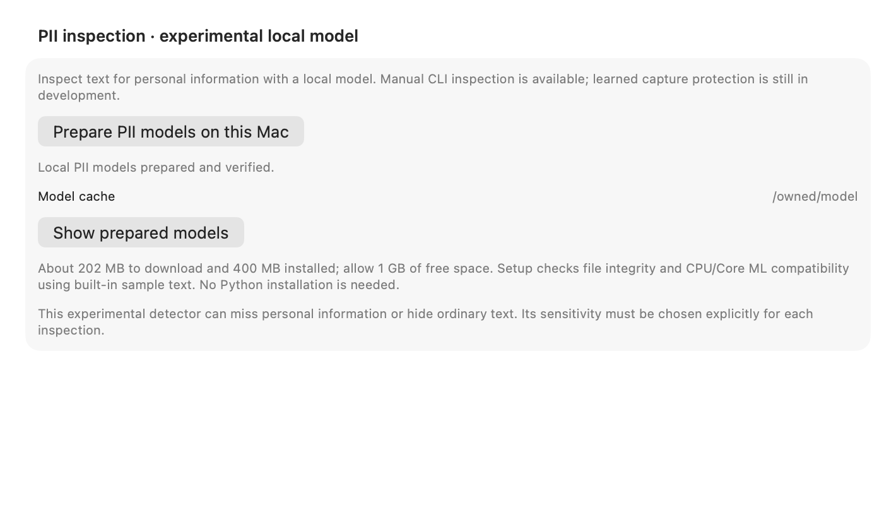

# Native setup for experimental PII inspection

The Models settings panel can prepare the local inspection models with progress,
cancellation, failure/retry and a prepared-cache location. The same preparation
is available through the history-free CLI:

```sh
oswindctl pii prepare
oswindctl pii verify
printf '%s' 'Owned example: password=fixtureSecret' |
  oswindctl pii inspect --compute coreML --threshold 0.5 --stdin
```

All three commands accept `--cache-root /absolute/cache`. Inspection also
accepts the earlier explicit `--model-dir` / `--runtime-library` pair; choose
either that pair or the prepared cache. Verification and inspection never
download missing assets. `--data` and `--vault` are refused before resolving a
library. Apple Silicon macOS 14+ is required for this pinned runtime.

This prepares **manual text inspection**. It does not select a learned capture,
import, answer or export policy. The example 0.5 threshold is not an accepted
privacy operating point; the detector can miss PII or remove ordinary text.
F047 remains TODO. [Runtime contract](NATIVE-PII-RUNTIME.md) and
[existing quality findings](PII-EVALUATION.md) remain applicable.

## Assets and derivation

The compiled [recipe](../models/pii-native-setup.json) pins eight public
downloads totaling 201963274 bytes. The installed payload is 393488824 bytes
plus its small preparation receipt. Allow 1 GB of free space for scratch work.
The default cache is `~/Library/Caches/OSwind/models/pii`; each complete recipe
gets its own content-derived directory name. Neither model weights nor the
runtime binary is bundled in the application.

The original GLiNER graph/tokenizer/card/config are pinned at model revision
`9b7f39b0a2da971a5beea78d35f1539d4009c891`. The pinned Ettin model card declares
MIT; its associated upstream code MIT notice is retained at code revision
`6cbf954a2ecaa7c753be6468a1bccdef401d5f93`. The GLiNER model card declares
Apache 2.0; its card, a full Apache 2.0 license and attribution are retained.

The runtime source is the official
[ONNX Runtime 1.24.2 macOS arm64 wheel](https://pypi.org/project/onnxruntime/1.24.2/),
SHA256 `d8a50b422d45c0144864c0977d04ad4fa50a8a48e5153056ab1f7d06ea9fc3e2`.
The version is deliberately pinned to the validated artifact. Native macOS
`unzip`, through the existing parent-death/cancellation guardian, extracts
only the dylib and MIT license into private scratch. No Python installation,
Python import, package resolver or wheel-provided code is executed. Both
retained members receive independent byte-size/hash checks before publication.

The fixed Core ML graph is derived natively by streaming six exact metadata
patches: one GraphProto message length, its four input ValueInfo messages and
the output ValueInfo message. All other source bytes are copied unchanged.
The original bytes are hashed again on the same read descriptor during the
transformation, and the result must exactly match the independently generated
ONNX graph hash `a6a66d8a988b9507b6d8d714a727ca47fcacef6b5090825f79b86be917e3e136`.
This is a fixed recipe, not a general-purpose ONNX converter.

## Publication and cancellation

An exclusive owner-checked cache lock prevents two preparers from publishing
into the same cache. Download sizes/hashes, descriptor-bound paths, root
identity and the complete installed file recipe are verified. Caches inside
history, backup or installed model packages are refused. Corrupt existing
installations fail verification and are preserved; setup never downloads over
them. Model-cache repairs or removal remain an explicit user operation.

The runtime archive is an owned, checksum-verified private file, sealed
read-only during extraction. The guardian retains cache/workspace reservations;
the extraction child inherits stdio only and opens that owned archive path.
Archive pathname replacement is checked after extraction. This does not claim
protection from a malicious process running as the same macOS user.

Before publication, two built-in authored texts must match their independent
reference masks and labels through both CPU and Core ML. Each model owner is
shut down before preparation continues. These four compatibility checks are
not representative PII acceptance or physical GPU-placement evidence. Existing
Core ML framework diagnostics remain visible on stderr.

Only a verified 13-file payload/receipt is atomically published. Cancellation
joins an active descriptor writer, child extraction or native inference before
unpublished work is cleaned. A cancellation racing after publication can leave
a complete verified installation; retry detects and verifies it. Abrupt parent
death releases reservations, with abandoned scratch cleanup on the next setup.
The ordinary cancellation and abrupt-death cases must be qualified separately.

`pii verify` checks pinned files and the preparation receipt, without executing
inference. Its receipt records the OS used when compatibility was originally
checked; verification is not a new hardware qualification on another Mac.
Reuse also verifies the full known payload and does not redownload or rerun
the probes. The CLI keeps framework diagnostics off its JSON stream.

## Development evidence and final qualification

A fresh development run downloaded all eight public files, reproduced the
Core ML graph and passed the four CPU/Core ML sample checks. That first run
used full-wheel extraction into scratch; the final implementation selects only
the two required members. Sixteen focused setup/UI cases pass with explicit
local-model/render opt-ins. Eighteen actual CLI checks include ready reuse,
both managed inspection modes, corrupt-install refusal and cancellation of an
observed live download: exit 130, no result JSON and no unpublished workspace.

The first Swift build's throwing-operator error is retained, then corrected.
The first ImageRenderer-based UI test passed while producing blank Forms;
visual inspection caught this. The test now uses an owned offscreen native
hosting view and rejects a blank result. Idle/ready/failure/busy/stopping states
are checked in light and dark appearances. These renders and injected actions
do not establish native button-click or production GUI acceptance.

[PR #74](https://github.com/vibhusapra/OSwind/pull/74) and the
[qualification receipt](../benchmarks/native-pii-setup-v1.json) record frozen
source `fef24c7`: **1,020 defined tests: 1,018 passes/two skips**, **168 selected
TSan passes**, **64 optimized PII/setup passes**, and all **12 ordered
operations** pass. The normal skips remain physical owned system-audio opt-in
and locked/thermal visual admission. TSan excludes precompiled runtime/framework
internals.

The final 34-file signed app/ZIP passes strict signatures, normalized raw/signed
payload and complete extracted-tree equality. The signed CLI freshly downloads
and prepares the selective-extractor cache, then passes 19 setup checks,
11 offline setup refusals and 25 earlier explicit-inspection checks. Native
streaming derivation exactly matches the independent graph bytes. CPU/Core ML
sample checks, cache reuse, managed inspection and actual live-download Ctrl-C
all pass. No unpublished workspace remains after the observed cancellation.

Ten normal native state renders were visually reviewed; the same 10 states also
render in TSan and optimized tests with a nonblank guard. The current visual
fixture preserves 459/501 top1 and 498/501 top5/top10, including index/scopes/reopen.
Installed/staged bytes and scoped owned-process/current-artifact-image proofs
pass. The app is staged separately; no normal GUI/library launch or installation
is part of this qualification.

An inherited CI counterexample remains open: PR #73 head `c8aa5cc` fails a rapid
native encrypted-vault lock/unlock test with the generic files-in-use refusal
(run 40824503723 / job 123284316910). Its earlier implementation CI passes both jobs;
the new local full suite and the new source's native-vault CI step also pass,
but neither explains or repairs that failure. Underlying native exit/stderr are
not surfaced by the current eject driver; diagnostic work is the next priority.
New source CI run 40827752090 has a passing benchmark job and a native job last
observed at packaging. Later documentation-head CI is separate. Broad privacy,
physical power, competitor and release acceptance remain open.


