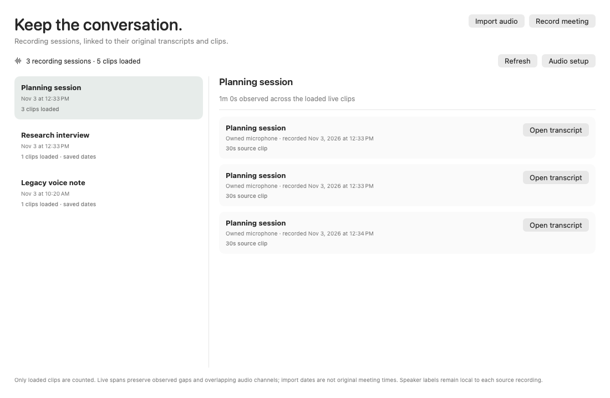
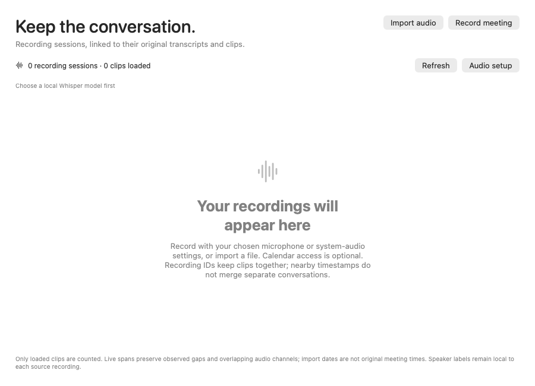
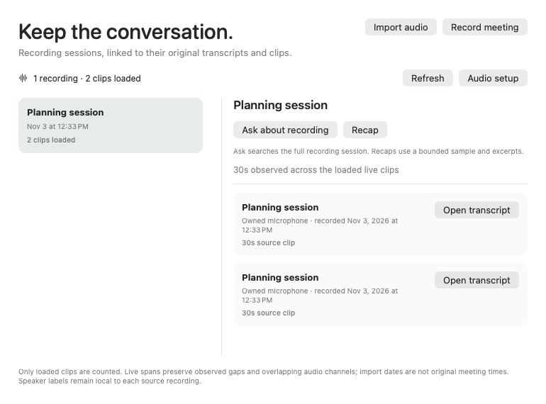
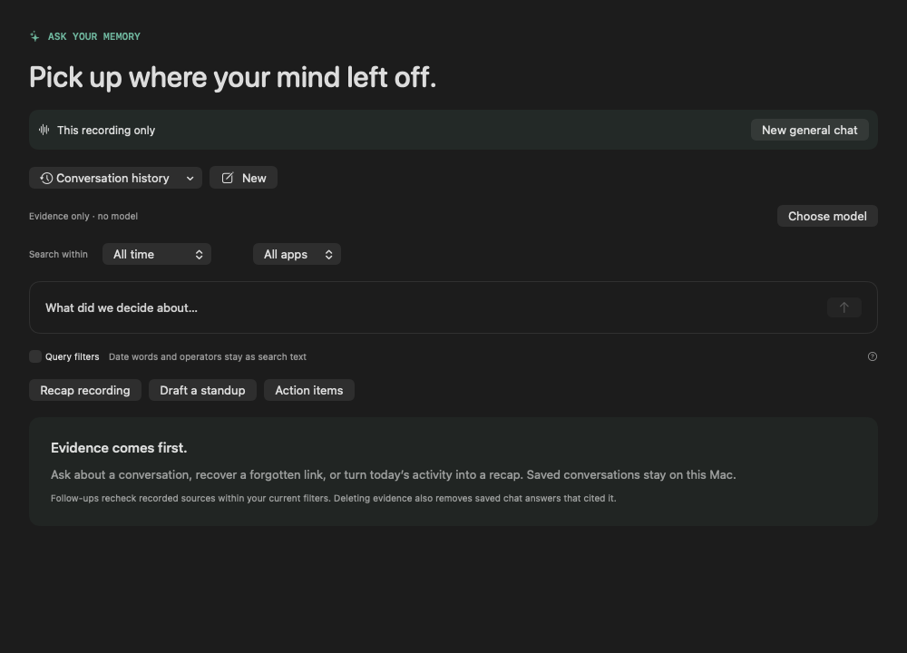

# Recorded meeting workspace

Meetings now opens on **Recordings**, alongside the existing **Upcoming** calendar view. Record audio using the existing microphone/system-audio settings, import a file, select a recording session, and open an original transcript/clip. A failed recording start stays visible even when no audio work became active. Calendar access remains optional.

Sessions use the recording IDs already assigned to live microphone/system chunks and imported files. Similar titles, nearby timestamps or matching speaker labels do not merge unrelated conversations. A clip without a recording ID is its own session. Counts explicitly describe loaded clips; **Load older recordings** pages further back without hydrating transcript bodies.

Live coverage is the union of observed source intervals. Overlapping channels are counted once and gaps remain gaps. Clips without a recorded interval—including imports and older recordings with unknown timing—show their retained clip duration and a saved date. That date is not presented as the original meeting time or proof of import provenance. Speaker names remain local source annotations.

The new SQLite index is derived metadata, rebuilt from canonical audio sources. SQL triggers cover ordinary source updates/deletes, older writers and restore/incoming adapters. It stores recording identifiers, dates and source metadata, with no copied transcript or audio. Opening/repair installs the cache and write-through triggers without a historical transcript scan. The first Recordings load builds historical metadata in its cancellable worker; measured first-use and steady-state costs are reported below. The steady-state page test denies canonical payload reads while listing recordings.

Ephemeral references belong to the exact open store and carry a per-row nonce. Updates, regrouping, deletion/recreation, foreign libraries and closed stores refuse stale source opening. Metadata pages retain values rather than vault descriptors. UI publication rechecks current settings; opening uses the normal source/detail path. Read jobs belong to the actual app departure registry, and a previous view's disappearance cannot clear a newer appearance.

## Initial workspace evidence

- The source-pinned development run at `c108699` passed **17 selected native Debug methods**, with no skips: 16 new Core/App/native methods plus the existing real-Keychain three-library/all-13-kind sync regression.
- Cases cover overlapping-channel/gap accounting, import dates, byte-distinct Unicode IDs, equal-time pagination, privacy exclusions advancing cursors, current-policy source refusal, stale/foreign references, source SQL updates, projection repair and source-kind changes.
- App cases cover a policy change after reading but before publication, a foreign page, old/new appearance ordering and actual AppSession departure joining a blocked page worker before close.
- An actual generated encrypted APFS fixture retains the value page after store close and verifies that the image detaches. The native sync regression preserves original account/private fields and all 13 data-kind counts after replay.
- The first 13-method development run passed behavioral checks, but visual review found three populated scenes showing an empty pane/stale status. Those original images remain retained as failed visual QA. The appearance lease, layout and render-state checks were corrected before the 17-method result.
- All six corrected normal/compact/empty light/dark scenes were inspected. A later UI-only refusal-caption change passed an eight-scene render case: the original six images are byte-identical, and both additional local-model refusal scenes were inspected. The owned missing executable fails before audio hardware startup.

At that stage, an upstream merge changed an unrelated peer test and documentation; the recording implementation differed only by the separately checked refusal caption. The later indexing/lifecycle changes and their selected qualification are recorded below. No whole-current-suite result is claimed.

[Development receipt](../benchmarks/recorded-meetings-development-v1.json) · [Raw inputs, source snapshots, logs and authored renders](../benchmarks/recorded-meetings-development-raw-v1.zip).

## Remaining work

- [ ] Named recording sessions and durable reviewed calendar-occurrence links.
- [x] Exact session/source-version Ask, bounded recording recaps, saved-history scope and portable filter adapters with selected regression.
- [ ] Fresh sync enrollment after quiet restore of grouped peer audio needs its original session bindings; current code refuses to rehash a projection.
- [x] Measure first-open/first-use metadata costs and move historical backfill into the cancellable Recordings load; retain all process latency/RSS observations.
- [x] Generated portable backup/restore, incoming-origin projection/deletion and current privacy/erasure regression for the derived index.
- [x] Selected optimized/sanitizer regression; ac5bf82 also has strict ad-hoc development packaging. Current identifier checks are scoped below; whole-current-suite and hosted qualification remain open.
- [x] Controlled grapheme/NUL/byte-distinct session IDs, admission limits and prior-cache repair.
- [ ] Incoming-change UI invalidation and actual list-publication/frame-cost audit.
- [x] Current normal release/ad-hoc development package at 7ab704b, packaged CLI scope control and exact ZIP/signature round trip. Native interaction and release acceptance remain open.
- [ ] Recorded/Upcoming wrapper interaction, keyboard/VoiceOver and actual native record/import/open/playback flows.
- [ ] Physical microphone/system-audio, permission/device switching, transcription quality and power acceptance.

These are generated fixtures and offscreen components on one Mac. F042 and the full v0 remain unfinished; no feature status or competitive ranking is promoted. No microphone/system recording, playback or provider/API request was made by these tests.

## Reviewed components

[Dark](../assets/recorded-meetings-v5-recordings-dark.png) · [Compact light](../assets/recorded-meetings-v5-compact-light.png) · [Compact dark](../assets/recorded-meetings-v5-compact-dark.png).

[Dark refusal](../assets/recorded-meetings-v5-setup-failure-dark.png) · [Empty light](../assets/recorded-meetings-v5-empty-light.png) · [Empty dark](../assets/recorded-meetings-v5-empty-dark.png).

## Untimed legacy-date correction

A follow-up normal Debug selection has **12passed /1explicit native skip /0failures**:10Core, appearance regression and an eight-scene UI case pass. The regex also selects the native-page class, whose required flag is deliberately absent. A legacy microphone clip without an end timestamp remains distinct from an established recording interval; its retained date does not imply an import. All eight current three-session/five-clip or empty/refusal scenes were inspected. The previous successful native17run and versioned images remain unchanged; no current whole native/sanitizer qualification is implied. [Correction receipt](../benchmarks/recorded-meetings-untimed-v1.json) · [Raw input/source/log/current renders](../benchmarks/recorded-meetings-untimed-raw-v1.zip).

## Deferred archive indexing and current selected checks

This section records **ac5bf82**. Later identifier changes have separate qualification below; these timings, broader test selections and normal package are not relabeled as current-source results.

Opening an existing archive now installs write-through metadata triggers without scanning old transcript bodies. Its first **Recordings** load performs that scan in the owned, cancellable worker and commits readiness atomically. Failure or cancellation rolls rows and readiness back together. New empty libraries are ready immediately; pending and ready reopens preserve new writer rows and existing nonces. Own app deletion and erasure clear or refresh recording previews.

The source-pinned optimized and Thread Sanitizer runs each selected **319 methods: 304 passed, 15 skipped, zero failures**. Every skip was audited: nine child-entry helpers, three opt-in scale probes, two probes requiring the exact prior-format client, and one component-render case. The recorded-workspace CI subset has 26 methods: 25 passed and that one render case skipped locally. The broader runs include actual encrypted APFS page retention/detach, real-Keychain three-library/all-13-kind replay, original private-field preservation, backup/restore, erasure, privacy, import, incoming projection and crash-recovery regressions. There was no sanitizer race report. This does not supersede earlier owner/peer broad WIP failures or qualify the whole current suite.

Two authored shapes were measured on one Mac17,6 with 128 GiB RAM: 20,000 audio sources with 768-byte text and 256 sources with 131,072-byte text. No recognized speech or audio media is involved. Both optimized frozen executables opened identical generated databases in eight counterbalanced pairs per shape, with three subsequent process opens per trial. Each new trial also verified its first page and all exact source IDs. Filesystem caches were not flushed; an older manual capture soak remained active.

| Authored archive | Median first CLI open, ms | Median first Recordings page, ms | Maximum first CLI open, ms |
|---|---:|---:|---:|
| 20,000 short clips | 207.530 → 34.388 | 15.155 → 190.210 | 236.971 → 540.544 |
| 256 long saved transcripts | 74.301 → 28.953 | 7.966 → 51.319 | 80.152 → 31.117 |

The scan moved to deliberate first use; total work was not eliminated. The first-lazy-open 540.544 ms outlier remains in the maximum and small-sample p95; its cause is unproved. Subsequent process opens, every traversal page, eleven repeat first-page timings per worker, process RSS and storage-state observations are retained in the data. These are component timings, not GUI frame/launch, energy, physical-device, automatic 24-hour or competitor-ranking results.

All **290 observations** remain available: 130 from the original predecessor/eager comparison and 160 from the eager/deferred comparison. No successful experiment was rerun just for metadata. A failed 24-method development run is also preserved: its incoming fixture tried peer apply before draining a receiver local write. The fixture sequence alone was corrected and passed in isolation; no production sync fix is claimed.

A separate normal release build from the qualified source was packaged into a new local development app, with all three executables executable and `codesign --verify --deep --strict` passing. Frozen comparator/test engines were preserved unchanged. The first packaging reviewer incorrectly required the normal release executable to equal the optimized-test executable byte for byte. A versioned read-only review corrected that assumption against the retained successful build/package; it did not rebuild, resign or rerun tests. The packaged CLI also passed an owned empty-library stats smoke. This is ad-hoc development packaging, without notarization or current live GUI/audio acceptance. Prior v5 component images above are retained; their render case was not repeated for these metadata changes.

[Source/input/test/package/performance receipt](../benchmarks/recorded-meetings-startup-v1.json) · [Raw observations, original failures, source snapshots and generators](../benchmarks/recorded-meetings-startup-raw-v1.zip) · [Current CI selection static review](../benchmarks/recorded-meetings-ci-selection-v2.json).

## Canonical recording identifiers

Source `29bd6c3` fixes accepted IDs being misclassified by the derived index. Swift admission counts graphemes; SQLite text length counts codepoints and stops at a NUL. Two authored controls on the unchanged prior production code exposed separate sessions and refused source opening for a valid 200-grapheme combining-mark ID and a leading-NUL ID. The three-method control run has two failed methods, 13 assertion issues (two unexpected), and one passing empty/over-limit admission check; its original source/log/engine are retained.

The index now checks nonempty UTF-8 bytes without trimming or normalization. Canonical source admission still rejects empty or over-200-grapheme IDs. Cache version 2 refuses prior grouping semantics. Reopening marks old caches for rebuilding; the first Recordings load rebuilds their rows before use. A generated old-cache fixture checks that behavior. Exact NUL suffixes and byte-distinct Unicode remain separate through reopening, and their original sources stay openable.

The focused normal Debug selection passed **30 methods with one optional render skip**. Current committed-source optimized and Thread Sanitizer selections each have the same **31 defined / 30 passed / 1 render skip / 0 failures**, with no race report. They include privacy, pagination, cancellation/rollback, backup/restore, actual encrypted APFS retained-page detach, real-Keychain three-library/all-13-kind replay and incoming origin separation/deletion.

The first fixed selection also exposed an adjacent app-fixture admission failure. A diagnostic reproduction showed `locked=true` as its only denied gate; the original run did not record that state. The fixture now supplies an explicit unlocked input, and another actual-AppModel unit tests locked → unlocked → locked admission. The production default still reads the real session lock. These are controlled tests, not physical OS-lock interaction or live GUI acceptance. All failed attempts are retained.

[Identifier source/input/test receipt](../benchmarks/recorded-meetings-identifiers-v1.json) · [Original controls, diagnostics and raw evidence](../benchmarks/recorded-meetings-identifiers-raw-v1.zip) · [CI selection review](../benchmarks/recorded-meetings-ci-selection-v3.json).

The broader 319-method runs, 290 performance observations and normal development package above remain pinned to ac5bf82. No new timings, normal package, whole-current-suite, physical/power/automatic 24-hour acceptance or ranking is claimed for this change. Feature statuses remain unchanged. Named sessions, durable calendar links and exact session Ask/recaps remain next product work.

## Exact recording-scoped Ask and portable history

Source `7ab704b` adds **Ask about recording** and **Recap** to the selected recording. Session queries follow all current matching canonical clips, including clips beyond the 512 loaded rows. An ungrouped clip follows one exact evidence version. Nearby dates, matching titles, shared words or speaker labels do not establish membership. App and CLI follow-ups retain the saved restriction; Core admission refuses a dropped or changed recording scope.

The Ask banner shows the restriction and offers an explicit new general chat. Recording recap shortcuts use All time rather than silently applying Today. Recaps disclose their distributed source sample and bounded excerpts; they are not complete transcripts. Source membership is rechecked after hydration and again before saving. Ready recording queries and evidence checks can read while another connection holds the capture writer reservation. Scope keys distinguish byte-different Unicode IDs on the real indexed Metal path.

Native and portable filters use a typed known-field discriminator so older String-kind decoders reject the restriction. An actual retained prior CLI reads a plain conversation and refuses its scoped counterpart. A separate actual retained development CLI reproduces an unscoped follow-up including a neighboring recording; the corrected current and normal packaged CLIs exclude that neighbor and retain scope. These are codec/CLI controls, not prior GUI acceptance.

Quiet backup/restore retains native history and scope. Incoming scopes preserve the source origin's session namespace or exact source-version binding; local same-ID sessions remain separate. Generic retained-run adapters are tested too, although the routine editor does not offer recording-scoped schedules. After a quiet restore removes sync bindings, grouped peer audio explicitly refuses fresh-catalog re-export without original session provenance; local scoped queries remain available. The single-source path re-exports. No title/time matching or projection rehash substitutes for the missing original.

**Current selected optimized and Thread Sanitizer runs each have 520 defined / 504 passed / 16 skipped / 0 failures, with no race report.** The 16 skips are nine child entry helpers, three explicit scale probes, two exact prior32-binary probes and two renderer opt-ins. This includes actual encrypted APFS detach, original Keychain/all-13-kind graph invariants, real 20k-vector Metal scope switching/regrouping, backup/erasure/privacy, API handler and incoming/outgoing sync regression. The complete current suite and hosted CI are separate gates.

All 13 current recording-model Debug methods pass with no skips. Twelve current light/dark populated, compact, empty, setup-refusal and scoped-Ask components were manually inspected. Delayed-read controls first reproduced two failed methods/eight issues; request identity, originating section and selected-source revision now prevent old completion from replacing a new chat, selected history or a newer recording. Earlier blank renders, compile errors, vector/run fixture errors, lock refusal and provenance refusal remain in the raw evidence. No successful frozen engines or earlier observations were rebuilt for metadata.

The normal development app contains **34 files**, passes strict deep ad-hoc signature verification, an owned empty-library smoke and an actual packaged-CLI scoped follow-up control. Its ZIP was extracted and all file bytes/modes and signature verified. It is a normal compiler product without `-enable-testing`, separate from optimized test engines. This does not establish notarization, live GUI/audio/physical acceptance or release readiness.

[Source/input/test/package receipt](../benchmarks/recording-scope-v1.json) · [All original controls, logs, source snapshots and renders](../benchmarks/recording-scope-raw-v1.zip) · [Static CI selection review](../benchmarks/recorded-meetings-ci-selection-v4.json).

F042 and the full v0 remain unfinished. Names/calendar links, incoming-change UI/frame-cost auditing, native keyboard/VoiceOver/record/import/open/playback, physical speech/device quality, power and current automatic 24h acceptance remain open. The 83-feature ledger, dated 20-offering comparison, earlier benchmark observations and earlier failed broad gates remain unchanged; no ranking is promoted.

## Recording archive publication performance

Source `195b4ad` prepares the merged recording groups in the registry-owned background worker. The main actor retains the current-library, visibility, request-generation, admission and settings guards before assigning results. Immutable per-recording dates, duration union, clip duration and uncertainty flags are computed once per grouping. Cancellation/departure owns the grouping stage as well as the SQL read. No database schema, serialized filter or source membership rule changes.

A benchmark-only definition was committed at `85029ea` with production code identical to `9bdd303`. Its source remains byte-identical in the candidate. Actual optimized baseline and candidate test engines were frozen before the comparison. Each of two original authored corpora was copied into a fresh library for each observation: eight counterbalanced pairs per corpus, **32 separate processes / 656 page measurements**, with no discarded runs or outliers. Original databases and frozen engines stayed unchanged. Every expected source ID, page cardinality, canonical memory-row digest and paired metric checksum matched. Writes and canonical payload reads were denied during timed traversal; derived-cache warmup was measured separately.

| Warm authored corpus / measure | Baseline median ms | Candidate median ms | Baseline p95 ms | Candidate p95 ms |
|---|---:|---:|---:|---:|
| 20,000 clips: main-actor publication | 52.742 | 0.757 | 91.133 | 1.587 |
| 20,000 clips: all-loaded-group metric sweep | 2.353 | 0.00383 | 4.488 | 0.00875 |
| 20,000 clips: page completion | 67.250 | 50.417 | 105.393 | 75.591 |
| 256 long transcripts: publication | 6.260 | 0.244 | 6.726 | 0.475 |
| 256 long transcripts: page completion | 13.541 | 13.394 | 14.323 | 14.670 |

These are pooled page medians and nearest-rank p95s, not independent page replicates. All per-process medians, eight paired reductions, raw values, warmups and maxima remain in the receipt. Across the eight 20k pairs, the median reduction in process-median publication time was 98.585%; completion was 25.848%. The candidate publication maximum was 14.623 ms (baseline 101.978 ms), and a 37.415 ms candidate SQL read remains in the data. SQL medians were essentially unchanged; long-import overall completion was essentially unchanged. No confidence interval or population-wide speedup is claimed.

Publication brackets `busy=false` emission through the loaded-status emission, excluding deferred cleanup and rendering. Completion includes worker, actor scheduling and a 1 ms polling observer. The metric sweep reads every loaded group's metrics, rather than measuring visible layout. This is one Mac17,6 / M5 Max / 128 GiB / macOS 26.6.2 with warm filesystem caches and an older manual-cadence capture soak active; background workloads were not isolated. These results do not establish GUI frame/vsync/input latency, OS-cold startup, speech, power, automatic 24h acceptance or competitor rank.

Current selected optimized and Thread Sanitizer runs each have **563 defined / 546 passed / 17 skipped / 0 failures**, with no race report. They include actual owned APFS retained-page detach, original Keychain/all-13-kind sync, recording scope/backup/restore/erasure/privacy, large indexed Metal retrieval and app-worker lifecycle checks. The 17 skips are nine child entry helpers, three explicit scale opt-ins, two exact prior32-binary opt-ins, two renderer opt-ins and this owned performance fixture. The performance method separately passed in every one of the 32 comparison processes. New blocked-grouping tests verify off-main execution, a changed privacy policy refusing publication, and actual AppSession departure waiting for grouping before store close. All inputs, actual test engines and prior frozen controls remained unchanged.

A fresh normal release development app passed strict deep ad-hoc signature verification, an owned empty-library smoke, and the actual packaged-CLI recording-scope control. All 34 signed app files and modes matched after ZIP extraction, with signature verification passing again. Its normal compiler product excludes `-enable-testing` and is kept separate from both optimized test engines and the earlier 7ab package. No notarization or current live activation is claimed.

[Source/input/performance/test/package receipt](../benchmarks/recording-view-performance-v1.json) · [All raw observations, logs, scripts and source snapshots](../benchmarks/recording-view-performance-raw-v1.zip).

The 83-feature ledger, dated 20-offering research report, earlier comparison data and old failed broad owner/peer gates remain unchanged. F042 names and calendar links, incoming recording-view updates, actual native interaction and accessibility, speech/device quality, energy and current automatic 24h acceptance remain open. This component does not complete v0 or establish parity/top-three placement.
