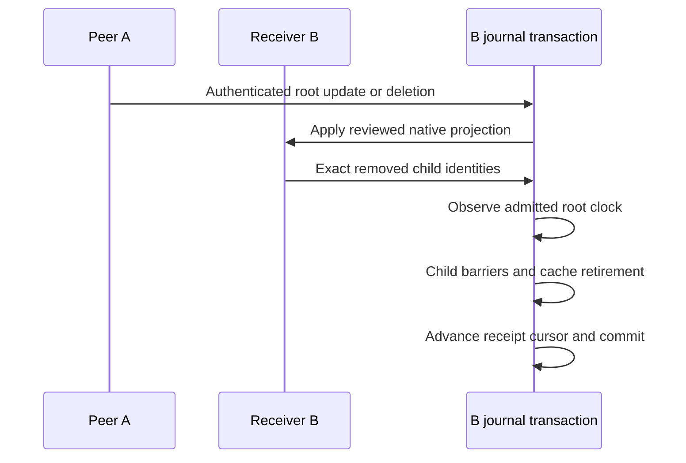

# Derived child retirement — functional component verified

The common incoming projection/deletion entry now turns actual native child removals into genuine journal tombstones. A source deleted on device A can erase a recap or answer created only on device B; B now publishes barriers for those child lifetimes so device C can retire their protocol state too. A source update or explicit entity correction can remove receiver-only entity metadata and needs the same treatment. Independent sources, entity definitions and conversations keep their own lifetimes.

The connection installs thirteen TEMP AFTER DELETE triggers against explicit `main` tables. Each records only the active catalog digest and canonical table for a deleted native key, using the indexed byte-exact local-key mapping. The collector also accepts the integrity-checked source planner's selected cached identities and explicit obsolete recap-citation identities. It is inactive between admitted operations, checks its fifteen exact TEMP schemas, rejects nested/altered collectors and clears metadata with ordinary DML. Reopening has no collector state. [SQLite documents the connection-local behavior and explicit main-table qualification](https://www.sqlite.org/lang_createtrigger.html#temp_triggers_on_non_temp_tables).

For each child, the same outer transaction establishes a journal barrier, retires its catalog mapping and purges cached versions plus recipe/session/run metadata by global digest. This preserves replacement lifetimes at reused native keys. Source projection media stages before cache removal; physical cleanup retains the existing committed-queue and exclusive-reservation protocol. An already-deleted child needs no duplicate announcement. The parent key is excluded from publication; this is not parent echo.

The root's clock must be observed before writing child tombstones. A received put normally advances its peer cursor only after its typed callback returns. The collector merges the admitted stored root clock after projection succeeds and before publishing derived changes, so a child barrier includes its triggering update rather than an older cursor. The whole sequence, including native mutations, child barriers, cache cleanup, receipts and clocks, rolls back if any announcement fails.

Eleven new defined cases include ten executed tests and one guarded worker. They cover three replicas and a late offline put, source-update removal of a receiver mention, independent objects, recipe/run and entity/mention cascades, second-announcement rollback/repair/retry, a real uncached NUL-containing native key, inactive/nested/altered TEMP protection and reopening. Two parents SIGKILL only their owned child before and after commit, inspect the durable pending media queue before opening, verify normal startup cleanup, and retry without duplicate announcements. No device power failure is simulated.

Three retained counterexamples exposed missing receiver-only barriers, missing source-update retirement, and a child barrier missing its admitted root put's clock. The initial TEMP teardown attempt also hit a locked table while the outer journal retained statements; the final connection-local schemas stay inactive between calls. A startup-media oracle was corrected after observing legitimate committed cleanup on reopening. The [twenty-stage receipt](../benchmarks/sync-derived-retirement-v1.json) passes 1,612 full cases / 80 explicit skips, and 612 sanitizer / 612 optimized cases, each with 20 skips. All 710 repository inputs and 456 Sources/Tests/Vendor inputs remain unchanged. All 15 parent/retained-worker sanitizer logs contain no race warnings. The full suite skips the worker-only entry and the wake-controller case requiring an initialized native app; this adds no physical native/power acceptance.

A new ad-hoc signed 34-file app passes actual initialized/fresh old30 refusal, current entity/project/metadata, capture, normal/indexed API/MCP, SDK, original erasure, deletion/wipe, recaps/routines and interrupted backups. Strict staged/extracted signatures and every file agree. Installed 15 files and four earlier staged trees remain unchanged. CLI SHA256: `74bfff8cf2c80449041fb9a55ab60263aabe6685cc31a3d2dc4bb4321314eed1`; ZIP SHA256: `34123652bc36fe9dc2eb53a54e43e53d2547450df149149c9223cfa0ce3118a9`.

Persistent schema31 and the existing wire format stay unchanged. This is an internal component with no public sync control. Scoped erasure and wipe collection/epoch barriers, acknowledgement-based compaction, production privacy/media/transport admission, enrollment/key recovery, background lifecycle, native conflict/status UI, providers/two-device acceptance, representative scale/power and distribution remain open. F059 and all 78 feature statuses remain unchanged; no broad parity or comparative ranking claim follows.

The native-key collector uses indexed mappings; existing whole-source erasure still validates its bounded retained dependency graph. Representative projection/deletion fan-out, batching, no-child clock-write overhead, schema-check allocation, replay and physical-energy measurements remain required. No throughput improvement is claimed here.
