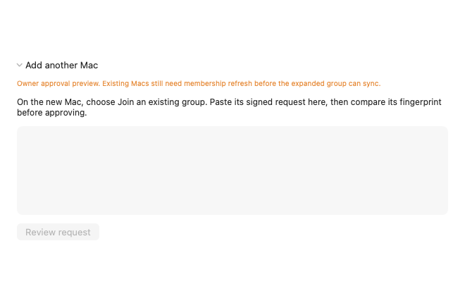
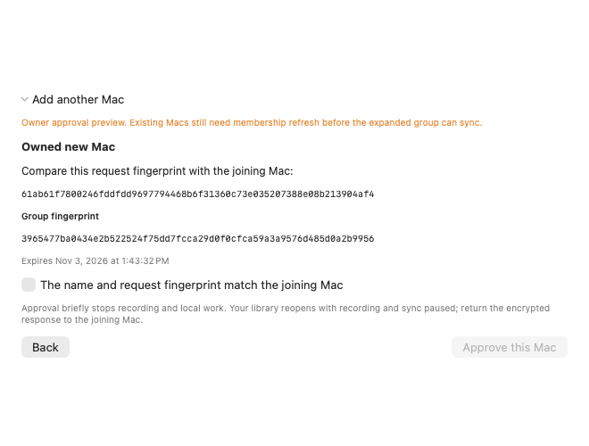
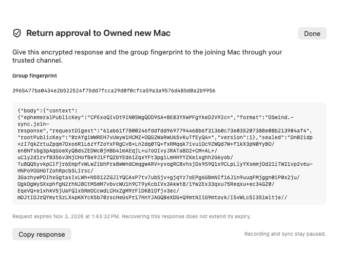

# Owner-addition app lifecycle preview

Source `5efde85` integrates reviewed owner approval into the actual AppSession lifecycle. It remains an opt-in development preview. The default two-Mac setup stays unchanged; existing peers still need membership catch-up and expanded-group reconnection before a newly enlarged group can sync. F059 remains TODO.

## Current development boundary

**Do not use the retained `5efde85` package as a ready preview.** During subsequent peer work, a controlled encrypted-vault notification reproduced a fresh AppModel opening while the original membership SQLite close remained blocked. [PR162](https://github.com/vibhusapra/OSwind/pull/162), commit `f24f3c6`, adds the close/finish guard and passes that targeted regression. The negative control exercised the peer path; it did not directly rerun this frozen parent. The parent source has the same unguarded `loadVault` entry and remains immutable for these receipts.

The owner flow requires the development flag `OSWIND_OWNER_ADDITION_PREVIEW=1`. In Settings → Connect, the owner reviews the joining Mac's signed request, group/request fingerprints and expiry. The operation joins app work, retains original resources through close/retry and returns an encrypted response after same-workspace quiet reopening. Recording, API and sync remain stopped. Saved reconnect preferences remain available. Default folder setup remains limited to two Macs at this source; use generated development libraries to evaluate the evolving enlarged-group flow.

## Failure and recovery behavior

- Reviews belong to the exact current session and latest review token. Another session, retired model, changed root/database, expiry or a disabled preview cannot consume them.
- App retirement denies new work before suspension and joins actual capture/import/query/index/model/recap/statistics/storage workers plus the exact sync actor's stop.
- A retained one-attempt operation owns the original library and credential leases before the first private save. An ambiguous failure does not discard those owners.
- Failed SQLite/media close retains the same resources and exposes **Retry closing device update**. Switching/recovery/Quit cannot bypass that close. A successful retry closes that same owner before reopening.
- Saved membership intent exposes **Finish saved device approval** in a distinct restricted-recovery screen. Recovery uses the original accounts without a provider folder and reopens quietly. It does not automatically present an older approval response.
- Encrypted libraries can detach after the original close and unlock back into saved recovery. Late cancellation, Lock or Quit suppresses response presentation and joins late stores before detach.
- Fresh models validate the original root device/inode, sync origin/generation, pairing handle/lifetime and delivery identity before presentation or service activation.

## Qualification remains incomplete

**723 committed inputs**, 20 changed / 703 unchanged preceding inputs. Forty-one new methods comprise 30 actual app cases, four busy-close owner cases, six exact-session transfer cases and one genuine frozen predecessor-format2 gate.

| Selection | Actual result |
|---|---|
| Retained full Debug at136cf1e; all production inputs identical | 2,670 passed / 170 skipped / 0 failed methods |
| Current-source Debug pairing class, tracing off | 25 passed / 3 skipped / 0 failed methods |
| Expanded affected Thread Sanitizer | 1,368 passed / 131 skipped / 1 failed methods (2 issues, 0 unexpected) |
| Explicit native Thread Sanitizer | 310 passed / 3 skipped / 0 failed methods |
| Expanded affected optimized | 1,368 passed / 132 skipped / 0 failed methods |
| Explicit native optimized | 309 passed / 3 skipped / 1 failed methods (1 issues, 1 unexpected) |

**Overall qualification remains incomplete.** Two distinct current selections retain failed methods: affected-tsan: OSwindAppTests.PendingMediaSchedulerTests.testLibrarySwitchJoinsActualPendingMediaWorkerBeforeClosingStore; owned-native-optimized: OSwindCoreTests.NativeVaultCancellationTests.testCancellationDuringMediaDrainStillClosesStoreAliasAndOwnedImage. Broad TSAN has two assertion issues in the readiness method; native optimized has one unexpected moved-image binding issue in its cancellation method. Both causes remain unexplained. Their failed exits, method identities and issue counts remain in the receipt. The continuation executes only distinct previously unexecuted native/optimized/build/package stages and does not rerun failed selections to obtain a green result. No production fix or relaxed deadline is claimed. Full Debug is the retained136cf1e result; all other722 declared inputs and all production/package inputs are identical to current5ef. The one changed test file has a separately retained current-source28method normal Debug result with tracing off. This does not claim a new current-source whole-fullDebug run. One existing wake callback method legitimately passes only when unlocked and thermally allowed; its actual pass/skip state is retained by identity. Native selections explicitly exercise generated APFS images and owned original login-Keychain accounts, plus six light/dark request/review/response SwiftUI component rasters in each native mode. All 12 retained images were visually inspected; matching point geometry and actual 1×/2× raster scale are recorded. These are offscreen component renders, not interactive GUI acceptance.

Both native selections retain seven real delivered-response SIGKILL boundaries and prior frozen35/36 floor/backfill gates. A newly frozen genuine `ad32c6c` engine first admits/writes/prepares a cached SQL statement against a genuine format2 predecessor. After completed approval it refuses cached/normal writes and fresh opening; the current writer, exact saved ciphertext and joining recipient remain usable. Five original generated accounts are verified cleaned. The old engine's 709 original source inputs were unchanged; its test-only worker and immutable binary are separately pinned.

The reviewer requires exact XCTest starts/terminal identities and states, complete aggregate summaries, commands, environments, source/resource/frozen hashes, native markers and cleanup. Six altered test logs and five altered native records reject. A normal production release build and strict ad-hoc package pass separately from the incomplete broad test qualification, with all prior bundled resources/Info unchanged and executable modes verified.

Retained earlier failures: qualification v1 stopped before tests because an aliased build symlink confused Clang module paths. V2 reached all 2,840 methods but failed three guardian process methods because their fixture assumed checkout `.build/debug`. The fixture now resolves the actual helper beside the running XCTest bundle, including external scratch and optimized builds. All ten actual guardian/process methods pass in targeted and applicable selected modes; this does not erase unrelated current readiness failures. V3 broad ThreadSanitizer retained one existing restricted-recovery timeout (1,368passed /131skipped /1failed). V4 normal Debug retained a different existing15second pairing-helper timeout (24passed /3skipped /1failed). Their causes remain unexplained; later passes do not erase or explain them. Test-only state/callsite and optional phase diagnostics preserve existing15/30second conditions and deadlines; no production fix is claimed. Development fixture/scope/expiry errors remain in raw logs.

[Receipt](../benchmarks/sync-owner-app-lifecycle-v1.json) · [Pinned inputs](../benchmarks/sync-owner-app-lifecycle-inputs-v1.json) · [Raw evidence](../benchmarks/sync-owner-app-lifecycle-raw-v1.zip).

## Remaining acceptance

Peer request/page export, reviewed catch-up and expanded-group reconnection/transfer come next. Removal, rotation, capability negotiation, pressure, physical two-Mac/provider testing and production credential behavior remain open. This receipt does not qualify uninterrupted 24-hour current automatic capture, controlled energy, Developer ID/notarization, complete v0 or a competitive ranking. All 83 feature statuses and all 505 preceding benchmark files remain unchanged.

## Rendered component review

These six retained offscreen components use generated requests and encrypted responses. They do not show private desktop history or establish interactive GUI acceptance.

[Dark appearance](../assets/owner-addition-request-dark.png)

[Dark appearance](../assets/owner-addition-review-dark.png)

[Dark appearance](../assets/owner-addition-response-dark.png)

## Hosted result and future selection

The [source5ef hosted run](https://github.com/vibhusapra/OSwind/actions/runs/41715026531) is terminal: its native job passed and its benchmark-harnesses job was cancelled. The overall run reports failure. That workflow predates the new explicit owner-app native/render selection; its passing native job does not erase either local failed method. [Terminal job/step record](../benchmarks/sync-owner-app-hosted-source5ef-v1.json).

A follow-up workflow change adds the exact owner-app class with both native flags and always retains only generated component PNGs. YAML parsing and preservation of all preceding steps passed; a future hosted result is separate. [Static selection review](../benchmarks/sync-owner-app-ci-selection-v1.json).
