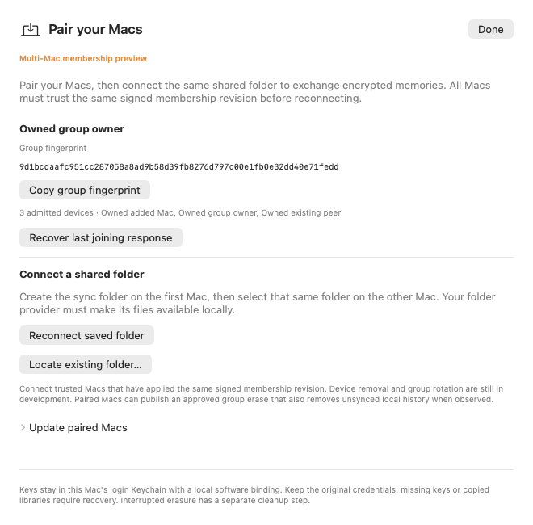
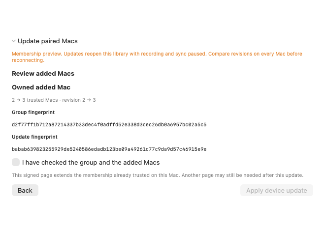

# Peer membership update preview

Runtime `4c0d51d86f8de8499406a5375df9a068a5dca906` adds signed membership requests, bounded public update pages, reviewed existing-peer catch-up and enlarged-group folder controls. It also guards vault metadata notifications from opening a fresh model while the original membership close remains pending. This is an opt-in development preview; F059 and the full-sync acceptance remain unfinished.

Enable `OSWIND_OWNER_ADDITION_PREVIEW=1` when launching a development build. Default setup remains two-Mac. Use generated development libraries while the remaining acceptance below is open.

1. The owner approves the joining Mac through **Add another Mac** and returns its encrypted joining response. The owner library reopens with recording and sync paused.
2. Each existing connected peer uses **Update paired Macs → Prepare membership request**. This is a public signed certificate request.
3. In the owner's disconnected pairing setup, paste that request under **Help an existing Mac catch up** and prepare a signed update page. Export does not change private accounts or return private keys.
4. On the existing peer, paste the page, review the added names and group/update fingerprints, compare the group, then confirm **Apply device update**. The exact reviewed session and latest review token must still be current.
5. The original app producers/session stop before private intent. The retained operation owns original leases through close failures and retry. It reopens the same workspace quietly and returns no joining response. Saved recovery works without the provider folder, including the owned encrypted-vault fixture.
6. Repeat pages when needed. Compare signed revisions on every participating Mac before explicitly reconnecting the same locally available shared folder. In preview, three-or-more-member groups have reconnect/locate-folder controls. Default mode continues to gate them.

The entire incoming signed path is verified, including any already-applied prefix. Private preparation uses only the suffix after this peer's exact current certificate; the review fingerprint remains bound to the supplied canonical page. A signed fork at the same revision cannot substitute for the exact trusted certificate. Requests/pages have explicit byte limits, and public history export was exercised through 64 admitted members in multiple bounded pages. This does not establish global provider freshness, removal or rotation.

## Current evidence

**31 selected methods passed, zero skips**, with both generated native Keychain/Mac-binding and encrypted APFS fixture flags enabled. All 726 declared runtime/test/build inputs match the committed qualification source. The reviewer checks each exact method's start/terminal state and both complete aggregate summaries. The first parser attempt failed because current XCTest names included their module; the versioned correction reviews the unchanged log without repeating tests.

- The public three-library graph preserves all 13 data kinds, three-direction writes, two peer writes while the owner is offline, and exact counts for all 13 tables after reconnect/replay. A real owned login-Keychain variant compares original account IDs and private fields in RAM, checks their continued readability, and verifies generated-account cleanup. It logs no private values.
- Three actual AppSession models exchange generated source notes using explicit folder connections and network-toggle cycles. The owner is drained and closed; both remaining peers receive each other's new writes before it returns. The owner reopens quietly, reconnects and retains exact source counts and the original account-ID set. This uses software test credentials on one Mac; it is separate from the native graph variant.
- App tests cover held producers, cancellation, exact/stale reviews, substituted root/database refusal, actual SQLite busy close and both retained leases, saved intent, provider-free recovery, late Lock, encrypted detach/unlock and a positively acknowledged actual vault metadata notification.
- Twelve current light/dark components were visually inspected: request/review/export, three-member preview, three-member default gate and ordinary two-member default setup. Labels/borders/placeholders make empty paste fields visible. These are offscreen components, not interactive GUI acceptance.

The watcher defect and overlapping-page defect each have retained failing controls before their separate production corrections. Earlier development failures remain in the raw evidence. The first three-app attempt timed out at a nil session state; the corrected fixture explicitly completes onboarding only in its own models and records that the replacement peer initially had onboarding enabled/admission blocked. The original run did not record that state, so its exact cause is not claimed. No user defaults or readiness deadlines were changed.

[Receipt](../benchmarks/sync-peer-membership-v1.json) · [Pinned inputs](../benchmarks/sync-peer-membership-inputs-v1.json) · [Raw logs, source snapshots and generated renders](../benchmarks/sync-peer-membership-raw-v1.zip).

## Remaining work

- [ ] Current broader owner/pairing regression, Thread Sanitizer and optimized selections; normal production build/package.
- [ ] Enlarged-group policy/exclusion and approved erase acceptance, capability/version negotiation, device removal and group rotation.
- [ ] Physical multi-Mac/provider behavior, pressure/resource limits and production credential/distribution acceptance.
- [ ] Current automatic 24-hour capture, controlled energy and whole-product comparison.

The parent qualification retains an existing PendingMedia readiness failure in broad TSAN and a moved-image binding failure in native optimized; these selected peer passes do not erase or explain either. All 505 preceding benchmark files and the frozen native35 package remain unchanged. No requirement status, full-v0 completion or competitive ranking is promoted.

## Reviewed components

[Dark preview](../assets/folder-membership-three-preview-dark.png) · [Default three-member gate](../assets/folder-membership-three-default-gate-light.png) · [Ordinary two-Mac setup](../assets/folder-membership-two-default-light.png).

[Dark review](../assets/peer-membership-review-dark.png) · [Labelled peer request](../assets/peer-membership-request-light.png) · [Owner public export](../assets/peer-membership-export-light.png).

## Broader qualification update

All four distinct source-f5e stages are terminal. The 95-method Thread Sanitizer selection has **88 passed, 6 render-only skips and one failed method with two assertion issues**. `PeerMembershipAppSessionTests.testActualOwnerAppExportsExactPublicPageWithoutChangingPrivateAccounts` compares all fixture credential bytes while another peer remains active. No per-account delta was recorded, so an unrelated peer checkpoint remains an unproven hypothesis. No data-race report was found in this selected log.

The distinct optimized selection has **89 passed, 6 render-only skips and zero failures**. Release build, package and strict ad-hoc signature checks pass, with all30 prior resource/Info files unchanged and executable modes0755. The original successful native-Debug31 run and failed sanitizer engine are separately retained. The optimized pass does not erase or explain the sanitizer failure. **Overall qualification remains incomplete.**

[Broader WIP receipt](../benchmarks/sync-peer-qualification-wip-v1.json) · [Inputs](../benchmarks/sync-peer-qualification-wip-inputs-v1.json) · [Raw distinct-stage evidence](../benchmarks/sync-peer-qualification-wip-raw-v1.zip). The next isolated test joins the peer before testing whole-fixture private-byte invariance and records role-based change booleans without private values. No production change or deadline relaxation is proposed from this failure alone.
