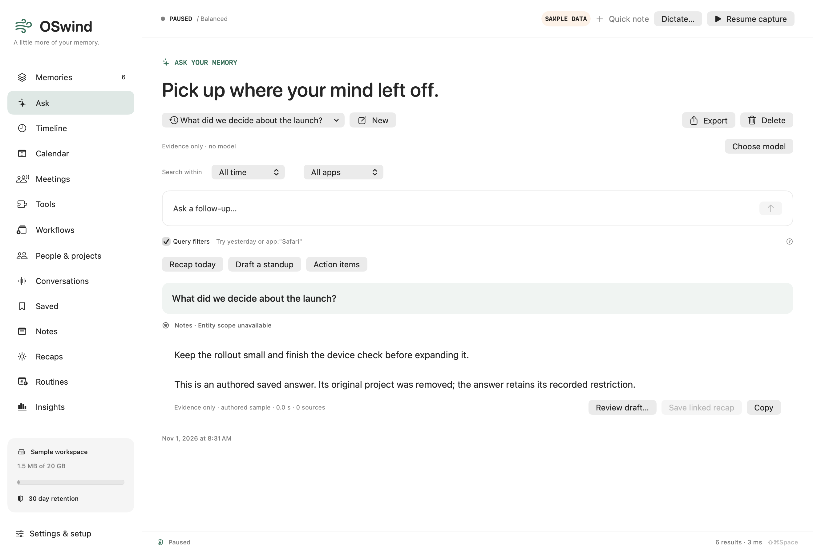

# Unavailable entity scopes

Deleting a project, person or other entity must keep an independent saved answer readable without turning its saved restriction into an all-source query or attaching it to another entity lifetime. OSwind now preserves an explicit unavailable state in native history, portable filters, calendar scopes, snapshots and Markdown export.

**Component qualified; F059 remains TODO.** This adds native schema 32 and an internal wire field. It enables no public sync service, pairing, watcher or transport. Owning conversations, recipes and evidence retain their required-reference rules; the earlier optional conversation component keeps its own dated evidence.

## Behavior

| Trigger | Result |
| --- | --- |
| Native entity delete or merge | Preserve independent question/answer and other fields; replace only its entity restriction with unavailable. A merge does not silently choose the surviving entity. |
| Last suggested mention removed, extraction replaced, or last source changed/erased | Apply the same narrowing only if the definition is actually pruned. Curated entities and definitions with remaining sources stay available. |
| Known peer entity deletion | Use the genuine durable barrier, exact current cached packet, owning connection and transaction. Rebind the same admitted packet to its new exact native frame; preserve raw run-original bytes. |
| Late turn/run names an erased optional scope | Import the independent history with an unavailable scope. Missing live definitions still retry without a receipt; required owners/evidence are not waived. |
| Query or model request reuses unavailable scope | Refuse before query interpretation, provider requests or visual inference; metadata counts select no unrelated sources. |
| Calendar snapshot/scope reused | Preserve the restriction and a distinct cache key through value/JSON round trips. |
| Markdown export | State “Entity: unavailable (original restriction retained)”; never describe it as “any”. |
| Quiet restore and new enrollment namespace | Retain unavailable provenance; never grant old IDs the new catalog’s lookup authority. |

The saved-answer label is **Entity scope unavailable**. New questions use the current visible controls. Select an available entity in People & projects to start a new scoped search; unavailable saved filters are never implicitly cleared.

[Dark](../assets/unavailable-scope-history-dark.png) · [compact light](../assets/unavailable-scope-compact-light.png) · [compact dark](../assets/unavailable-scope-compact-dark.png). These are own-app offscreen renders using actual native create/append/delete paths and authored text. They establish no new native click/keyboard or capture acceptance.

## Storage, protocol and compatibility

- Schema 32 adds two sparse JSON scope indexes and a distinct writer marker on all 15 canonical/history tables. Already-open older connections refuse writes, including empty statements; fresh older clients refuse the newer schema.
- Native unavailable selectors encode a typed object in the formerly String-valued entity selector alongside the unavailable marker. An actual schema-31 decoder refuses it instead of ignoring an unfamiliar key and broadening the filter. Ordinary active filter JSON keeps its prior shape.
- New outgoing packets use explicit unavailable provenance. Reconstructing an old active wire reference is allowed only for its actual admitted cached packet, the matching origin/generation/group/epoch and a genuine entity barrier. Provenance alone grants no entity dependency or lookup.
- Scope retirement visits at most 128 row IDs per batch and one full payload at a time, with a per-row autorelease pool. Exact turn permits and run-original permits retain ordinary invalidation for unrelated changes. Cancellation or failed deletion rolls back the history change and receipt.
- Routine definitions currently select app/kind/tag, not entities. Stored/portable run filters can contain an entity restriction; authored raw run fixtures exercise that existing representation without claiming a public entity selector for recipes.

## Qualification and receipts

[Qualification](../benchmarks/sync-unavailable-scopes-v1.json) · [complete source manifests](../benchmarks/sync-unavailable-scopes-inputs-v1.json).

Native production and tests are compiled at `36a0e66`. Final verification is `21f8596`: **exactly one Python smoke-oracle line** recognizes the new, correct raw-writer refusal. All815 other inputs, native production/tests/dependencies and the staged app are unchanged. Fifteen passing source-bound stages are retained from that compilation;18 corrected/final process and artifact stages complete 33 checks. The original oracle failure remains retained.

- Full debug: **1,933 passes / 95 explicit skips**.
- Thread Sanitizer and optimized: **523 passes / 35 skips each**; all 37 mandatory scope controls execute in all three builds, with no race warnings.
- Owned native encrypted-library selection: **39 passes /no skips**. Full/native selections cover **1,970 distinct passed methods**.
- Independent review checks six recovered, closed databases after actual before/after-commit SIGKILL across all three builds: exact turn/run frames, raw originals, cached bodies/bindings, causal barrier/receipt, accounting, no echo and idempotent retry.
- Actual frozen schema31 code/binary accepts ordinary current wire and refuses unavailable wire/native filters. An already-initialized old writer and reader, fresh CLI reader/writer and old backup inspector refuse as required. Durable data and original payloads stay unchanged; volatile SHM hashes are recorded separately. The authored [schema31 fixture and generation probe](../Tests/OSwindCoreTests/Fixtures/HistoricalErasureMigration/provenance-cached-schema31.json) are SHA-pinned for CI.
- Signed app/archive contents match across all 34 files; CLI/HTTP/MCP/SDK, backup, retention, APFS held-reader/query interruptions and eight schema32 process groups pass. All 32 prior app trees remain unchanged.

Earlier genuine late-arrival, native-key-reuse, cache-binding, old-writer and calendar/export failures remain distinct from fixture/compiler/oracle mistakes. Passing subsets are not a whole-product completion claim.

## Native metadata observation

[Raw measurements](../benchmarks/sync-unavailable-scopes-performance-v1.json) · [reproducible harness](../benchmarks/harnesses/sync-unavailable-scopes-v1.py).

| Authored histories | Filters retired | Whole CLI wall time | Whole process peak RSS |
| --- | --- | --- | --- |
|1,000 turns +1,000 stored runs|2,000|0.189s|21.36MiB|
|10,000 turns +10,000 stored runs|20,000|1.347s|29.09MiB|

One warm observation per size on Apple M5 Max / 128 GiB, macOS 26.6.2. Full native-row oracles cover all 22,000 retired filters, four unaffected history controls and two unchanged source records, including minimum negative row IDs and SQLite integrity. Timer includes CLI startup, schema checks, native deletion and exit. Raw SQL population, setup/source-control embedding, imported run originals, active sync capture/journal/transport, cold cache and timed model inference are excluded. RSS is the entire CLI, not incremental retirement memory. These measurements establish no speedup, energy result, peer-sync rate or competitor rank.

To repeat using a locally built schema32 CLI, run the harness from a checkout containing the matching32 fixture adapter. Pass `--cli /absolute/oswindctl --output /new/absolute/folder --source FULL_SOURCE_SHA --cli-sha256 BINARY_SHA256`. This standalone mode labels the source association as caller-declared; it does not turn an unqualified build into this qualified binary.

## Remaining delivery gates

F059 is still TODO: publication/collection erasure epochs, compaction, full current-policy/media/transport admission, enrollment/key recovery/status/conflict UI, actual providers and two Macs. Sustained capture/power, notarized distribution and whole-product parity/ranking remain open in the [83-requirement ledger](features.json) and [20-offering research](landscape.html). The older [optional conversation](SYNC-OPTIONAL-REFERENCES.md) and [late dependency](SYNC-LATE-DEPENDENCIES.md) receipts remain source-bound historical components.
