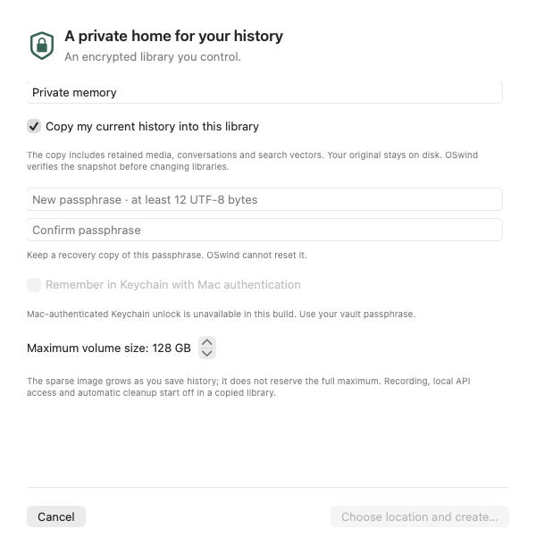
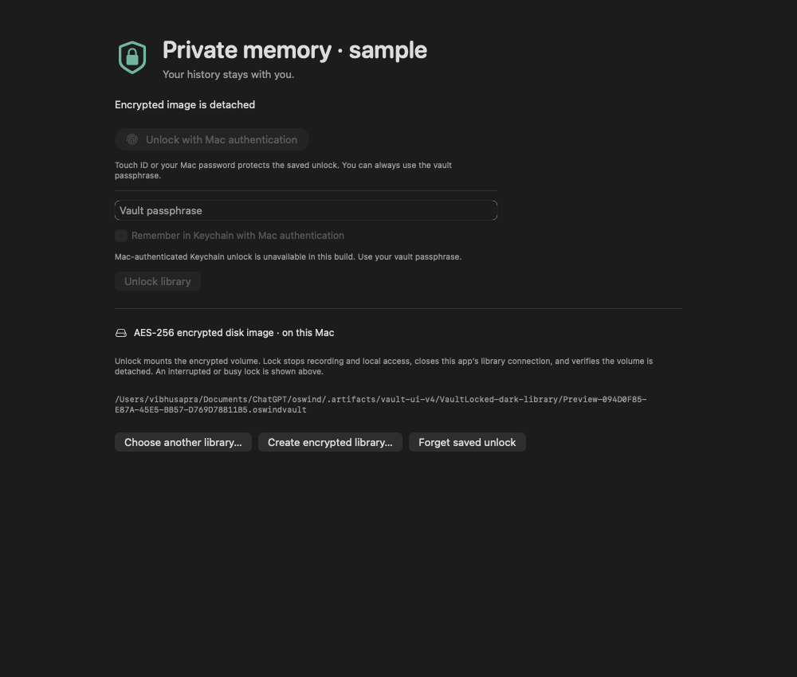
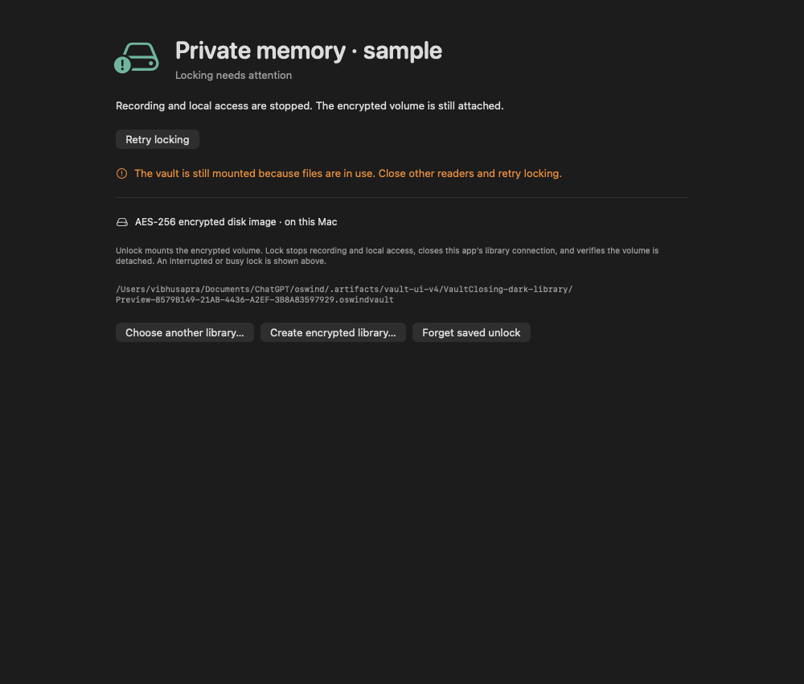

# Encrypted libraries

Schema 18 adds a native encrypted-library package, separate from the ordinary library. The source includes setup, verified copy, passphrase/optional Keychain unlock, an explicit locked screen, menu/Settings lock controls and sleep/session-lock requests. The installed schema-17 app has not yet been replaced with this work. The separately staged ad-hoc signed package passes headless release qualification: 522 total tests (516 pass / six skips), 79 focused TSan passes and all 15 signed-release process groups. Native authentication and click/focus/device acceptance remain open. [Sanitized evidence](../benchmarks/encrypted-library-v1.json).

## Cooperative cancellation

The current candidate in [PR #54](https://github.com/vibhusapra/OSwind/pull/54) waits for an owned mutating create/attach/detach action to finish before acknowledging cancellation. DiskImages can delegate work beyond the hdiutil process; killing that front-end early did not prove the image was detached. Unlock cancellation then performs the existing identity-checked cleanup. After locking closes the public handle, normal detach and fresh absence confirmation finish before cancellation returns. Existing helper deadlines apply, and read helpers remain cancellable. The UI can remain in its stopping state while native work completes.

The preceding staged runtime has a reproduced cancellation defect even though its final CI is green. [Current signed qualification](../benchmarks/vault-cancellation-v1.json) exercises all 818 defined cases and 407 distinct TSan cases, five repeated actual CLI SIGINT trials and terminal-generated Ctrl-C during create/unlock/lock. Immediate recovery preserves an authored source; independent OS inventory confirms detachment. Native Stop during a bounded owned-helper hold and intervening OS lock are followed by an observed detached screen, and immediate native unlock shows only the original note with recording paused. OS lock interrupts the final Settings Lock observation; final product/OS state is verified independently. No real Keychain authentication is accepted by this fixture.

Do not equate cooperative cancellation with a second Ctrl-C, Force Quit, SIGKILL, power loss or an OS-native hang. Those boundaries require separate fault/recovery evidence. No force-detach fallback or weaker identity check is added. Busy unlock still displays its last status sentence beside Working safely; wording polish remains open.

The repeatable terminal fixture creates a new private controlling PTY, sends its actual VINTR character to the foreground CLI group and keeps the random passphrase on a separate closed pipe. It never uses the user's terminal. Foundation launches the observed hdiutil helpers in different process groups on this host, so this is not evidence that a signal delivered directly to a native helper is harmless. Raw synthetic output and encrypted packages remain under the explicitly new fixture root.

```bash
python3 scripts/vault-terminal-smoke.py /absolute/path/oswindctl \
  --root /new/owned/vault-terminal-check
```

A later source 681676f qualification retains an additional cancelled-lock counterexample under TSan: an independent inventory lists one owned image after cancellation returns, before later status reports detached. No image remains attached after the run. This occurs without a measured suspension gap and leaves the complete closing transition/settlement boundary unqualified. [Partial evidence](../benchmarks/entity-unicode-v1.json) preserves it; earlier passing trials remain observations rather than a universal cancellation guarantee.

[PR #57](https://github.com/vibhusapra/OSwind/pull/57) reproduces an earlier-phase gap with a held supported media-writer lease: cancelling the prior transition returns before store closure in all three cycles (seven assertions fail, including two still-attached observations). The complete closing transition now runs independently of cancellation, retaining the operation lease, normal detach and identity checks; already-cancelled public calls stop before reservation. Forty-five focused and twelve session cases pass; [broader frozen-source qualification](../benchmarks/vault-close-transition-v1.json) is in progress. The controlled gap does not isolate the earlier awake TSan counterexample's timing.

## Storage and locking

Read-only status also checks that a detached completed image is still encrypted; a missing or unencrypted replacement is unavailable. Each `.oswindvault` package contains an AES-256 encrypted APFS sparse disk image, a small non-secret manifest, an operation lease and managed session metadata. The image grows up to its selected maximum; available physical disk space still limits writes. The manifest exposes the library name, capacity, UUIDs, creation time and whether a Keychain credential was saved. It contains no history or passphrase.

`Library` is a stable public handle. It is a regular closed file while locked and a relative symlink only to the independently verified private mount while unlocked; moving the whole package keeps that handle connected to the same mounted library. Opening checks the managed image, actual APFS volume UUID, mount point and directory identities. Missing/corrupt metadata and a reserved package with no manifest refuse plaintext fallback before directory/SQLite creation. Preferences retain the stable handle rather than a temporary mount path.

Locking stops supported capture/audio, routines and local API access, cancels app workers, clears displayed history, closes the app's SQLite connection, closes the public handle, then attempts a normal detach and verifies it. A competing reader can prevent detach. That state is **closing, still mounted**, with retry; OSwind never force-detaches the volume or claims that pending state is cryptographically locked. An existing supported store can close through its retained, identity-checked directory descriptor after another process closes the public handle or moves the package. The descriptor is released on successful close so it cannot pin the volume indefinitely. Package-change events let an open app observe a competing CLI lock and close its connection. On a package rename, the watcher resolves its already-open directory descriptor, verifies the vault ID, updates the selected stable handle, clears displayed history and requests lock at the new location. Status separately reports `volumeMounted` and `imageAttached`. An unmounted filesystem with an attached decrypted backing device remains closing; only verified image detachment authorizes a cryptographic lock or normal exit. A detached incomplete setup can still terminate safely. Normal app termination returns to the ordinary event loop while awaiting a requested lock, then requests exit after verified detach; a failed lock keeps the app open. A reproduced `terminateLater` nested-loop deadlock from a MainActor caller is covered by a delegate lifecycle regression and owned preview-process exits. Force Quit, a crash, power loss and OS shutdown are different boundaries and cannot guarantee cleanup.

A reproduced macOS rename case leaves the image-path and Disk Arbitration mount path stale while the kernel mount path changes. Attachment lookup binds the saved device, volume UUID, image identity and actual kernel mount instead of assuming a missing old path means detach. Normal detach targets the verified backing image device. Only for this verified renamed case, a stale-path refusal can fall back to a normal kernel unmount followed by verified backing-device detach. No force option is used. If interrupted between those steps, retry recognizes the still-attached unmounted image. Ambiguous identities remain unavailable rather than adopting or ejecting another device.

Opening an older ordinary library in this build upgrades it to schema18. The retained original after a vault copy preserves its history, but is not a byte-identical/schema-downgrade backup; older executables refuse it. Keep an independent earlier backup if returning to an older build matters. No normal user library was opened during qualification.

New schema-18 libraries exclude older executables before supported writes. This does not revoke already-open raw file handles or make arbitrary old/raw clients cooperative. Detached-handle refusal also prevents an older executable from silently creating a new plaintext library at that handle.

## Temporary work and exports

The database, retained images/audio/video, supported audio/replay staging, backup pins/snapshots and search-index caches live on the mounted volume. Every OSwind SQLite connection for a managed library uses `temp_store=MEMORY`, including backup, snapshot and vector-source helpers; ordinary libraries retain their existing disk-temp policy. Migration's temporary copies are inside the **new encrypted volume**. SQLite does not redirect a process-global temporary directory.

This is disk-image encryption, not an isolated execution enclave. While mounted, programs running as the same Mac user may read the volume. Decoded media, text, model inputs and secrets also exist in process memory; OS paging, crash reports, framework internals, endpoint policy and physical memory protection are not covered by this feature. UI clearing is not a claim of forensic RAM erasure. General downloaded model weights remain outside the vault. Keep FileVault enabled to protect the rest of the disk.

An explicitly requested full backup, Markdown/media or JSON export is a readable copy at the chosen destination. Remote BYOK and connected MCP clients retain their existing consent/data boundaries. Locking does not recall data already sent to a provider or client. Earlier exports, original plaintext libraries, APFS snapshots and backups are independent copies.

## Passphrases and optional Keychain

Use a UTF-8 passphrase of 12–4096 bytes without NUL characters. Keep an independent recovery copy: OSwind cannot reset the disk-image password. The helper receives it through NUL-terminated stdin, with no shell, password environment variable or password argument. Public reports exclude credentials and raw helper output. Swift/OS copies of secret memory cannot be guaranteed zeroed.

Remembering is optional and is attempted only after a successful passphrase-based attachment. An in-memory digest binds the saved credential to the passphrase just accepted by that actor; an arbitrary replacement cannot be enrolled merely because a volume was already open. If Keychain saving fails, the app reports that failure and the chosen passphrase still works.

[Apple documents the app identifier and access-group requirements](https://developer.apple.com/documentation/security/sharing-access-to-keychain-items-among-a-collection-of-apps). The separate `com.oswind.vault-passphrases` service uses the macOS Data Protection Keychain, `WhenUnlockedThisDeviceOnly` and `userPresence` access control. It never falls back to an unprotected generic item. Retrieval uses a fresh LocalAuthentication context only for an explicit Unlock action, never at startup. The real provider refuses saving/retrieval while the Mac session is locked. A read-only signing preflight disables protected-Keychain controls when this executable has no app-identifier entitlement; the current ad-hoc build uses passphrase unlock. No provisioning entitlement is fabricated and there is no weaker-storage fallback. Mac authentication may use Touch ID or the Mac password; this is not a Touch-ID-only policy. Forgetting removes the saved unlock, not the disk-image password or history. Moving a package to another Mac does not transfer its Keychain credential.

Tests cover the credential lifecycle with an injected fake provider and real owned encrypted images. Actual Data Protection Keychain entitlement/signing behavior and the real authentication dialog have **not** been accepted. No real user Keychain entry was created during these checks.

## Copying an existing library

Settings → Data → Encrypted library creates a new package. Copying preserves retained media, source records and links, conversations, vectors and portable settings through the existing verified backup/restore pipeline. Destination services, remote use and automatic cleanup start quiet. Local API tokens, model caches and credentials are not copied.

All new pins, snapshots, manifests, verification databases and restore workspaces are placed inside the new mounted volume. The public library handle stays closed until restore verification and managed initialization finish. Cancellation detaches the owned image when possible and leaves the original selected. An incomplete package is preserved for diagnosis; existing files are never overwritten or silently discarded.

The source database's external-change counter, connection change counter and settings digest are checked across the copy. A changed source produces a valid snapshot with `sourceStable: false`; the app retains the original selection and asks the user to open the snapshot explicitly or copy again. The app stops its own services before copying. This is a bounded change check, not a permanent write lock on independent programs; a separate writer could change the source after the final check. The original is always retained and never advertised as securely erased or moved.

## CLI

```bash
# Pipe a passphrase from a trusted source. Never put it in argv or shell history.
oswindctl vault create /path/Private.oswindvault --capacity-gb 128 --passphrase-stdin
oswindctl vault unlock /path/Private.oswindvault --passphrase-stdin
oswindctl --vault /path/Private.oswindvault search --mode keyword example
oswindctl vault lock /path/Private.oswindvault
oswindctl vault status /path/Private.oswindvault

# Copy to a new encrypted package; never erase the source.
oswindctl vault migrate /path/ExistingLibrary --to /path/Copy.oswindvault --passphrase-stdin
```

Create/migrate detach by default; `--keep-unlocked` is explicit. `--vault` requires an already unlocked library and cannot be combined with `--data`. A nonexistent migration source refuses before creating a destination. Ctrl-C cancels a helper and waits for its process to exit; independently verified cleanup runs outside the cancelled task. An interrupted or busy result must be inspected with `vault status` before retrying. A second Ctrl-C is an immediate exit and cannot promise cleanup.

## Validation gates

- Automated guards: closed/missing/corrupt/forged metadata, redirected handles, root replacement, operation exclusion, subprocess output bounds and cancellation, plain/managed SQLite temporary policies.
- Real owned images: create, wrong password, verified attachment, store/scratch/read/write, native copy and change detection, source retention, busy detach/close/retry, remount and Ctrl-C recovery.
- App-model checks: managed startup without credential retrieval, isolated setup/copy/switch, explicit lock/unlock, cancellation, busy-reader truthfulness, startup session lock and external lock observation. These do not substitute for native clicks or OS authentication.
- Remaining: actual authentication and Keychain signing on supported distributions; full keyboard/focus/VoiceOver and native sleep/wake/session transitions; older-macOS matrix; disk-full/media-device failures and large-history migration performance; crash/forced-shutdown recovery; packaged process regressions and final installation binding.

No competitor security superiority, complete Recall security parity, broad feature completeness or top-three ranking follows from these checks.

## Reviewed sample layouts

These are synthetic application-owned renders, reviewed in light and dark appearance. All six export processes exit normally. They do not demonstrate native clicks, keyboard acceptance or Mac authentication.







After a successful normal detach, [bounded verification](VAULT-DETACH.md) requires two consecutive fresh absent observations while retaining original package/manifest/image identity. Known missing-volume observations can settle within the configured budget; ambiguous/unknown states remain pending. No extra detach or force flag is introduced.
