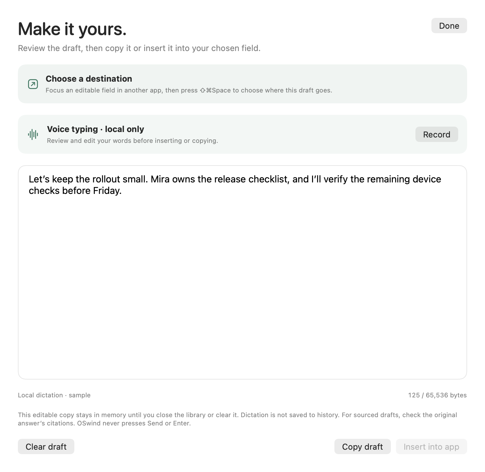

# Reviewed local voice typing

Voice typing is a deliberate, bounded microphone session that produces an editable draft. It uses the same selected local Whisper.cpp or Parakeet v3 model as Audio, including the selected Core ML compute units and shared resident-model retention. There is no cloud fallback. This is a partial F083 implementation; native microphone/permission/foreground/typing acceptance, dictation quality and sustained power remain open.

## Use

1. Choose a local model in Settings → Audio. Finish ongoing conversation recording or audio import before dictation; OSwind does not take their microphone or silently interrupt them.
2. Select **Dictate…** in the workspace and then **Record**. Model preparation and fresh privacy checks happen before the microphone request. Accessibility and Microphone permission are required. Nothing records on launch, shortcut registration, sheet opening, or model selection.
3. Select **Stop & transcribe**, or let the thirty-second limit finish the session. The display shows listening, local transcription, cancellation, and failure states. **Cancel** discards the recording/result. Cancellation waits for actual local work to return before permitting another recording.
4. Edit the words. After transcription, focus the intended field in another application and press **⇧⌘Space** to choose a fresh destination. Return to the draft to insert, or explicitly copy it. An earlier destination is revoked after inference. The shortcut never starts recording or types.
5. **Insert** makes one attempt after current library/privacy validation, target activation, and the existing fresh field/window/selection/secure-input checks. The destination is consumed before attempting the write. OSwind never presses Enter or Send. Check the destination before submitting or retrying.

Browser, terminal/IDE, excluded/private, secure and unsupported fields follow the existing [draft insertion restrictions](CONTEXTUAL-DRAFTS.md). Use an explicit manual copy/paste for unsupported applications. Dictation text is treated as editable text, never as instructions to run tools or commands. The final handoff compares exact UTF-8 review bytes, including canonically equivalent Unicode edits during suspended validation.

## Data and lifecycle

Microphone callbacks convert to 16 kHz mono PCM and append directly into one locked buffer, capped at 480,000 samples (thirty seconds). There is no actor task per callback or unbounded transcription queue. Oversized callbacks, non-finite audio and device/format failures refuse the session. Very short or inaudible audio never reaches the recognizer. The buffer does not promise zero allocation or a measured process-RSS limit.

After the microphone stops, a private `audio/.staging` workspace on the active library volume holds a mode-0600 WAV. The workspace's media lease and private files remain owned until the real recognition call returns, including late cancellation. Normal completion/failure/cancellation removes the temporary workspace. Abandoned leased-workspace recovery recognizes dictation jobs. A library-volume replacement is refused before microphone startup and before/after transcription. No temporary dictation WAV is intentionally written into the system temporary folder for an encrypted library.

Dictation does not automatically insert a source, store an audio clip, run embeddings, save a chat, call a model API, or invoke a tool. The editable result lives in application memory. Clear it or close/lock the library to discard it. Explicit Copy writes to the clipboard, and the destination application controls any inserted text's persistence. This is not memory erasure or protection against swap, system caches or another process with equivalent privileges.

Pause, sleep/session deactivation, privacy/speech-setting changes, retirement, lock, library switching and quit revoke recording/results. The worker stays busy through actual preparation/permission/inference return. Session switching joins the worker before SQLite close; plain Quit waits before its final termination callback. A cancelled operation never admits a late transcript. Current application identity/privacy and lock are checked before/after asynchronous boundaries and during recording (nominal 500 ms poll plus AX latency). The PCM cap is hard; microphone stopping also depends on actor scheduling and privacy-read latency. This is not instantaneous detection or a measured privacy-response SLA. The existing bounded full AX privacy traversal is used; the lightweight stream-binding snapshot is deliberately insufficient for secure-field decisions.

## Verification and open work

The final focused run passes 53 selected tests: 24 new dictation cases plus existing PCM-ingress and reviewed-draft cases. Fixtures exercise concurrent PCM bounding, exact-once drain, non-finite/silent/oversized audio, denied and cancelled authorization without engine creation, private WAV permissions/cleanup, cancellation held through real workspace ownership, actual application pause/settings/retirement/replaced-root handling, and real AppSession switch/AppDelegate Quit callbacks. No test requests a physical microphone or reads the general clipboard, personal corpus, real Keychain, or a third-party editable field.

An explicit owned/public JFK WAV also passes the production dictation path twice with the installed local Parakeet model and Neural Engine selection; this checks actual local decoding, stable text and empty staging/history after completion. This single short public sample is a smoke test, not a dictation benchmark, microphone test, or competitor comparison. The final [774-input/source-Git receipt](../benchmarks/voice-typing-v1.json) passes all15 stages at6ac71ff:1,818 full passes/84 explicit skips,155 each under Thread Sanitizer and optimization/no skips or race warnings,22 signed CLI checks, SDK/API/MCP, quiet backup/restore plus interruption checks and strict34-file archive equality. Installed15 files and21 prior app trees remain unchanged. Final production-path public-file smoke tests also pass twice with GPU+CPU-selected Parakeet and configured Whisper. These are decode checks, not GPU-utilization or quality measurements.

Two extra tests after initially passing checkpoints exposed a pending-authorization Finish that could attempt a late engine startup, and terminal PCM failure that stayed hidden until Stop. Both original red logs remain; generation revocation and terminal readiness now prevent those paths. Reported buffer/conversion failure stops at the next recorder poll and never transcribes failed PCM. This is not evidence that every physical device or missing-callback interruption is detected.

Authored component renders cover idle, listening, transcription and review in light/dark appearance. All eight final regenerated PNGs are byte-identical to inspected layouts at760×740pt. They validate layout only. The Mac remains locked after the earlier native-control refusal; no input/permission acceptance is inferred from component renders.

Open: real microphone/device interruption and permission UX; owned foreground-app insertion acceptance; command/user-facing shortcut ergonomics; representative accents, names, punctuation and multilingual WER; Whisper/Parakeet cold/warm latency and energy; measured privacy response; pause/resume interaction across real power/session transitions; signed/notarized distribution. Thirty seconds is deliberate v0 scope, not unlimited dictation parity. Complete sync, whole-product benchmarks and a top-three ranking remain open separately.

Parent hosted native APFS qualification is still open: [0c9 move failure](https://github.com/vibhusapra/OSwind/actions/runs/41288968230) is retained; [instrumented bcfaf run](https://github.com/vibhusapra/OSwind/actions/runs/41291021469) passes the move/all13app-session cases but fails a separate rapid final detach with exit16 ResourceBusy. The uploaded trace records a later normal cleanup detach; the original cause is unproven. No native-vault fix is claimed here.
