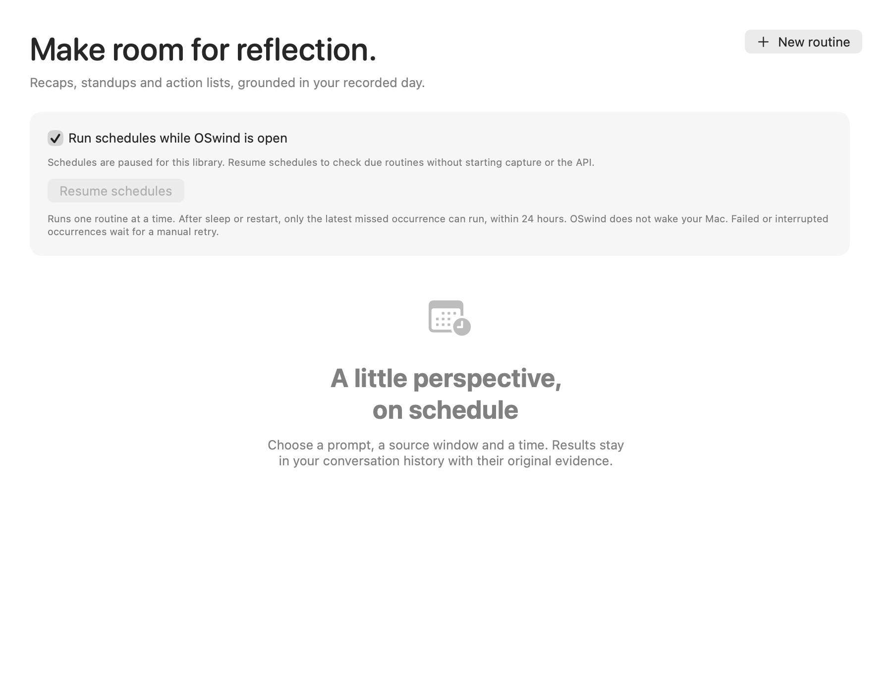
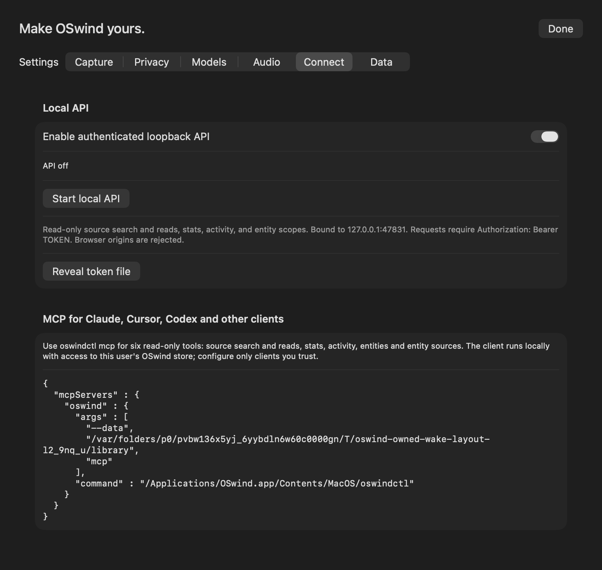
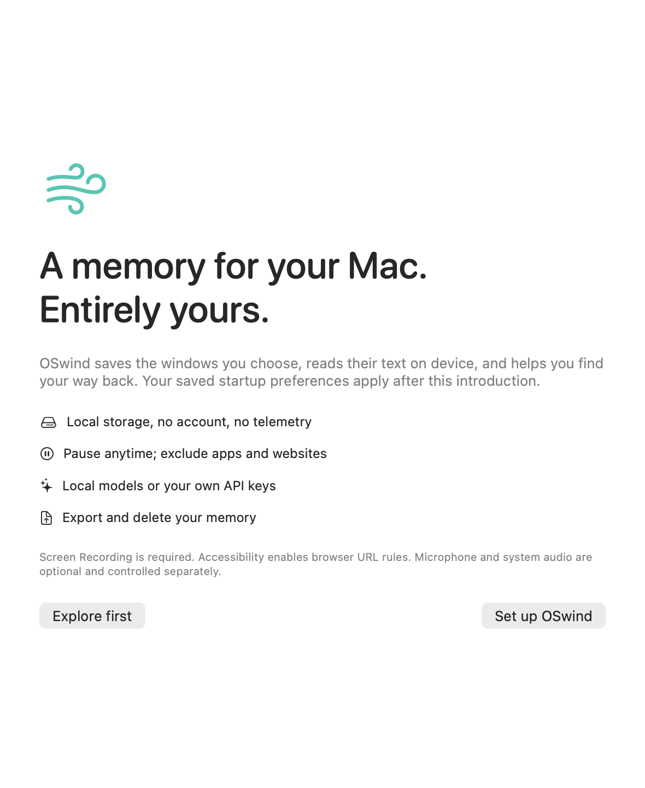

# Quiet libraries and automatic work

[PR #69](https://github.com/vibhusapra/OSwind/pull/69), final product source `9d6f33ef281f214850fa39ebe8804c600fbf90a9`, schema 22. Test-only qualification follow-up: `4a137279c5ee14f69abad7df3e8e3d71bc0406a8`.

A quietly prepared library must remain available for review without starting saved capture, indexing, schedules or API preferences. Previously, workspace wake directly requested routine and entity work, visual auto-resume began armed, and configured startup ran services before onboarding completed.

| State or action | Result |
| --- | --- |
| Prepare with `startServices:false` | Saved preferences remain; configured services and visual auto-resume begin inactive. |
| Request configured startup during onboarding | Remember the request and wait for the introduction to finish. |
| Finish onboarding after a startup request | Apply the saved enabled services once. |
| Reopen onboarding | Suspend capture/audio, routine scheduling, entity/visual indexing, maintenance and the API listener; preserve preferences. |
| Prepare a library switch or lock | Revoke startup intent and stop services; later wake/power/session callbacks cannot rearm it. |
| Pending wipe cleanup | Automatic work remains inactive; clear the problem and explicitly retry startup. |
| Resume schedules in a quiet library | Start scheduling only; capture, API and entity/visual catch-up remain inactive. |
| Disable schedules | Remove their timer. A late automatic callback cannot start another run. |
| Explicit manual build, Run now, cleanup or API control | The relevant action remains available, subject to its existing privacy, power and library guards. |

Wake uses the active routine timer, configured entity startup and the visual auto-resume permission separately. A manually resumed capture can still enqueue its enabled visual work. Visual wake/power/session catch-up waits for onboarding and respects existing lock, thermal, power and media rules. Configured startup no longer creates a routine polling timer when schedules are disabled; no energy reduction is inferred from this logical change.

Paused schedules show a Resume schedules control. Connect settings show Start local API when its saved preference is enabled but the listener is off. Onboarding explains when saved startup preferences apply. API status callbacks carry the listener generation so late callbacks cannot relabel a stopped or replacement listener. Stopping the listener preserves its preference during onboarding/switch preparation; explicit API Off still disables the preference. This does not promise immediate cancellation of every already admitted HTTP request.

## Evidence and reproduction

The initial eight authored-library cases have **five failing cases and 16 failed assertions** against preceding product source `7bd10de` (product inputs unchanged from `b2c520c`). The failures cover quiet wake, dismissed onboarding, configured startup during onboarding, quiet power/session callbacks and wake after switch preparation. Active wake, manual entity build and queued power after switch already pass.

The expanded related selection has **34 defined cases: 33 pass, one locked-session visual-admission skip, zero failures** before full qualification. Eighteen new cases cover workspace lifecycle, independent manual services, pending cleanup, saved API credentials, disabled timers and late timer callbacks. Run:

```sh
swift test --filter 'WorkspaceWakeLifecycleTests|MaintenanceStartupTests|RoutinesModelTests|VisualIndexCoordinationTests'
```

These tests post through the actual notification publishers and operate only on authored temporary libraries. They do not put the computer to sleep, alter power settings, grant permissions, record ordinary history or call a cloud model. The initial visual counterexample runs while its admission conditions permit; the later locked-session skip is retained.

Six light/dark component layouts are checked at logical 900×700 (schedules), 760×720 (Connect) and 590×720 (onboarding), exported at twice that pixel resolution. Initial layout receipts remain; a follow-up centers the empty state and updates API/MCP descriptions. Onboarding follow-up pixels are byte-identical to the reviewed initial images.

The first full/model/native run passes 953 of 956 cases with three retained skips (muted audio output unavailable, physical system audio not opted in, and locked-session visual admission). The first 151-case TSan run has 149 passes, one skip and one failed case with two assertions; no data race is reported. Its encrypted opening case spans 342 seconds of logged maintenance sleep and exhausts the old continuous-clock fixture budget while still busy. Independent inventory finds no owned image attached, and the unchanged case passes in a separately observed awake run. A test-only follow-up keeps the same awake-work budget and awaits normal cleanup before root removal. The [current follow-up](../benchmarks/quiet-workspace-wake-v1.json) passes **954 of 956 defined cases, with two skips and zero failures**, plus **150 of 151 selected TSan cases, with one skip, zero failures and no race reports**. All **11 follow-up operations** and **seven final render operations** pass. The original failure remains retained. The current awake/system driver clocks agree; no timing improvement is claimed. The muted audio-runtime case that skipped initially passes in the follow-up, with product inputs unchanged. Physical system audio and locked-session visual admission remain skipped. Physical wake, locked/unlocked transitions, signed-GUI permissions, VoiceOver, sustained desktop energy, the inherited busy-terminal attachment-inspection failure and broad release acceptance remain open. Earlier normal-library activity from the corrected native cleanup incident has not been audited or recovered.







The separately staged ad-hoc-signed app/ZIP has matching payloads across all 33 files. Installed and staged bytes remain unchanged after processes. Complete full-command-path inventory finds no owned GUI/test/driver or current artifact/opening image, and read-only launch lookup resolves to `/Applications/OSwind.app`. Both product-source CI jobs pass (run 40789738849); both fixture-only follow-up CI jobs also pass (run 40798125648). Later documentation revisions have separate CI runs.
